# CA2 — PaaS Orchestration: the intrusion-detection pipeline on Kubernetes


## Overview

This project runs the CA0/CA1 pipeline on a three-node Kubernetes cluster: a producer replays 5,000 labelled network-flow records onto a Kafka topic, a processor reads them and stores them in MongoDB, and a REST API serves them. Everything that makes it run is written down in this folder. `infra/` builds the cluster itself (Terraform creates a dedicated VPC, subnet, firewall and three AWS machines; Ansible installs k3s, a certified Kubernetes distribution, on them). The YAML manifests in the other folders declare the pipeline, its network rules, its access rules, the handling of its secrets and its autoscalers. Nothing is created by hand.

The work followed the checklist from the CA1 debrief (see below): a disposable network, parameters written once and consumed by every tool, a second run that changes nothing, one tagged event traced through every stage, and an independent scan that proves `destroy` left nothing behind. Every claim in this README points to a file in [`evidence/`](evidence/), and [`integritypacket.md`](integritypacket.md) says which test proves which claim. The `evidence/` folder includes saved output from real AWS and Kubernetes runs, local verification results, and generated reports, charts, and measurements. The source of each piece of evidence is described in the relevant section. The files of Steps 4 to 7 come from the clusters I built and destroyed while developing. In Step 8 the first cluster was destroyed and scanned (`step8-dry-run-*`, `step8-scan-1-*`, `step8-teardown-1`), then a second cluster was built from a fresh `git clone` (`step8-rebuild-*`, `step8-scan-2-*`) and destroyed again (`step8-teardown-2`, `step8-teardown-3-again`); see *Rebuild from nothing*.

| Stage | Command | What it does | Proof |
|---|---|---|---|
| Check the files | `make validate`, `make verify` | Manifests against the Kubernetes schemas; manifests, programs, cluster code, this README and the Integrity Packet against each other. Needs no cluster. | [step6-validate.txt](evidence/step6-validate.txt), [step9-verify.txt](evidence/step9-verify.txt) |
| Build the cluster | `make cluster-up` | Terraform: VPC, subnet, firewall, 3 machines. Ansible: k3s. | [step4-cluster-up.txt](evidence/step4-cluster-up.txt) |
| Deploy the stack | `make up` | Creates the Secret, applies the 37 Kubernetes objects rendered by `kustomization.yaml` (`kubectl apply -k .`), and waits until the stack is ready. Smoke-test and scaling workloads run separately when requested. | [step5-up-run1.txt](evidence/step5-up-run1.txt) |
| See what would change | `make dry-run` | Asks the cluster what the next `make up` would change, and changes nothing. | [step8-dry-run-server.txt](evidence/step8-dry-run-server.txt), [step8-dry-run-client.txt](evidence/step8-dry-run-client.txt) |
| Validate | `make rest-check`, `make smoke`, `make netpol-check`, `make rbac-check`, `make heal-check` | REST call from outside; one tagged event through all stages; 30 network connections; access rules; self-healing. | [step5-rest-check.txt](evidence/step5-rest-check.txt), [step6-smoke.txt](evidence/step6-smoke.txt), [step6-netpol-check.txt](evidence/step6-netpol-check.txt), [step6-rbac.txt](evidence/step6-rbac.txt), [step6-heal.txt](evidence/step6-heal.txt) |
| Scale | `make scale-test` | Producers 1 → 5 pods under an autoscaler; messages per second before and after. | [step7-scale-results.md](evidence/step7-scale-results.md) |
| Delete the stack | `make down` | Deletes workloads, disks, Secret and namespace. | [step5-down.txt](evidence/step5-down.txt) |
| Delete everything and prove it | `make teardown` | Deletes the stack, destroys the machines and the network, then scans AWS for leftovers. | [step8-teardown-1.txt](evidence/step8-teardown-1.txt) |
| Rebuild from nothing | fresh `git clone`, then the same commands | Everything again from a copy of the repository, nothing carried over. | [step8-rebuild-stack.txt](evidence/step8-rebuild-stack.txt) |

### Quick start

```bash
git clone https://github.com/Amshu0-0/CA.git
cd CA/CA2
make verify          # checks the files; needs no cluster and no AWS account
make cluster-up      # AWS: network, firewall, 3 machines, Kubernetes (needs AWS credentials, see Prerequisites)
make up              # the whole stack
make smoke           # one tagged event through producer, Kafka, processor, MongoDB and REST API
make teardown        # delete everything, then scan AWS to prove nothing is left
```

`make` with no argument lists every command. Details, expected output and troubleshooting are below. If you do not want to use AWS, the next section runs the same stack on a cluster you already have.

## Use your own Kubernetes cluster
The Kubernetes part of this project does not need the AWS cluster that `infra/` builds. If you have a Kubernetes cluster and `kubectl` points at it, these commands run the whole stack:

```bash
cd CA2
bash scripts/create-secrets.sh   # makes the namespace ca2 and the Secret mongo-credentials; the password is random and is never printed
kubectl apply -k .               # the whole stack: 37 objects (kustomize is built into kubectl)
kubectl -n ca2 get pods          # about a minute later every pod is Running and producer-replay-... says Completed
kubectl -n ca2 port-forward svc/restapi 8080:8080     # in a second terminal ...
curl -s http://127.0.0.1:8080/stats                   # ... asks the REST API how many records MongoDB holds (5000 or more)
kubectl delete -k .              # removes everything again: the namespace, with its disks and the Secret
```

If you downloaded the repository as a ZIP file instead of cloning it, unzip it and start in the `CA-main/CA2` folder.

**Why the script comes first.** A Secret manifest would put the MongoDB password into Git. The script makes the password on your computer (`openssl rand`), keeps it in `.secrets/` (ignored by Git) and creates the Secret from those files, so the password is never in the repository, on a command line or in a log. It needs `bash` and `openssl`. If you apply the manifests first, MongoDB, the processor and the REST API wait in `ContainerCreating` until the Secret exists; run the script and they start. Running the script again changes nothing: an existing Secret is left alone.

**What the cluster must provide.** The manifests name no machine, no IP address, no host path and no storage class. They do assume the following:

| Assumption | Why | If it is missing |
|---|---|---|
| A default StorageClass | Kafka and MongoDB each ask for a 5Gi volume and name no class | the two pods stay `Pending` |
| Access to `ghcr.io` and Docker Hub | the three application images are public on `ghcr.io/amshu0-0/` (no pull secret is needed); Kafka, MongoDB and the init containers come from Docker Hub (`confluentinc/cp-kafka:7.7.1`, `mongo:7.0`, `busybox:1.36`) | `ImagePullBackOff` |
| metrics-server | the two autoscalers read the pods' CPU from it | the autoscalers show `<unknown>` and never scale; everything else works |
| A network plugin that enforces NetworkPolicy | the 11 policies are only rules until it does | nothing fails, but nothing is isolated |
| The cluster DNS domain `cluster.local` | Kafka tells its clients to come back to `kafka-0.kafka-headless.ca2.svc.cluster.local` (`kafka/kafka.yaml`) | clients reach Kafka once, then fail to reconnect |
| About 0.9 CPU and 1.7 GiB of free capacity | the pods' requests at their smallest replica counts; the limits add up to 4 CPU and 3.5 GiB | pods stay `Pending` |
| Pod Security Admission | the namespace enforces the `baseline` profile and every pod complies (on by default since Kubernetes 1.25) | the profile is not enforced |

**Tested only on k3s** `v1.37.1+k3s1`, the cluster that `infra/` builds. It was not tested on kind, minikube, EKS, GKE or AKS.

**Do not apply the folder recursively.** `kubectl apply -R -f .` would also start the load generator in `producer/scaling/` and the smoke-test Job in `producer/smoke/`; both are applied on demand (`make scale-up`, `make smoke`) and are deliberately not listed in [`kustomization.yaml`](kustomization.yaml). Use `kubectl apply -k .`.

**The `make` commands also work on another cluster** once you name its kubeconfig, for example `make up KUBECONFIG=$HOME/.kube/config`. The tests that call the REST API from your computer ask Terraform for the node addresses by default; on another cluster pass the address yourself, for example `python3 scripts/rest-check.py --hosts <node-address>` or `make smoke SMOKE_ARGS="--host <node-address>"`, or use the port-forward above.

## What changed after CA1 grading

The CA1 debrief ended with a checklist. CA2 applies it again, now to a Kubernetes platform:

| Debrief item | Status | How CA2 does it |
|---|---|---|
| Make the network disposable | **Done** | Terraform creates and destroys its own VPC, subnet, internet gateway, route table and firewall; nothing uses the account's default network. `make cluster-down` removes them. |
| Centralize parameters | **Done** | [`infra/config.yml`](infra/config.yml) holds the cluster settings and is read by Terraform and Ansible. [`config/pipeline-config.yaml`](config/pipeline-config.yaml) (a ConfigMap) holds the application settings. Image versions come from one file ([`VERSION`](VERSION)). `make verify` fails if two files disagree. No application contains an old address as a fallback. |
| Automate service installation | **Done** | Ansible installs Kubernetes; `kubectl apply -k .` installs the stack. No step is done by hand. |
| Keep secrets out of Git | **Done** | The MongoDB password is made on your computer, kept in `.secrets/` (ignored by Git), sent to the cluster from a file and mounted into the pods as files. No manifest contains it. |
| Run it twice | **Done** | Second `make cluster-up`: Terraform says "No changes" and Ansible reports `changed=0`. Second `make up`: created 0, configured 0, unchanged 37. |
| Trace one unique event end to end | **Done** | `make smoke` sends one event with a new trace id and finds it again in Kafka (partition and offset), the processor log, MongoDB and the REST API. |
| Verify that destroy left nothing | **Done** | Every AWS resource carries the tag `Project=CS5287-CA2`. `make scan` asks AWS directly what is left; it must find the cluster while it exists and nothing after the destroy. |
| CA1 limitation: the operator address was typed in by hand | **Fixed** | `admin_cidr: auto` looks up the current public address on every run. When the address changes, `make cluster-up` updates the three firewall rules that use it, in place. This happened once during development: [excerpt of the terminal log](evidence/step6-address-change-excerpt.txt). |

## Where each grading category is shown

| Category (weight) | Where to look |
|---|---|
| Declarative completeness (20%) | All four pipeline stages and the REST endpoint are manifests, applied together by [`kustomization.yaml`](kustomization.yaml): [`kafka/kafka.yaml`](kafka/kafka.yaml), [`db/mongo.yaml`](db/mongo.yaml), [`processor/processor.yaml`](processor/processor.yaml), [`producer/job-replay.yaml`](producer/job-replay.yaml), [`restapi/restapi.yaml`](restapi/restapi.yaml). The cluster is [`infra/`](infra/). Every object carries a label and a description (see *Labels, annotations and the dry run*). See *Directory structure* and *How to deploy*. |
| Security and isolation (15%) | [`policies/networkpolicies.yaml`](policies/networkpolicies.yaml) (default deny plus one rule per connection), [`rbac/roles.yaml`](rbac/roles.yaml), Secrets mounted as files, one published port. Tested with real connections: [step6-netpol-check.txt](evidence/step6-netpol-check.txt), [step6-netpol-control.txt](evidence/step6-netpol-control.txt), [step5-firewall.txt](evidence/step5-firewall.txt), [step6-rbac.txt](evidence/step6-rbac.txt), [step6-secrets.txt](evidence/step6-secrets.txt). |
| Scaling and observability (20%) | Autoscalers [`producer/scaling/hpa.yaml`](producer/scaling/hpa.yaml) and [`processor/hpa.yaml`](processor/hpa.yaml); measured by `make scale-test`: [step7-scale-results.md](evidence/step7-scale-results.md), [step7-scale-chart.svg](evidence/step7-scale-chart.svg), [step7-scale-samples.csv](evidence/step7-scale-samples.csv). See *How to run the scaling test*. |
| Documentation and usability (20%) | This file: prerequisites with versions, deploy, validate, scale, destroy, expected output, limitations, deviations. `make verify` checks that every link, every `make` command and every quoted evidence line in this README is real. |
| Platform execution (10%) | StatefulSets with disks, Services, ConfigMaps, Secrets, RBAC, NetworkPolicies, HPAs, Jobs; self-healing tested ([step6-heal.txt](evidence/step6-heal.txt)); clean cleanup proved by [step8-teardown-1.txt](evidence/step8-teardown-1.txt) and [step8-teardown-2.txt](evidence/step8-teardown-2.txt). |
| Integrity Packet (15%) | [`integritypacket.md`](integritypacket.md) (claims, evidence, assumptions, validation, AI review) and [`ai-guidance-log.md`](ai-guidance-log.md) (each AI recommendation, the official source, what was tested). |

## Architecture

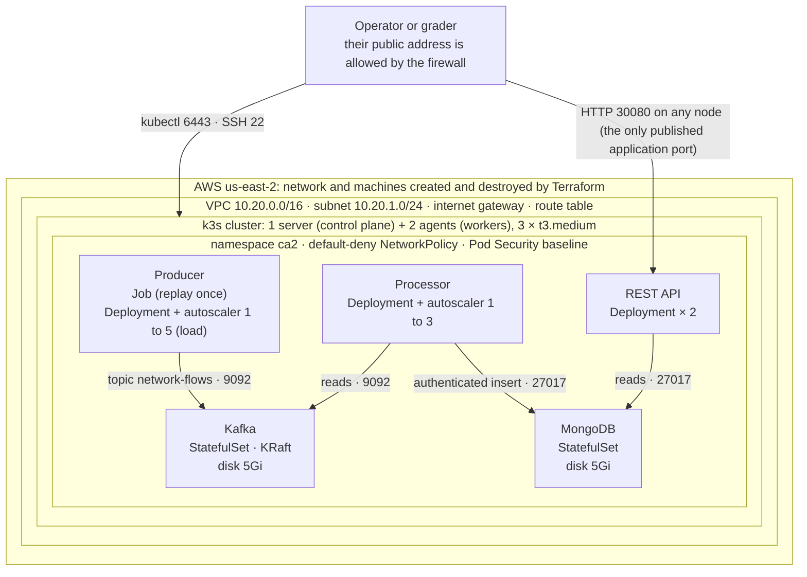

The pods are placed by Kubernetes, so which node runs which pod can change between runs. What does not change is who may talk to whom: see *Network and isolation*.

### Two layers, kept apart

| Layer | What it is | Where it lives | How it is driven |
|---|---|---|---|
| Platform | the machines, the network, the firewall and Kubernetes itself | [`infra/`](infra/) (Terraform and Ansible) | `make cluster-up`, `make cluster-down` |
| Microservices | Kafka, MongoDB, the processor, the REST API and the producers, with their network rules, access rules, Secret handling and autoscalers | every other folder, listed in [`kustomization.yaml`](kustomization.yaml) | `kubectl apply -k .` (`make up`), `kubectl delete -k .` (`make down`) |

The only thing that passes from the first layer to the second is a kubeconfig file (`.secrets/kubeconfig.yaml`). The manifests name no machine, address, host path or storage class, so the second layer runs on any cluster that meets the assumptions in *Use your own cluster*; the first layer knows about the application only through one published port (`rest_node_port: 30080` in [`infra/config.yml`](infra/config.yml)), which `make verify` compares with the REST API's Service.

## Automation toolchain

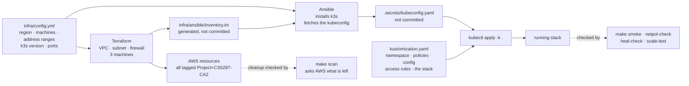

Terraform writes the current machine addresses into the Ansible inventory, so nothing depends on an old address, and Ansible writes the kubeconfig that `kubectl` uses. Nothing in this chain is typed in by hand: the one value that depends on the person running it, their public address, is looked up on every run.

## Directory structure

```text
CA2/
├── README.md                  this file
├── integritypacket.md         claims, evidence, assumptions, validation, AI review
├── ai-guidance-log.md         every consequential AI recommendation, its official source, what was tested
├── Makefile                   every command (run "make" to list them)
├── VERSION                    the version tag of the three application images
├── kustomization.yaml         the list of manifests that make up the stack: one "kubectl apply -k ."
├── namespace.yaml             namespace ca2, Pod Security "baseline" enforced
├── config/
│   └── pipeline-config.yaml   ConfigMap: topic, host names, ports, database, dataset (no secrets)
├── kafka/kafka.yaml           Kafka (KRaft) StatefulSet, two Services, 5Gi disk
├── db/mongo.yaml              MongoDB StatefulSet, two Services, 5Gi disk
├── processor/                 Deployment, ConfigMap and Service (processor.yaml), autoscaler (hpa.yaml), program, Dockerfile
├── producer/                  one-time replay Job, program, Dockerfile, dataset
│   ├── smoke/                 the Job that sends one tagged event (make smoke)
│   └── scaling/               the load Deployment and its autoscaler (make scale-test)
├── restapi/                   Deployment (2 pods), NodePort Service, program, Dockerfile
├── policies/
│   └── networkpolicies.yaml   the 11 NetworkPolicies
├── rbac/                      service accounts and the two roles (viewer, operator)
├── infra/
│   ├── config.yml             settings of the cluster, read by Terraform and Ansible
│   ├── terraform/             VPC, subnet, internet gateway, route table, firewall, 3 machines
│   └── ansible/               installs k3s on the machines and fetches the kubeconfig
├── scripts/                   the tests and helpers behind the make commands
├── evidence/                  terminal output, reports, charts and measurements
└── images/                    all screenshots
```

The programs are built into images by a GitHub Actions workflow (`.github/workflows/ca2-images.yml` at the root of the repository, where GitHub requires workflows to live). It builds for `linux/amd64` and `linux/arm64`, tags the images with the number in [`VERSION`](VERSION) and pushes them to `ghcr.io/amshu0-0/ca2-producer`, `ca2-processor` and `ca2-restapi`. No Docker installation is needed on the laptop and no registry password is stored: the workflow uses the temporary token that GitHub gives every run.

## Software stack

| Component | Version |
|---|---|
| Kubernetes | k3s `v1.37.1+k3s1` (containerd 2.3.4), one server and two agents; Traefik and servicelb switched off; secrets encryption on |
| Cluster provisioning | Terraform (AWS provider 6.68.0, locked in [`.terraform.lock.hcl`](infra/terraform/.terraform.lock.hcl)), Ansible core |
| Machines | 3 × AWS `t3.medium` (2 vCPU, 4 GiB), Ubuntu 24.04 LTS, 30 GB encrypted gp3 disk, IMDSv2 required |
| Kafka | `confluentinc/cp-kafka:7.7.1`, one node acting as broker and controller (KRaft), 3 partitions per topic |
| MongoDB | `mongo:7.0`, authentication on |
| Producer | `ghcr.io/amshu0-0/ca2-producer`, Python 3.11, kafka-python 3.0.11 |
| Processor | `ghcr.io/amshu0-0/ca2-processor`, Python 3.11, kafka-python 3.0.11, pymongo 4.18.2 |
| REST API | `ghcr.io/amshu0-0/ca2-restapi`, Python 3.11, Flask 3.1.3, pymongo 4.18.2, gunicorn 26.2.0 |
| Storage | k3s `local-path` provisioner: each disk is a directory on the node's encrypted disk |
| Init containers and test pods | `busybox:1.36` (the init containers wait for Kafka and MongoDB; `make netpol-check` starts its probe pods from the same image) |
| Registry | `ghcr.io` (public images), built by GitHub Actions |

Versions of the tools on the computer that runs the commands are in *Prerequisites*. `make images-info` lists every image the manifests use.

## Configuration and parameterization

Each value is written in one place and read by everything that needs it:

| What | Where it is written | Who reads it |
|---|---|---|
| Region, machine type and count, address ranges, project tag, k3s version, REST node port | [`infra/config.yml`](infra/config.yml) | Terraform (AWS resources), Ansible (k3s), `make scan` (region and tag), `make verify` |
| Topic, host names, ports, database, collection, dataset | [`config/pipeline-config.yaml`](config/pipeline-config.yaml) (ConfigMap `pipeline-config`) | the producer, the processor and the REST API, loaded as environment variables |
| Image version of the three programs | [`VERSION`](VERSION) | the image workflow (tag) and, by comparison, the five `image:` lines in the manifests: `make verify` fails if they differ |
| Credentials | `.secrets/` on the operator's computer (not in Git) | `scripts/create-secrets.sh`, which creates the Kubernetes Secret |

```yaml
# infra/config.yml (the part that most people change)
project_tag: CS5287-CA2        # every AWS resource gets the tag Project=CS5287-CA2
region: us-east-2
instance_type: t3.medium
agent_count: 2                 # plus one server: 3 nodes
admin_cidr: auto               # "auto" = the public address of the computer that runs the command
rest_api_cidr: admin           # who may call the REST API: the same address, or a range such as 203.0.113.0/24
rest_node_port: 30080          # must equal nodePort in restapi/restapi.yaml (make verify checks it)
k3s_version: v1.37.1+k3s1
```

```yaml
# config/pipeline-config.yaml (data section)
KAFKA_BROKER: "kafka:9092"
KAFKA_TOPIC: "network-flows"
MONGO_HOST: "mongo"
MONGO_PORT: "27017"
MONGO_DB: "ca2"
MONGO_COLLECTION: "flows"
REST_PORT: "8080"
DATASET_FILE: "Friday-Morning-5000-mixed-bot.csv"
```

`kafka` and `mongo` are Kubernetes Service names; cluster DNS turns them into addresses, so no program contains an IP address. The programs do not start without their settings: a missing variable stops the pod with a message that names it.

## Network and isolation

There are two firewalls, and each one is tested.

### Around the machines: AWS (Terraform)

Terraform builds its own network instead of using the account's default one:

| Resource | Design |
|---|---|
| VPC | `10.20.0.0/16` |
| Subnet | `10.20.1.0/24`, public, because the machines pull images and download k3s (a NAT gateway would cost extra); the firewall decides who can reach them |
| Internet gateway, route table, association | default route `0.0.0.0/0` to the gateway |
| Security group `ca2-cluster` | the rules below |
| Default security group | adopted with no rules, so nothing can use it by accident |
| Machines | 3 × `t3.medium` in the subnet |

| Inbound rule | Allowed from | Purpose |
|---|---|---|
| 22/tcp | the administrator's address only | SSH (Ansible, debugging) |
| 6443/tcp | the administrator's address only | Kubernetes API (`kubectl`) |
| 30080/tcp | `rest_api_cidr` (default: the administrator's address) | the REST API node port: the one published application port |
| 6443/tcp, 10250/tcp, 8472/udp, ICMP | the cluster's own security group | between the nodes: API, kubelet, pod network (VXLAN), ping |

Outbound traffic is open (image pulls, package downloads, the k3s installer). Nothing is open to `0.0.0.0/0` inbound. The rules were read back from AWS, and every port was tried from outside (`make exposure-check` does the port check):

<!-- from: evidence/step5-firewall.txt -->
```text
RESULT: PASS - on all 3 nodes only 22 (SSH), 6443 (Kubernetes API, server only), 30080 (REST API node port) answer; the other 8 ports are dropped
```

Full output: [evidence/step5-firewall.txt](evidence/step5-firewall.txt).

### Between the pods: Kubernetes NetworkPolicies

[`policies/networkpolicies.yaml`](policies/networkpolicies.yaml) holds 11 policies. The first one denies all traffic in and out of every pod in the namespace; every other policy adds exactly one allowed connection, so the only traffic that works is the pipeline itself.

| Policy | What it allows (everything else is dropped) |
|---|---|
| `default-deny-all` | nothing: blocks all traffic into and out of every pod in `ca2` |
| `allow-dns-egress` | every pod may ask CoreDNS (namespace `kube-system`) on port 53 |
| `kafka-ingress` | the producer and the processor may connect to Kafka on 9092 |
| `kafka-self` | the Kafka pod may talk to itself on 9092 and 9093 (broker and controller) |
| `mongo-ingress` | the processor and the REST API may connect to MongoDB on 27017 |
| `processor-ingress` | pods with the label `app.kubernetes.io/component: observer` (the monitoring role; `make netpol-check` starts one) may read the processor's metrics port 8000 |
| `restapi-ingress` | any sender may reach the REST API on 8080 (the AWS firewall decides who reaches the node port in front of it) |
| `producer-egress` | the producer may connect to Kafka only |
| `processor-egress` | the processor may connect to Kafka and MongoDB only |
| `restapi-egress` | the REST API may connect to MongoDB only |
| `observer-egress` | an observer may connect to the processor's metrics port and the REST API only |

A policy only matters if the network plugin enforces it. k3s does, with its built-in network-policy controller. That was **tested, not assumed**: `make netpol-check` starts six short-lived probe pods that wear the labels of each role (and one that lives in another namespace) and tries 30 real connections, then compares every answer with the policies:

<!-- from: evidence/step6-netpol-check.txt -->
```text
  from                                        kafka:9092      mongo:27017     processor:8000  restapi:8080    DNS:53
  stranger (no role, in ca2)                  blocked         blocked         blocked         blocked         open
  intruder (another namespace)                blocked         blocked         blocked         open            open
  producer (wears the producer label)         open            blocked         blocked         blocked         open
  processor (wears the processor label)       open            open            blocked         blocked         open
  restapi (wears the REST API label)          blocked         open            blocked         blocked         open
  observer (the monitoring role)              blocked         blocked         open            open            open
```

<!-- from: evidence/step6-netpol-check.txt -->
```text
RESULT: PASS - all 30 connections behave as the policies say (13 allowed, 17 blocked)
```

`make netpol-control` is the control experiment: the same test with the policies deleted, then with them put back. Without the policies every connection worked; with them only the allowed ones do. So the policies, and nothing else, do the blocking:

<!-- from: evidence/step6-netpol-control.txt -->
```text
  every connection was accepted after at most 1 s
  the original answers were back after at most 2 s
RESULT: PASS - without the policies every connection worked, with them only the allowed ones do: the policies are what blocks
```

Full output: [step6-netpol-check.txt](evidence/step6-netpol-check.txt), [step6-netpol-control.txt](evidence/step6-netpol-control.txt). The policies as the cluster holds them: [step6-netpol-list.txt](evidence/step6-netpol-list.txt).

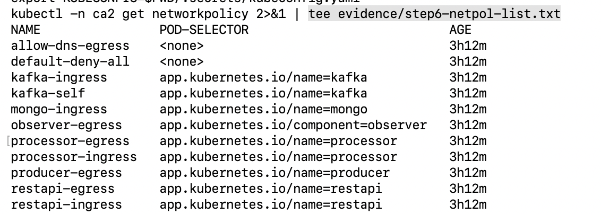

*Step 6, `kubectl -n ca2 get networkpolicy`: the 11 policies as the cluster holds them (the file that creates them is `policies/networkpolicies.yaml`).*

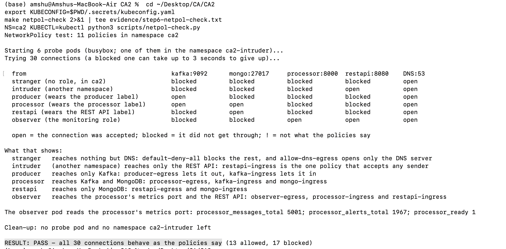

*Step 6, `make netpol-check`: six probe pods try 30 connections; the 13 that the policies allow are `open`, the other 17 are `blocked`, and the result says that all 30 behave as the policies say.*

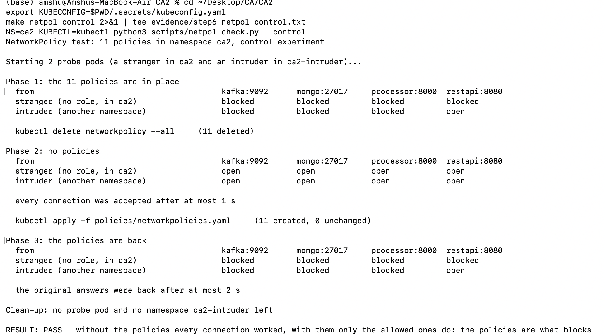

*Step 6, `make netpol-control`: two probe pods try to reach Kafka, MongoDB, the processor and the REST API three times: with the 11 policies in place (blocked, except the REST API for the pod from another namespace), with all policies deleted (every connection is accepted) and with the policies put back (the first answers are back), so the policies are what blocks.*

## Security and access controls

| Control | How it is done | Where to see it |
|---|---|---|
| Secrets are mounted, never written into a manifest | The MongoDB password is created on the operator's computer (`openssl rand`), kept in `.secrets/` (ignored by Git), sent to the cluster with `--from-file` (never typed, never printed) and mounted as read-only files (mode 0440). The programs read `MONGO_PASSWORD_FILE`, not a variable that holds the password. | [`scripts/create-secrets.sh`](scripts/create-secrets.sh), [step6-secrets.txt](evidence/step6-secrets.txt) |
| Secrets are encrypted inside the cluster | k3s `secrets-encryption: true` | [`infra/ansible/roles/k3s_server/templates/config.yaml.j2`](infra/ansible/roles/k3s_server/templates/config.yaml.j2) |
| Role-based access control | Two accounts: `pipeline-viewer` (read-only) and `pipeline-operator` (also starts and deletes producer Jobs and changes replica counts). No rule anywhere grants access to Secrets. | [`rbac/roles.yaml`](rbac/roles.yaml), [step6-rbac.txt](evidence/step6-rbac.txt) |
| Pods have no Kubernetes API credentials | `automountServiceAccountToken: false` on every service account and pod | [step6-secrets.txt](evidence/step6-secrets.txt) |
| Pod Security | Namespace `ca2` enforces the `baseline` profile: a privileged pod is refused | [step5-ailog-checks.txt](evidence/step5-ailog-checks.txt) |
| Hardened application containers | Producer, processor and REST API run as user 1000 (`runAsNonRoot`), with no privilege escalation, all capabilities dropped, the default seccomp profile, and CPU and memory requests and limits | [`processor/processor.yaml`](processor/processor.yaml), [`restapi/restapi.yaml`](restapi/restapi.yaml), [`producer/job-replay.yaml`](producer/job-replay.yaml) |
| Minimal exposure | One Service is reachable from outside the cluster: `restapi`, node port 30080, and only from the address in `rest_api_cidr` | [step6-secrets.txt](evidence/step6-secrets.txt), [step5-firewall.txt](evidence/step5-firewall.txt) |
| Encrypted disks, IMDSv2 | Machine disks are encrypted gp3; the instance metadata service needs a session token | [`infra/terraform/compute.tf`](infra/terraform/compute.tf) |
| Pinned installer | The k3s installer script is pinned to a release and a checksum, so a changed script stops the run | [`infra/config.yml`](infra/config.yml) |

What the access rules answer when asked (`make rbac-check`):

<!-- from: evidence/step6-rbac.txt -->
```text
pipeline-viewer   can list pods?       yes
pipeline-viewer   can delete pods?     no
pipeline-operator can scale producers? yes
pipeline-operator can read secrets?    no
processor pod     can read secrets?    no
```

The MongoDB password never appears in this repository, in a log or in an evidence file: the evidence scripts print file modes and names, not contents.

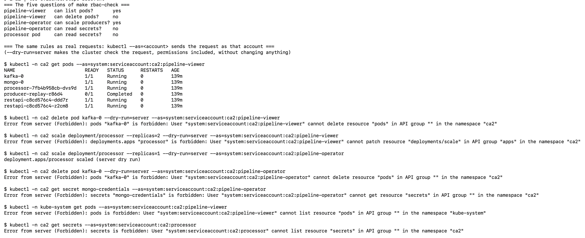

*Step 6: the answers of `make rbac-check`, then the same rules as real requests sent as each service account with `kubectl --as`: the viewer can list pods but not delete them, the operator can scale but can neither delete pods nor read Secrets, and the processor's account cannot list Secrets.*

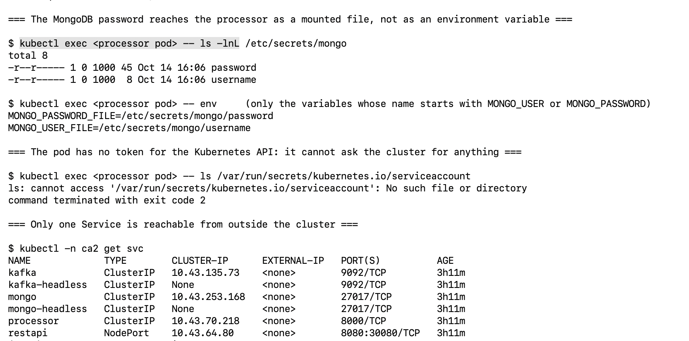

*Step 6: the MongoDB password reaches the processor as a mounted file (mode `-r--r-----`), not as an environment variable (only the names of the files are set); the pod has no token for the Kubernetes API; and only one Service, `restapi`, is reachable from outside the cluster.*

## Prerequisites

Everything was built and tested on a MacBook (Apple Silicon) with the tools below. The commands are plain `make`, `bash` and `python3`, so Linux should work the same way (I did not try it). The machines in AWS need nothing installed by hand: Ansible does it.

| Tool | Version used | What for |
|---|---|---|
| macOS | 26.5 | the computer that runs every command |
| GNU Make | GNU Make 3.81 | all the commands |
| Terraform | Terraform v1.16.3 | builds the network and the machines |
| Ansible | ansible [core 2.21.4] | installs k3s on the machines |
| kubectl | Client Version: v1.37.1 | talks to the cluster |
| kubeconform | v0.8.0 | `make validate`: checks manifests against the Kubernetes schemas (optional) |
| AWS CLI | aws-cli/2.36.49 Python/3.14.7 Darwin/25.5.0 source/arm64 | credentials, `make scan`, and the firewall check |
| Python 3 | Python 3.13.2 with PyYAML 6.0.2 | `make verify` and the test scripts |
| OpenSSL, ssh-keygen | OpenSSL 3.0.16 11 Feb 2025 (Library: OpenSSL 3.0.16 11 Feb 2025); OpenSSH_10.2p1, LibreSSL 3.3.6 | creates the MongoDB password and the machines' SSH key |
| Git | git version 2.50.1 (Apple Git-155) | clone and push |
| Docker | not installed | not needed: GitHub Actions builds the three images (see *Registry credentials* below) |

The first line that each version command prints is saved in [evidence/step9-tool-versions.txt](evidence/step9-tool-versions.txt). `make verify` needs only Python 3 with PyYAML (`python3 -m pip install pyyaml`) and `kubectl` (it renders the manifests with `kubectl kustomize`); it works without a cluster and without AWS.

**AWS credentials.** Use a dedicated IAM user, not the root account. Configure it once (`aws configure`) and check it (`aws sts get-caller-identity`; do not publish its output, it contains the account number). The user must be allowed to create, describe and delete EC2 instances, key pairs, volumes, VPCs, subnets, internet gateways, route tables and security groups in `us-east-2`. The IAM user used here is *not* allowed to call `tag:GetResources`; `make scan` shows that one optional check as skipped and says so in its result (see *How to destroy*). Terraform and the AWS CLI read the same credentials.

**Cluster context.** `make cluster-up` writes the kubeconfig to `.secrets/kubeconfig.yaml` (mode 0600, ignored by Git, context name `ca2-k3s`) and every `make` command uses that file. A `KUBECONFIG` variable that happens to be set in your terminal is ignored on purpose, so a second copy of this repository can never talk to the first copy's cluster by accident. To use a cluster you built another way, name it on the command line: `make up KUBECONFIG=$HOME/.kube/config`.

**Registry credentials.** None are needed. The three application images are public on `ghcr.io/amshu0-0/` and the manifests name them with an exact tag (`1.0.1`). To publish a new version, change a program or `VERSION` and push to `main`: the GitHub Actions workflow builds and pushes the images with the workflow's own token, so no Docker installation and no registry password are needed on the computer.

**The administrator's address.** Terraform looks up the public address of the computer that runs `make cluster-up` (`https://checkip.amazonaws.com`) and allows only that address through the firewall. Nothing needs to be typed. If you move to another network, run `make cluster-up` again: Terraform changes the three rules that use the address, in place, and nothing else.

## Secret setup

There is nothing to do by hand. The first `make up` runs [`scripts/create-secrets.sh`](scripts/create-secrets.sh), which creates `.secrets/mongo-username` and `.secrets/mongo-password` (a random password from `openssl rand`, mode 0600), sends them to the cluster as the Secret `mongo-credentials` and never prints them. `.secrets/` is ignored by Git, and a fresh clone contains no secret of any kind. To choose your own password, write it to `.secrets/mongo-password` before the first `make up`. MongoDB creates its administrator only the first time it starts, so the password cannot be changed later without deleting the database disk (`make down`, then `make up`).

## How to deploy

```bash
cd CA2
make verify         # optional: checks the files, no cluster needed
make cluster-up     # 1. build the cluster
make up             # 2. deploy the stack
make rest-check     # 3. call the REST API from your computer
make smoke          # 4. one tagged event through every stage
```

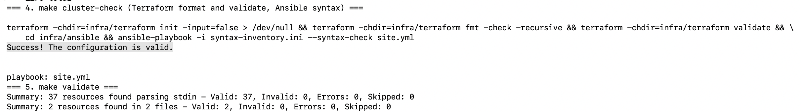

*Step 4, the checks that need no cloud account: `make cluster-check` runs the Terraform format check and `terraform validate` (`Success! The configuration is valid.`) and the Ansible syntax check of `infra/ansible/site.yml`; then `make validate` checks the manifests against the Kubernetes schemas.*

### 1. Build the cluster: `make cluster-up`

Terraform creates the 19 AWS resources (VPC, subnet, internet gateway, route table and association, the security groups and their rules, the key pair, three machines); Ansible installs k3s on the server, joins the two agents and saves the kubeconfig. Expected output (the lines that matter; the full run is in [step4-cluster-up.txt](evidence/step4-cluster-up.txt)):

<!-- from: evidence/step4-cluster-up.txt -->
```text
Plan: 19 to add, 0 to change, 0 to destroy.
Apply complete! Resources: 19 added, 0 changed, 0 destroyed.
ca2-agent-1                : ok=10   changed=5    unreachable=0    failed=0    skipped=0    rescued=0    ignored=0
ca2-agent-2                : ok=9    changed=5    unreachable=0    failed=0    skipped=0    rescued=0    ignored=0
ca2-server                 : ok=15   changed=7    unreachable=0    failed=0    skipped=0    rescued=0    ignored=0
```

`make cluster-status` then shows three nodes, `Ready`, with the roles `control-plane` and `worker` ([step4-nodes.txt](evidence/step4-nodes.txt)). The cluster type, version, node roles and namespaces are recorded in [step5-cluster-facts.txt](evidence/step5-cluster-facts.txt): k3s `v1.37.1+k3s1`, one control-plane node and two workers, namespaces `ca2` (the pipeline) and `kube-system` (Kubernetes' own parts: DNS, metrics-server, storage provisioner), plus `default`, `kube-public` and `kube-node-lease`, which Kubernetes creates and this project does not use.

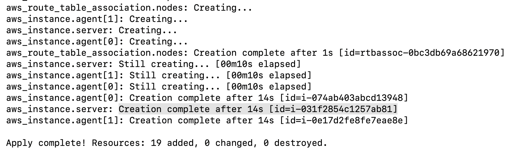

*Step 4, the first build of the cluster with `make cluster-up`: Terraform creates the machines and ends with `Apply complete! Resources: 19 added, 0 changed, 0 destroyed.` The lines that follow in the real output list addresses, so they are not in the picture.*

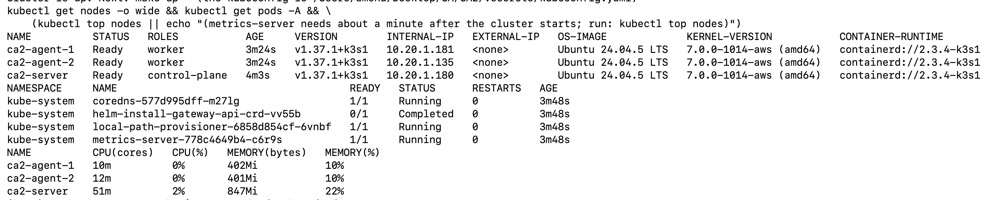

*Step 4, `make cluster-status`: three nodes, all `Ready` (one `control-plane`, two `worker`), the Kubernetes system pods `Running`, and `kubectl top nodes` already answering.*

### 2. Deploy the stack: `make up`

`make up` creates the Secret, applies [`kustomization.yaml`](kustomization.yaml) (37 objects: namespace, 11 NetworkPolicies, 7 service accounts, 2 roles and 2 role bindings, 2 ConfigMaps, 6 Services, 2 StatefulSets, 2 Deployments, the autoscaler and the replay Job) and waits until every part is running and the replay Job has finished. Expected end of the output ([step5-up-run1.txt](evidence/step5-up-run1.txt)):

<!-- from: evidence/step5-up-run1.txt -->
```text
deployment "processor" successfully rolled out
deployment "restapi" successfully rolled out
job.batch/producer-replay condition met
Stack is up. Call the REST API from this computer with:  make rest-check
```

`make get-all` is `kubectl get all -A`. Its output as a screenshot is in [images/kubectl-get-all.png](images/kubectl-get-all.png), and the output of the same command, saved as text on the rebuilt cluster of Step 8, is in [step8-rebuild-cluster-facts.txt](evidence/step8-rebuild-cluster-facts.txt).

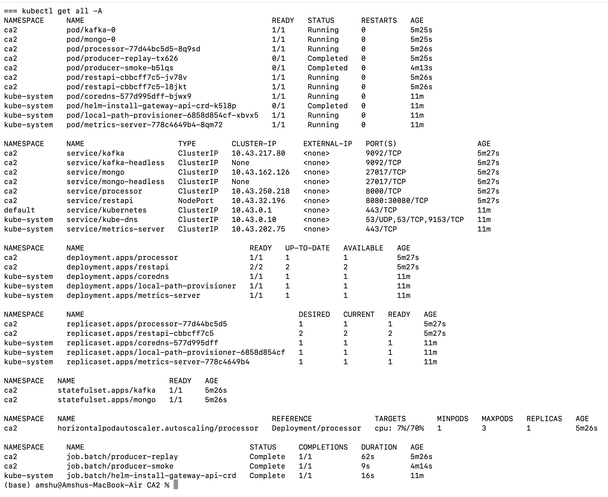

*The output of `kubectl get all -A` on the cluster that was rebuilt from a fresh clone in Step 8, as saved in `evidence/step8-rebuild-cluster-facts.txt` and shown here in my terminal: that cluster was destroyed afterwards, so the command cannot be run again now.*

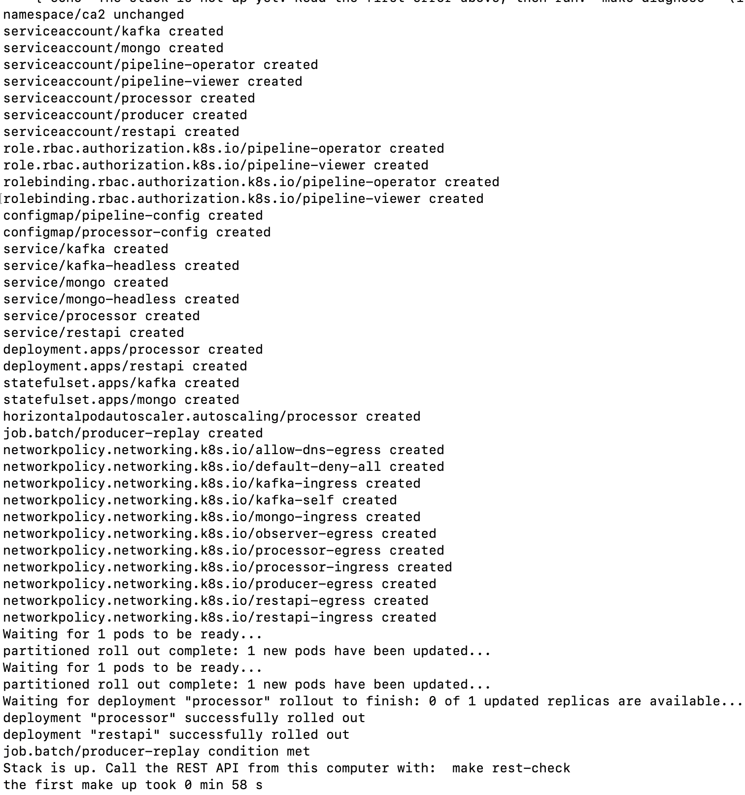

*Step 5, `make up` on the new cluster: the objects of the stack are created (the first lines of the run are not in the picture) and the run ends with `Stack is up` after 58 seconds.*

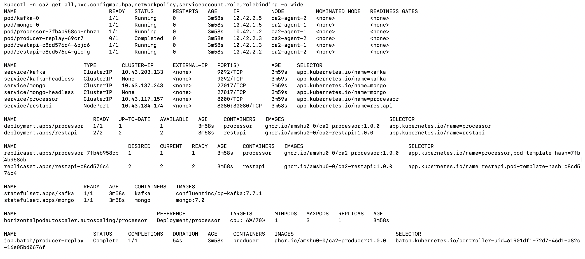

*Step 5, `make status` (everything in the namespace `ca2`, with `-o wide`): the IMAGES column shows the three programs coming from `ghcr.io` (version 1.0.0 at that time; the current manifests use 1.0.1) and Kafka and MongoDB from their public images. The pods are `Running` and the replay Job is `Complete`.*

### 3. Call the REST API: `make rest-check`

The REST API is published on node port 30080 of every node. `make rest-check` calls it from your computer through each node:

<!-- from: evidence/step5-rest-check.txt -->
```text
RESULT: PASS - 3 of 3 nodes answered correctly and MongoDB holds 5000 flows
```

| Endpoint | Meaning |
|---|---|
| `GET /health` | the process is alive |
| `GET /ready` | the REST API can reach MongoDB |
| `GET /stats` | database, collection and the number of stored records |
| `GET /alerts` | the stored flows whose label is not benign (first 50) |
| `GET /events/<trace_id>` | one stored record, found by its trace id |

By hand: `curl http://<public-address-of-any-node>:30080/stats` (the node addresses are printed by `terraform -chdir=infra/terraform output`).

### Labels, annotations and the dry run

Every object has the label `app.kubernetes.io/part-of=ca2-pipeline` and a `description` annotation of one sentence that says what the object is for. The Secret has both too (`scripts/create-secrets.sh` adds them). The label is for filtering, the annotation is for reading:

```bash
kubectl -n ca2 get all,pvc,configmap,networkpolicy,serviceaccount,role,rolebinding,secret -l app.kubernetes.io/part-of=ca2-pipeline
kubectl -n ca2 get deployment,statefulset,job,hpa,service,configmap,networkpolicy,serviceaccount,role,rolebinding,secret -o custom-columns=KIND:.kind,NAME:.metadata.name,DESCRIPTION:.metadata.annotations.description
```

On the rebuilt cluster, 38 objects carried the label and a description: the 36 objects of the stack that live in the namespace, the Secret, and the smoke-test Job `producer-smoke` (it stays for 30 minutes after `make smoke`). Two objects have neither, because Kubernetes makes them itself in every namespace: the ConfigMap `kube-root-ca.crt` and the ServiceAccount `default`. The output is in [step8-rebuild-labels.txt](evidence/step8-rebuild-labels.txt).

`make dry-run` asks the cluster's API server what `kubectl apply -k .` would change, and changes nothing (a server-side dry run: the cluster runs its own validation and admission rules, Pod Security included). `make dry-run DRY_RUN=client` is the client-side form: `kubectl` checks the files and prints them, and sends nothing. After `make up`, every object should say `unchanged`. Both forms were run against the running cluster just before the labels and descriptions were added, and both reported 35 objects `configured` and 2 `unchanged` (the 35 were the objects that got a description) and changed nothing: [server](evidence/step8-dry-run-server.txt), [client](evidence/step8-dry-run-client.txt). A dry run shows that the files are accepted; it does not show that the pods start. That is what `make up` and the tests below are for.

## Validation: the smoke test and the other checks

All of these run against the deployed stack and remove whatever they create.

**Smoke test, `make smoke`.** Sends one event that carries a new trace id through the whole pipeline and finds it again at every stage: the producer's Job reports the Kafka partition and offset where the event was stored; the test reads that exact message back from the topic; finds the processor's log line with the same trace id, partition and offset; finds the record in MongoDB; and fetches it from the REST API from outside the cluster. A count of rows would pass on old data; a trace id cannot.

<!-- from: evidence/step6-smoke.txt -->
```text
RESULT: PASS - event smoke-1014-165801-c52d went producer -> Kafka (partition 0, offset 1664) -> processor -> MongoDB -> REST API in 35 s
```

The successful REST request and response are saved in [step6-rest-request.txt](evidence/step6-rest-request.txt) (the request, `HTTP 200`, and the start of the body) and [step6-smoke-response.json](evidence/step6-smoke-response.json) (the complete answer). The whole run is in [step6-smoke.txt](evidence/step6-smoke.txt).

| Check | Command | What it proves | Result |
|---|---|---|---|
| REST API from outside, through every node | `make rest-check` | the firewall, the node port and the path to MongoDB work; MongoDB holds all 5,000 flows | [step5-rest-check.txt](evidence/step5-rest-check.txt) |
| Ports open on the machines | `make exposure-check` | only 22, 6443 (server) and 30080 answer | [step5-firewall.txt](evidence/step5-firewall.txt) |
| Network isolation | `make netpol-check`, `make netpol-control` | 30 real connections match the policies; the policies are what blocks | [step6-netpol-check.txt](evidence/step6-netpol-check.txt), [step6-netpol-control.txt](evidence/step6-netpol-control.txt) |
| Access rules | `make rbac-check` | viewer and operator can do what the roles say and nothing more | [step6-rbac.txt](evidence/step6-rbac.txt) |
| Self-healing | `make heal-check` | four failures on purpose: delete a REST pod, stop the processor while an event waits in Kafka, delete the MongoDB pod, delete the Kafka pod. Each one recovers and no data is lost. | [step6-heal.txt](evidence/step6-heal.txt) |

<!-- from: evidence/step6-heal.txt -->
```text
RESULT: PASS - 4 of 4 recovery tests passed
```

What each failure looks like, as measured by `make heal-check` ([step6-heal.txt](evidence/step6-heal.txt)):

| What fails | What happens | Measured |
|---|---|---|
| A REST API pod is deleted | the Deployment (2 pods) starts a replacement while the other pod keeps answering | both pods ready again 16 s after the delete; 0 of 32 calls (one every 0.4 s) failed |
| The processor is away | events wait in Kafka; nothing is lost | an event sent while no processor ran got HTTP 404; 10 s after the processor started it was stored and the REST API returned it (HTTP 200) |
| The MongoDB pod is deleted | the StatefulSet starts `mongo-0` again on the same disk | ready after 12 s, same volume, all 5,002 records still there |
| The Kafka pod is deleted | the StatefulSet starts `kafka-0` again on the same disk | ready after 22 s, same volume, 5,002 messages in the topic, and a new event went through the restarted broker |
| A whole machine is lost | not tested: the disks are `local-path` directories on one machine, so the data on that machine would be lost with it (known limitation 1) | |

If a pod does not become ready, `make diagnose` prints the node states, the pods that are not ready, their events and logs (it only reads, and prints no Secret). `make up` is safe to run again.

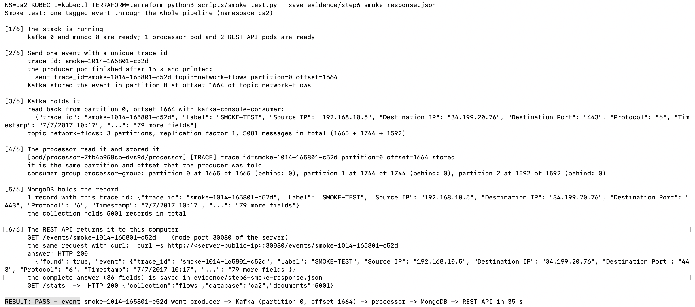

*Step 6, `make smoke`: one event with a new trace id is sent through the producer, Kafka, the processor, MongoDB and the REST API and found again at every stage; `RESULT: PASS`.*

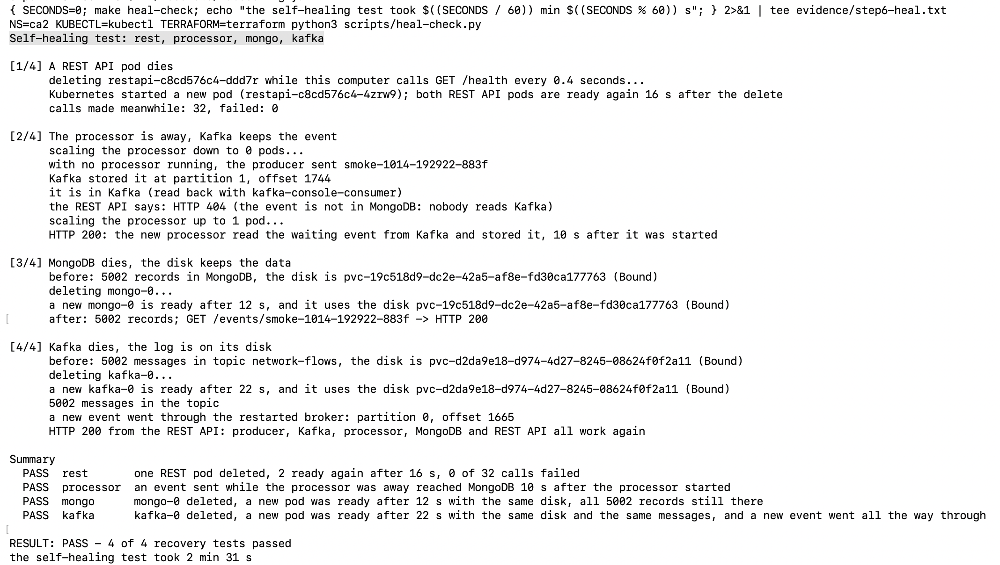

*Step 6, `make heal-check`: a REST API pod, the processor, MongoDB and Kafka are stopped on purpose, one after another; each one recovers and no data is lost (`RESULT: PASS - 4 of 4 recovery tests passed`).*

## How to run the scaling test and where to find logs/results

**Run it** (the stack must be up: `make up`). The test takes about 5 minutes (the saved run took 4 min 55 s):

```bash
make scale-test        # the whole test, starts and removes its own load
make scale-report      # optional: draw the table and the chart again from the saved samples (needs no cluster)
make scale-test SCALE_ARGS="--help"     # every option, for example shorter windows: SCALE_ARGS="--before 30 --after 30"
```

**What the test does.** Two autoscalers are involved, and both are ordinary `HorizontalPodAutoscaler` objects:

| Autoscaler | Target | Range | Scales when | File |
|---|---|---|---|---|
| `producer-load` | the load-generating producer Deployment | 1 to 5 pods | average CPU above 50 % of the pod's request (100 m); may double the number of pods every 15 s; scales down one pod per 30 s after a 60 s stabilization window | [`producer/scaling/hpa.yaml`](producer/scaling/hpa.yaml) |
| `processor` | the processor Deployment (part of the stack) | 1 to 3 pods | average CPU above 70 % of the request; adds one pod per 30 s; scales down one pod per 60 s after a 120 s stabilization window; the maximum is 3 because the topic has 3 partitions and one consumer per partition is the most that can work | [`processor/hpa.yaml`](processor/hpa.yaml) |

The load generator is the Deployment [`producer/scaling/deployment-load.yaml`](producer/scaling/deployment-load.yaml): producer pods that replay the dataset in a loop (`REPLAY_FOREVER=true`) as fast as their CPU limit allows. After every 500 rows a pod waits until Kafka has confirmed them, so a pod never has more than about 500 rows waiting in its memory and what it prints is the speed Kafka really accepts. The test then runs these steps:

1. Check that the stack runs, that the REST API answers from this computer and that CPU numbers are available.
2. Start **one** producer pod and wait until the number of pods (also the processors) has not changed for 20 seconds. Measure for 60 seconds: this is **before**.
3. Create the `producer-load` autoscaler and watch Kubernetes add producer pods up to the maximum, by itself.
4. Wait for calm again and measure for 60 seconds: this is **after**.
5. Save `kubectl describe hpa`, remove the autoscaler and the load, and wait until the processors have stored the backlog.

A sampler records one line every 5 seconds while it runs. Three rates are measured independently of each other: what the producers say they send (the line each pod prints every 5 seconds), what Kafka receives (growth of the topic's end offsets) and what MongoDB stores (growth of the record count from `GET /stats`). It also records the backlog in Kafka, the CPU of the pods and the nodes, and the end-to-end delay of one tagged event per window (from "stored in Kafka" to "returned by the REST API").

The wait in step 2 is visible in the saved output ([step7-scale-run.txt](evidence/step7-scale-run.txt)):

<!-- from: evidence/step7-scale-run.txt -->
```text
    the number of pods has not changed for 20 s (producers 1, processors 1)
    the number of pods has not changed for 20 s (producers 5, processors 3)
```

The test protects the cluster's disks: it removes the load in every case, also when it stops early, if you press Ctrl-C, if the Kafka or MongoDB pod restarts, after 1,500,000 messages or after 25 minutes.

**Where the results are** (all in [`evidence/`](evidence/)):

| File | What it holds |
|---|---|
| [step7-scale-results.md](evidence/step7-scale-results.md) | the before/after table, the autoscaler's steps and a plain-language reading of the numbers |
| [step7-scale-chart.svg](evidence/step7-scale-chart.svg) | the chart (shown below) |
| [step7-scale-samples.csv](evidence/step7-scale-samples.csv) | the raw measurements, one row every 5 seconds |
| [step7-scale-summary.json](evidence/step7-scale-summary.json) | when each phase started and ended, the tagged-event timings, the autoscaler settings |
| [step7-scale-hpa.txt](evidence/step7-scale-hpa.txt) | `kubectl describe hpa` at the end: current and target CPU, scaling events |
| [step7-scale-producer-log.txt](evidence/step7-scale-producer-log.txt) | the log lines of the producer pods, in the order the test saw them |
| [step7-scale-run.txt](evidence/step7-scale-run.txt) | everything the test printed |

**Other logs and metrics while the stack runs:** `make logs` (processor), `kubectl -n ca2 logs deployment/producer-load`, `kubectl -n ca2 describe hpa`, `kubectl top pods -n ca2`, `kubectl top nodes`. The processor serves counters on port 8000 (`processor_messages_total`, `processor_alerts_total`, `processor_ready`; shown in [step6-netpol-check.txt](evidence/step6-netpol-check.txt)), and the REST API's `GET /stats` returns the record count.

### Results

Before and after (the table is copied from [step7-scale-results.md](evidence/step7-scale-results.md)):

| Measurement | Before: 1 producer pod, no autoscaler | After: 5 producer pods, autoscaler working | Change |
|---|---:|---:|---:|
| Producer pods ready | 1 | 5 | x5.0 |
| Messages per second from one producer pod | 656 | 474 | |
| Producers send, messages per second (all pods together, reported by the pods) | 656 | 2,369 | x3.6 |
| Kafka receives, messages per second (growth of the topic) | 625 | 2,399 | x3.8 |
| MongoDB stores, messages per second (growth of the record count) | 737 | 1,138 | x1.5 |
| Backlog in Kafka at the end of the window, messages | 310 | 117,483 |  |
| Time a new message would wait in the backlog, seconds (backlog / storing rate) | 0.4 | 103.3 |  |
| One tagged event: stored in Kafka until the REST API returns it, seconds | 0.1 | 46.1 | |
| Processor pods ready | 2 | 3 | x1.5 |
| Producer pods' CPU, % of their request (from the autoscaler) | n/a | 490 |  |
| Processor pods' CPU, % of their request (from their autoscaler) | 355 | 461 |  |
| Worker nodes' CPU, % (average of the workers, from kubectl top nodes) | 35 | 77 |  |
| Control-plane node's CPU, % (the server also runs pods, from kubectl top nodes) | 21 | 78 |  |

How the autoscaler added pods:

| Seconds after the autoscaler was created | Producer pods ready | Producer pods wanted by the autoscaler | Producer pods' CPU, % of request | Processor pods ready |
|---:|---:|---:|---:|---:|
| 3 | 2 | 2 | 499 | 3 |
| 13 | 2 | 2 | 499 | 3 |
| 23 | 4 | 4 | 498 | 3 |
| 33 | 4 | 5 | 495 | 3 |
| 44 | 5 | 5 | 495 | 3 |
| 54 | 5 | 5 | 492 | 3 |

The tagged event is the one the smoke test sends. Its time runs from the moment the producer Job reported that Kafka had stored it until the REST API returned it (asked every second), so it is accurate to about 2 seconds. The second event was sent in the middle of the second window; the load was removed at the end of that window. The REST API finds the event by its trace_id; before the test the script gave MongoDB a small index on that field, so the lookup does not read every stored record.

What the numbers say:

- The producers' combined rate went from 656 to 2,369 messages per second (x3.6) when the autoscaler took the producers from 1 to 5 pods.
- That is less than 5 times the rate of one pod. The worker nodes averaged 77% CPU, so they were busy but not full. This test did not measure what held the producers back (the CPU limit of each pod, the shared nodes or Kafka), so no cause is claimed.
- The processors were still scaling during the 'before' window (from 1 to 3 pods), so 'before' is not a steady state. MongoDB stored more per second (737) than Kafka received (625), which is only possible while the processors work off messages that were already waiting.
- MongoDB stored 1,138 messages per second while the producers sent 2,369. The difference waits in Kafka (117,483 messages at the end of the window), so after the producers the next limit is the part that reads from Kafka and writes to MongoDB: 3 processor pods and MongoDB. The processors were busy (461% of their CPU request, the target is 70%); their autoscaler stops at 3 pods, one per partition of the topic.
- The processors have an autoscaler of their own. It took them from 1 to 3 pods, the first extra pod 30 s after the first producer pod was ready (their CPU was 355% of the request, the target is 70%).
- A tagged event needed 0.1 s to get from Kafka to the REST API before scaling and 46.1 s after, because it queued behind the backlog.
- The autoscaler needed 40 s from its creation to have all 5 producer pods ready.
- At the end the producer pods ran on: ca2-agent-1 2, ca2-agent-2 1, ca2-server 2.


**Why CPU, and what it does not show.** Both autoscalers scale on CPU, because that is the simplest signal Kubernetes already measures (metrics-server). It is not the best measure of whether the pipeline keeps up: the number of messages waiting in Kafka (consumer lag) would be a better signal. The test records that backlog (117,483 messages at the end of the 'after' window), but the autoscalers do not use it, and I did not build one that does.

**Growing and shrinking.** The saved run shows growth: the producers went from 1 to 5 pods in 40 s and the processors from 1 to 3 pods. Shrinking was seen for the processors, in the first run that the test stopped: their autoscaler went from 3 to 2 to 1 pods with the reason "All metrics below target" ([step7-run1-oom-diagnosis.txt](evidence/step7-run1-oom-diagnosis.txt)):

<!-- from: evidence/step7-run1-oom-diagnosis.txt -->
```text
12m         Normal    SuccessfulRescale              horizontalpodautoscaler/processor       New size: 2; reason: All metrics below target
11m         Normal    SuccessfulRescale              horizontalpodautoscaler/processor       New size: 1; reason: All metrics below target
```

The scaling test ends the load by deleting the producers' autoscaler first and their Deployment second, so it does not show the producer pods shrinking again; that was not tested.

**What this test does not show.** The load is a synthetic loop over a 5,000-row file, so the figures describe this cluster (three small machines, one of them also the control plane; Kafka, MongoDB, the processors and the producers all share them), not a production system. The 'before' window was not a steady state, because the processors' autoscaler added pods during it (the results above say so), so the fair comparison of 'before' and 'after' is between what the producers send and what Kafka receives (656 and 625 messages per second before, 2,369 and 2,399 after). The processors cannot go beyond 3 pods because the topic has 3 partitions. The test creates one extra index in MongoDB (`trace_id_sparse`, only tagged events are in it) so that finding the tagged event does not read every record; that is a change to the database outside the manifests, and `--no-latency` skips it.

**A failed first run is kept on purpose.** The first run of this test was stopped by the test's own safety check: the producer pods were killed by Kubernetes for using more memory than their limit (`OOMKilled`), because the first version of the load generator queued messages in memory without waiting for Kafka. The measurement exposed this; the fix (wait for Kafka every 500 rows) is in `producer.py`, and the image version went from 1.0.0 to 1.0.1. The evidence of that run is in `evidence/step7-run1-oom-*` ([diagnosis](evidence/step7-run1-oom-diagnosis.txt)), and the check that the fixed pod's memory stays flat is [step7-fix-check.txt](evidence/step7-fix-check.txt). The story is told in the Integrity Packet.

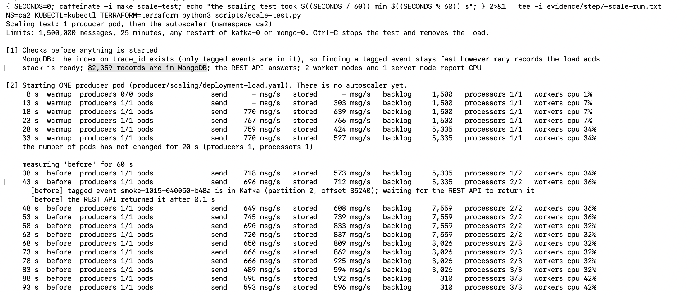

*Step 7, `make scale-test`, first phase: the checks, then ONE producer pod and no autoscaler yet. The test waits until the number of pods has stopped changing and then measures for 60 seconds: this is the `before`.*

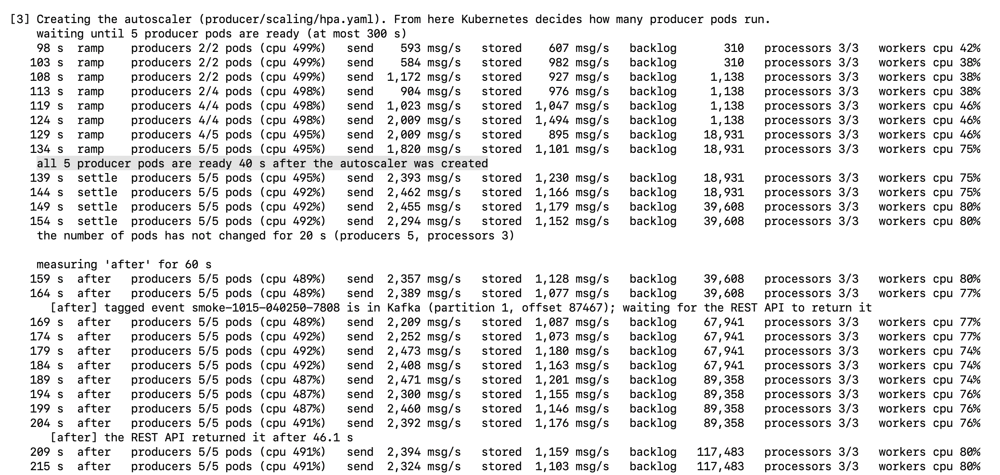

*Step 7: the autoscaler is created and Kubernetes adds producer pods by itself (2, then 4, then 5 pods ready, all five 40 seconds after the autoscaler was created) while the sending rate rises; then the `after` measurement.*

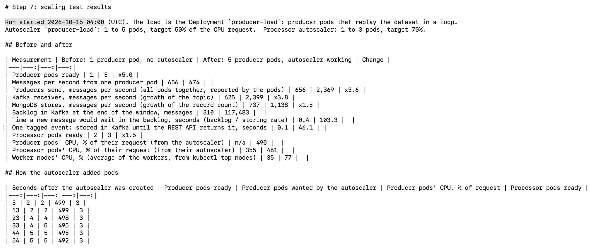

*Step 7, the results of the same run: before and after in numbers (one producer pod against five; messages per second sent, received by Kafka and stored by MongoDB) and the steps in which the autoscaler added pods. The table is also in `evidence/step7-scale-results.md`.*

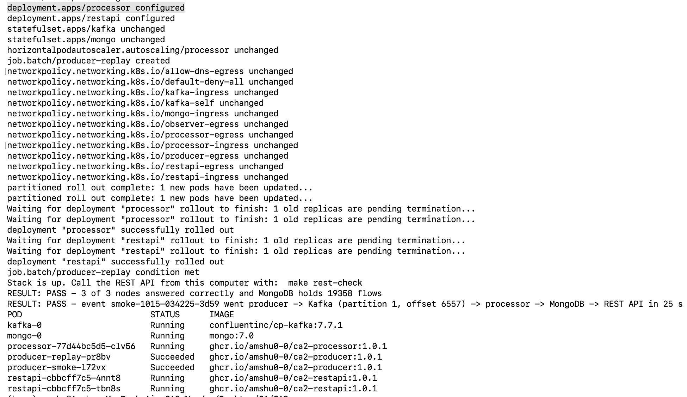

*Step 7, after the three images were rebuilt as version 1.0.1: a plain `make up` rolls the new version out. `processor` and `restapi` are `configured`, their old pods are replaced one by one, `make rest-check` and `make smoke` pass, and every pod of the three programs runs `1.0.1`. The 20 `unchanged` lines above these are not in the picture.*

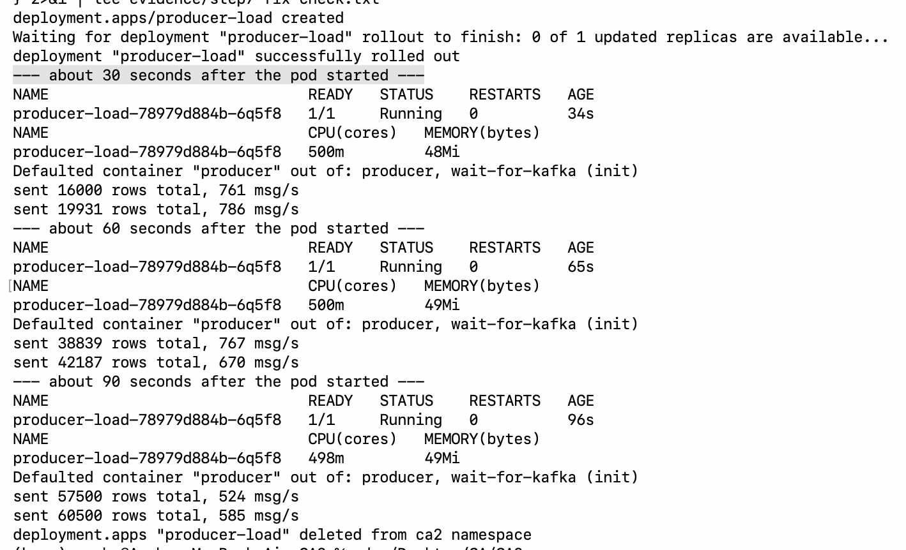

*Step 7, after the fix: the load-generating producer pod is watched for 90 seconds with `kubectl top pod` and `kubectl logs`. Its CPU stays near 500m and its memory flat at 48 to 49 Mi while it sends 500 to 800 messages per second (the first version grew until Kubernetes killed it). The saved text is `evidence/step7-fix-check.txt`.*

## How to destroy

```bash
make down              # delete the stack (workloads, disks, Secret, namespace); the cluster stays
make cluster-down      # destroy the machines and the network
make teardown          # all of it in one command, then scan AWS for leftovers
make scan              # only the scan (read-only)
make scan SCAN_ARGS="--all-regions"     # also look for billable resources in every other region
```

`make teardown` is the single command that removes everything. If the cluster answers, it first runs `make down` and shows what is left inside Kubernetes (no `ca2` namespace, no volumes); then it runs `make cluster-down` (Terraform destroys all 19 resources and the generated files are removed); then it runs the scan. It asks nothing, and it fails (non-zero exit status) if anything is left.

<!-- from: evidence/step8-teardown-1.txt -->
```text
Deleted. Check:  kubectl get namespace ca2   (it should say NotFound)
Destroy complete! Resources: 19 destroyed.
Cluster destroyed.
RESULT: CLEAN - nothing tagged Project=CS5287-CA2 is left, and no billable resources are running in us-east-2.
```

### Proof that nothing is left: the cleanup scan

Terraform only knows what is in its own state file, so "Destroy complete" is not proof that nothing is left. [`scripts/cleanup-scan.py`](scripts/cleanup-scan.py) asks AWS directly, in three ways:

1. **By tag, one kind of resource at a time:** instances, volumes, VPCs, subnets, security groups, internet gateways, route tables and key pairs carrying the tag `Project=CS5287-CA2` (the tag Terraform puts on everything it creates; `make verify` checks that the scan and Terraform use the same tag).
2. **The tag index:** anything in any AWS service with that tag. This check is optional; the IAM user used here is not allowed to call `tag:GetResources`, so the scan prints `[skip ] Tagged resources (permission denied: tag:GetResources)` and names the skipped check in its result instead of pretending it ran.
3. **Everything that costs money, tagged or not:** instances, volumes, Elastic IP addresses, NAT gateways and load balancers in the region (`--all-regions` extends this to every enabled region).

A scan that always says "clean" would prove nothing, so it was tested in both directions (a *positive control*). While the cluster exists the scan **must** find it, and after the destroy it must find nothing:

<!-- from: evidence/step8-scan-1-before-teardown.txt -->
```text
RESULT: LEFTOVERS FOUND - the resources listed above are still in AWS.
```

<!-- from: evidence/step8-teardown-1.txt -->
```text
RESULT: CLEAN - nothing tagged Project=CS5287-CA2 is left, and no billable resources are running in us-east-2.
```

After the second destroy, at the end of the rebuild test, the scan also looked in every region:

<!-- from: evidence/step8-teardown-2.txt -->
```text
RESULT: CLEAN - nothing tagged Project=CS5287-CA2 is left, and no billable resources are running in us-east-2.
RESULT: CLEAN - nothing tagged Project=CS5287-CA2 is left, and no billable resources are running in any region.
```

The scan exits with 0 when clean, 1 when something is left and 2 when it could not scan (a required AWS call was refused), so a script can tell the three apart. Machines that AWS still lists after termination (for up to an hour) are ignored, because they cost nothing. Only the last four digits of the account number are ever printed.

Files: [step8-scan-1-before-teardown.txt](evidence/step8-scan-1-before-teardown.txt), [step8-teardown-1.txt](evidence/step8-teardown-1.txt), [step8-teardown-2.txt](evidence/step8-teardown-2.txt).

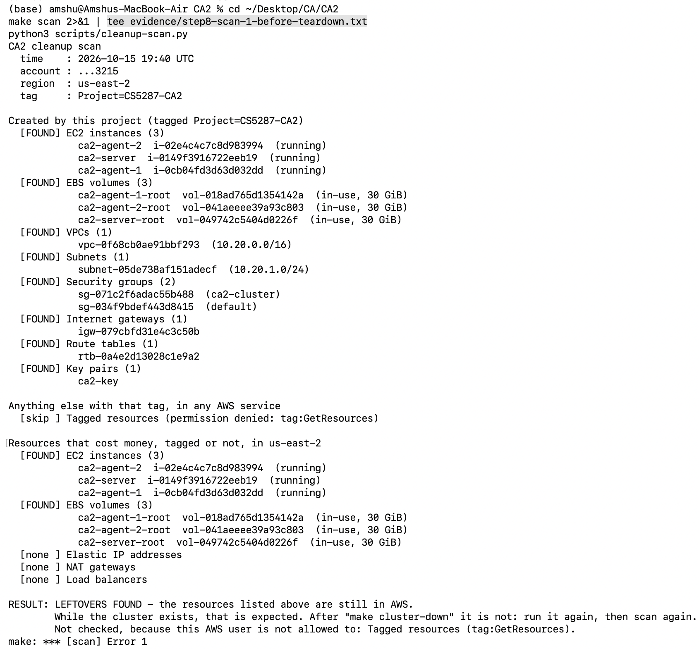

*Step 8, `make scan` while the cluster is still running: the scan finds the three machines, their disks and the network and says `LEFTOVERS FOUND`, so a later `CLEAN` means something. The last line, `Error 1`, is the exit code 1 that means something is left.*

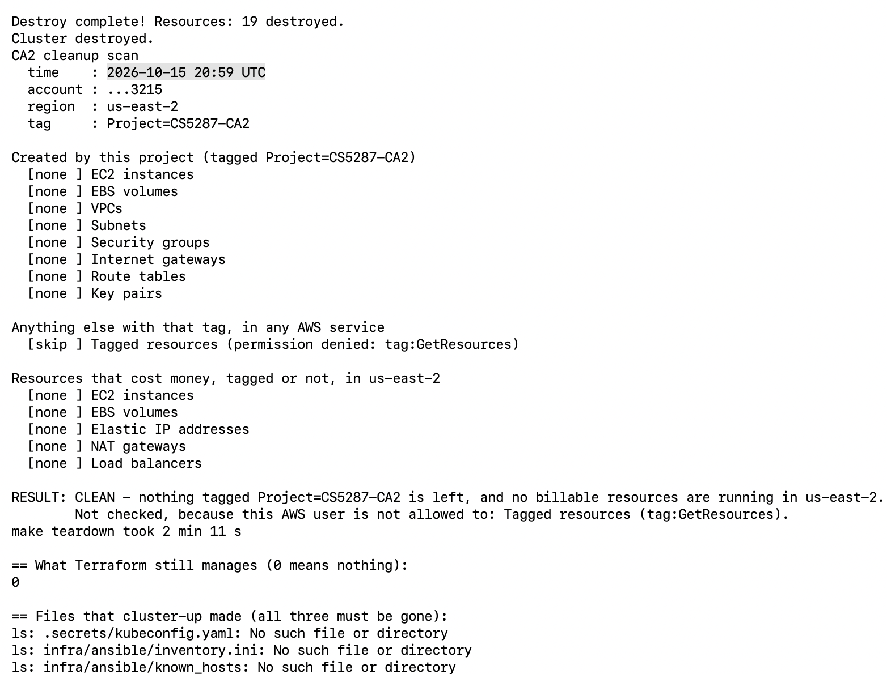

*Step 8, `make teardown`: Terraform reports `Destroy complete! Resources: 19 destroyed.`, then the scan finds nothing (`RESULT: CLEAN`), Terraform manages 0 objects and the three files that `make cluster-up` made are gone.*

## Idempotency: run it twice

Running the same command against something that is already correct must change nothing. This was tested at both levels:

**The cluster.** A second `make cluster-up` right after the first:

<!-- from: evidence/step4-cluster-up-run2.txt -->
```text
No changes. Your infrastructure matches the configuration.
Apply complete! Resources: 0 added, 0 changed, 0 destroyed.
ca2-agent-1                : ok=8    changed=0    unreachable=0    failed=0    skipped=1    rescued=0    ignored=0
ca2-agent-2                : ok=7    changed=0    unreachable=0    failed=0    skipped=1    rescued=0    ignored=0
ca2-server                 : ok=13   changed=0    unreachable=0    failed=0    skipped=1    rescued=0    ignored=0
```

The first run had made 19 changes in Terraform and 5, 5 and 7 in Ansible ([step4-cluster-up.txt](evidence/step4-cluster-up.txt)); the second run, [step4-cluster-up-run2.txt](evidence/step4-cluster-up-run2.txt), changed nothing.

**The stack.** A second `make up`:

<!-- from: evidence/step5-up-run2.txt -->
```text
objects created: 0   configured: 0   unchanged: 37
```

**The destroy.** A repeat of `make teardown`, run when nothing existed any more, changed nothing and did not fail ([step8-teardown-3-again.txt](evidence/step8-teardown-3-again.txt)):

<!-- from: evidence/step8-teardown-3-again.txt -->
```text
The cluster does not answer, so there is no stack to delete: going on to destroy the machines.
No changes. No objects need to be destroyed.
Destroy complete! Resources: 0 destroyed.
RESULT: CLEAN - nothing tagged Project=CS5287-CA2 is left, and no billable resources are running in us-east-2.
exit code of the second make teardown: 0
```

**The second run of the second cluster.** On the cluster that was rebuilt from a fresh clone, a second `make cluster-up` also changed nothing ([step8-rebuild-cluster-up-run2.txt](evidence/step8-rebuild-cluster-up-run2.txt)) and a second `make up` created 0, configured 0 and left 37 objects unchanged ([step8-rebuild-stack.txt](evidence/step8-rebuild-stack.txt)).

Full output of the second `make up`: [step5-up-run2.txt](evidence/step5-up-run2.txt). Deleting and re-creating the stack was tested as well: [step5-down.txt](evidence/step5-down.txt) (the namespace is gone and no volume is left) and [step5-up-run3.txt](evidence/step5-up-run3.txt) (it comes back and `make rest-check` passes again, [step5-rest-check-run3.txt](evidence/step5-rest-check-run3.txt)).

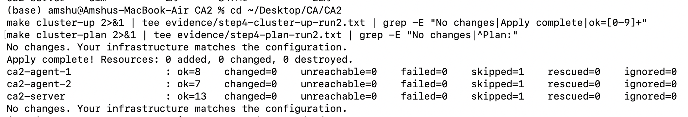

*Step 4, a second `make cluster-up` right after the first: Terraform says `No changes` and Ansible reports `changed=0` on all three machines.*

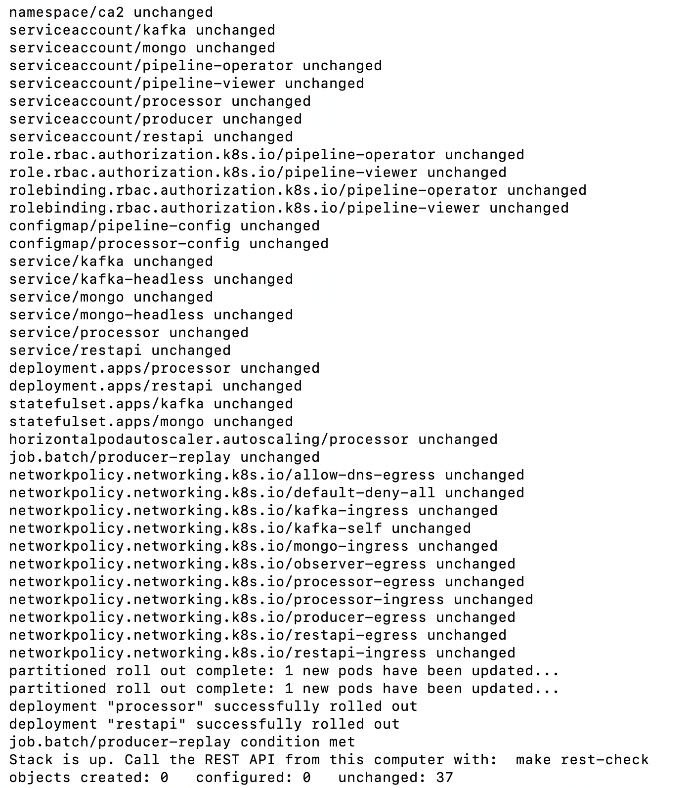

*Step 5, a second `make up`: every object says `unchanged`, and the last line counts them: created 0, configured 0, unchanged 37.*

## Rebuild from nothing: a fresh clone

"It works on my machine" is not proof that the repository is complete. After the first teardown, the repository was cloned into a new folder (no `.secrets/`, no Terraform state, no kubeconfig, no inventory: everything a clone does not contain), and the same commands built everything again: `make verify`, `make cluster-up` (twice), `make up` (twice), the smoke, isolation and access tests, then `make teardown` and a scan of every region.

<!-- from: evidence/step8-rebuild-cluster-up.txt -->
```text
Plan: 19 to add, 0 to change, 0 to destroy.
Apply complete! Resources: 19 added, 0 changed, 0 destroyed.
```

<!-- from: evidence/step8-rebuild-stack.txt -->
```text
objects created: 0   configured: 0   unchanged: 37
RESULT: PASS - 3 of 3 nodes answered correctly and MongoDB holds 5000 flows
RESULT: PASS - event smoke-1015-213651-de66 went producer -> Kafka (partition 1, offset 1676) -> processor -> MongoDB -> REST API in 30 s
RESULT: PASS - all 30 connections behave as the policies say (13 allowed, 17 blocked)
```

Files: [step8-rebuild-cluster-up.txt](evidence/step8-rebuild-cluster-up.txt), [step8-rebuild-cluster-up-run2.txt](evidence/step8-rebuild-cluster-up-run2.txt), [step8-rebuild-stack.txt](evidence/step8-rebuild-stack.txt), [step8-rebuild-cluster-facts.txt](evidence/step8-rebuild-cluster-facts.txt) (versions, nodes, namespaces, `kubectl get all -A`), [step8-scan-2-cluster-up.txt](evidence/step8-scan-2-cluster-up.txt) (the scan finding the rebuilt cluster, with new resource ids).

**The ZIP route.** A reviewer without git may download the repository as a ZIP file instead. That was tried too, at the commit of Step 8: the ZIP held the commit of `main` and no `.git` folder, and `make verify` and `make validate` passed on the unzipped copy ([step8-zip-check.txt](evidence/step8-zip-check.txt)).

**Data on destroy.** `make down` deletes the disks of Kafka and MongoDB with the StatefulSets (`persistentVolumeClaimRetentionPolicy: whenDeleted: Delete`), so a destroyed stack leaves no volume behind, and a rebuilt stack starts empty and replays the dataset again. That is intended for this assignment; for a system that must keep its data the policy would be `Retain`.

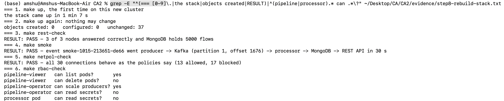

*Step 8, the cluster rebuilt from a fresh clone of the repository (summary lines of `evidence/step8-rebuild-stack.txt`): a second `make up` changes nothing, the REST check, the smoke test and the NetworkPolicy test pass, and the access rules answer as before.*

## Outputs summary

| Output the assignment asks for | Where it is |
|---|---|
| Screenshot of `kubectl get all -A` | [images/kubectl-get-all.png](images/kubectl-get-all.png); the same output as text: [step8-rebuild-cluster-facts.txt](evidence/step8-rebuild-cluster-facts.txt) (rebuilt cluster) and [step5-get-all.txt](evidence/step5-get-all.txt) (first cluster) |
| NetworkPolicy YAML | [policies/networkpolicies.yaml](policies/networkpolicies.yaml) (11 policies); how the cluster holds them: [step6-netpol-list.txt](evidence/step6-netpol-list.txt) |
| Scaling results snapshot | [step7-scale-results.md](evidence/step7-scale-results.md) and [step7-scale-chart.svg](evidence/step7-scale-chart.svg) |
| Cluster type, version, node roles, namespaces | [step5-cluster-facts.txt](evidence/step5-cluster-facts.txt) |
| Smoke test with a successful REST request and response | [step6-smoke.txt](evidence/step6-smoke.txt), [step6-rest-request.txt](evidence/step6-rest-request.txt), [step6-smoke-response.json](evidence/step6-smoke-response.json) |
| Deploy, delete and clean-up commands | `make up`, `make down`, `make teardown` (see *How to deploy* and *How to destroy*) |

Stable values: Kafka topic `network-flows` (3 partitions), MongoDB database `ca2` and collection `flows`, REST API container port 8080 and node port 30080, project tag `Project=CS5287-CA2`, namespace `ca2`. Node addresses change on every build: `terraform -chdir=infra/terraform output`.

## Deviations from CA0 and CA1

| What changed | Why | Where to see it |
|---|---|---|
| The pipeline runs as Kubernetes workloads on a k3s cluster, not as containers on four separate machines. | This assignment: declarative orchestration. | [`kustomization.yaml`](kustomization.yaml) and the folders it lists |
| Kafka and MongoDB keep the CA1 images (`cp-kafka:7.7.1`, `mongo:7.0`) but run as StatefulSets with their own 5Gi disks and a stable name; one Kafka node is both broker and controller (KRaft), as in CA1. | A broker and a database need a stable identity and storage that survive a restart. | [`kafka/kafka.yaml`](kafka/kafka.yaml), [`db/mongo.yaml`](db/mongo.yaml), [step6-heal.txt](evidence/step6-heal.txt) |
| The database is called `ca2` (in CA1 it was called `ca0`; the collection is still `flows`). | A name that refers to an old assignment would be confusing in logs and in this README; `make verify` checks it. | [`config/pipeline-config.yaml`](config/pipeline-config.yaml) |
| The producer is a Job for the one-time replay plus a Deployment with an autoscaler for load. | A Job fits "send the file once"; the scaling demonstration needs replicas. | [`producer/job-replay.yaml`](producer/job-replay.yaml), [`producer/scaling/`](producer/scaling/) |
| The three programs are built into images by GitHub Actions and pushed to `ghcr.io`. In CA1 they were built on the machines. | Kubernetes pulls images from a registry; there is no Docker on the laptop. | `.github/workflows/ca2-images.yml` (repository root), [`VERSION`](VERSION) |
| Secrets: a Kubernetes Secret created from files in `.secrets/` and mounted as files. In CA1 they were in Ansible Vault. | Kubernetes has Secrets; mounting avoids environment variables and manifests. | [`scripts/create-secrets.sh`](scripts/create-secrets.sh), [step6-secrets.txt](evidence/step6-secrets.txt) |
| The REST API is a Deployment of two pods behind a node port, with `/ready` and `/stats` added. In CA1 it was a systemd service on the database machine. | Replicas, health probes and the scaling test's database counter. | [`restapi/restapi.yaml`](restapi/restapi.yaml), `restapi/rest_app.py` |
| Network isolation: default-deny NetworkPolicies inside the cluster, on top of the AWS firewall. | The assignment asks for it; CA1 had only the firewall between machines. | [`policies/networkpolicies.yaml`](policies/networkpolicies.yaml), [step6-netpol-check.txt](evidence/step6-netpol-check.txt) |
| The administrator's address is looked up on every run (`admin_cidr: auto`). In CA1 it was typed into `terraform.tfvars` and went stale. | Fixes the CA1 limitation. | [`infra/terraform/config.tf`](infra/terraform/config.tf), [excerpt](evidence/step6-address-change-excerpt.txt) |
| The SSH key is created by `scripts/make-key.sh`; only the public key goes to Terraform. In CA1 Terraform generated the key, so the private key sat in the state file. | Keeps the private key out of Terraform state. | [`scripts/make-key.sh`](scripts/make-key.sh), [`infra/terraform/compute.tf`](infra/terraform/compute.tf) |
| Ansible installs Kubernetes (k3s) instead of Docker. | The platform changed. | [`infra/ansible/`](infra/ansible/) |
| The cleanup scan reads the region and the tag from `infra/config.yml`, ignores machines that are already terminated, and runs at the end of `make teardown`. | One command to remove everything and prove it. | [`scripts/cleanup-scan.py`](scripts/cleanup-scan.py) |
| Both autoscalers (producers 1 to 5, processors 1 to 3) and a scaling test that measures before and after. | New in CA2. | [`producer/scaling/hpa.yaml`](producer/scaling/hpa.yaml), [`processor/hpa.yaml`](processor/hpa.yaml), [step7-scale-results.md](evidence/step7-scale-results.md) |

The Integrity Packet checks these changes against the repository instead of just listing them.

## Troubleshooting

| Symptom | Cause | What to do |
|---|---|---|
| A call to the REST API times out (`HTTP 000`) or SSH is refused | Your public address changed since the last `make cluster-up`, so the firewall no longer lets you in | Run `make cluster-up` again: Terraform changes the three rules that use the address, in place. Do not open the firewall to everyone. |
| `make cluster-up` stops with "Could not look up this computer's public IP address" | `https://checkip.amazonaws.com` is not reachable from this network | Set `admin_cidr` in `infra/config.yml` to a fixed range, for example `203.0.113.7/32` |
| `make up` does not finish, or a pod is not ready | Image pull, scheduling or start-up problem | `make diagnose` (read-only: states, events, logs), then `make up` again; it is safe to repeat |
| `make: ... There is no cluster yet` | `.secrets/kubeconfig.yaml` does not exist: no `make cluster-up` was run in this folder | `make cluster-up` |
| `make up` fails with "field is immutable" for `producer-replay` | The image tag in the replay Job changed; a Job's pod template cannot be changed | `kubectl -n ca2 delete job producer-replay`, then `make up` |
| `kubectl top` shows no numbers right after the cluster starts | metrics-server needs about a minute | Wait, then try again |
| On your own cluster, the MongoDB, processor and REST API pods stay in `ContainerCreating` | the Secret `mongo-credentials` does not exist yet (the manifests do not contain it) | `bash scripts/create-secrets.sh`; the pods start by themselves |
| `make scan` ends with `COULD NOT SCAN` (exit status 2) | A required AWS call was refused or there are no credentials | `aws sts get-caller-identity`; fix the credentials or the IAM permissions; it never reports CLEAN in this case |
| `make scan` finds leftovers after `make teardown` | A destroy did not finish | Run `make cluster-down` again, then `make scan` |
| Terraform cannot find the resources to destroy | The state file (`infra/terraform/terraform.tfstate`) belongs to the folder that built the cluster | Destroy from that folder; `make scan` shows what exists in AWS either way |
| A `KUBECONFIG` is set in your terminal | A leftover from another project | Ignored on purpose: the Makefile uses `.secrets/kubeconfig.yaml`. Override on the command line if you mean it: `make up KUBECONFIG=...` |

## Known limitations

These are documented instead of hidden:

1. **One Kafka broker and one MongoDB, no replication.** The disks use the k3s `local-path` provisioner, so each one is a directory on a single node's disk: losing that machine loses the data. Here the data can be replayed from the dataset. A real system would replicate and use network storage.
2. **Disk sizes (5Gi) are nominal** under `local-path`; the size is not enforced.
3. **NetworkPolicies trust pod labels.** Anyone who may create a pod in the namespace can give it any label, and the `pipeline-operator` role can create Jobs. Closing that gap needs an admission policy (a rule that checks labels when pods are created), which is beyond this assignment.
4. **No TLS inside the cluster.** Kafka listens in plain text. MongoDB requires a login, but the processor and the REST API both use the administrator account; a production system would give each program its own least-privilege user.
5. **The REST API has no login of its own.** Who can reach it is decided by the AWS firewall (`rest_api_cidr`) and the node port.
6. **Kafka and MongoDB run with their images' own users** and are held to the `baseline` Pod Security profile, but do not get the extra container hardening (`runAsNonRoot`, dropped capabilities) that the three application containers have; their official images need to start as specific users.
7. **Terraform state is local** (`infra/terraform/terraform.tfstate`, ignored by Git) and contains the administrator's address. If it is lost, `terraform destroy` cannot find the resources; the cleanup scan exists for that case, because it asks AWS and not the state file.
8. **The IAM user cannot call `tag:GetResources`.** The scan shows that optional check as skipped; every other check is required.
9. **The 5,000-row dataset validates correctness, not production scale.** The scaling figures describe this small cluster; the processors stop at 3 pods because the topic has 3 partitions; the autoscalers use CPU only.
10. **The scaling test adds one MongoDB index** (`trace_id_sparse`) outside the manifests. The proper home for it is the processor, creating it at start-up.
11. **A running cluster costs money** (about $0.15 an hour for three `t3.medium` machines and their disks). `make teardown` stops it.
12. **Every replay adds 5,000 duplicate records.** The processor stores each message with a plain insert, without a unique key ([`processor/processor.py`](processor/processor.py)), so reading the same messages again adds them again. After the update to producer 1.0.1, which replayed the dataset once more, MongoDB held 19,358 records ([step7-update-to-1.0.1.txt](evidence/step7-update-to-1.0.1.txt)). This is why `make rest-check` passes on "at least 5,000 flows" and does not require exactly 5,000. A write with a unique key (an upsert) would fix it; I did not build it, and `make up` does not start a second replay by itself, because an existing Job is not run again.
13. **The Secret is made by a script, not by a manifest.** A plain `kubectl apply -k .` on a cluster where `scripts/create-secrets.sh` has not run leaves MongoDB, the processor and the REST API waiting for the Secret (see *Use your own cluster*). The password stays out of Git, which is the point, but the stack is then not a single `kubectl apply`.

## Testing / verification

- [x] Manifests valid against the Kubernetes schemas (`make validate`: [step6-validate.txt](evidence/step6-validate.txt))
- [x] All `make verify` checks pass ([step9-verify.txt](evidence/step9-verify.txt))
- [x] Cluster built from code (19 resources), second run changed nothing ([step4-cluster-up-run2.txt](evidence/step4-cluster-up-run2.txt))
- [x] Stack deployed with one command; second `make up` changed nothing ([step5-up-run2.txt](evidence/step5-up-run2.txt))
- [x] REST API answers from outside through all three nodes ([step5-rest-check.txt](evidence/step5-rest-check.txt))
- [x] Only the intended ports answer ([step5-firewall.txt](evidence/step5-firewall.txt))
- [x] One tagged event traced through producer, Kafka, processor, MongoDB and REST API ([step6-smoke.txt](evidence/step6-smoke.txt))
- [x] 30 real connections match the NetworkPolicies, and a control experiment shows the policies do the blocking ([step6-netpol-check.txt](evidence/step6-netpol-check.txt), [step6-netpol-control.txt](evidence/step6-netpol-control.txt))
- [x] Access rules answer as designed ([step6-rbac.txt](evidence/step6-rbac.txt)); Secrets are mounted files; pods have no API token ([step6-secrets.txt](evidence/step6-secrets.txt))
- [x] Four deliberate failures, four recoveries ([step6-heal.txt](evidence/step6-heal.txt))
- [x] Producers scaled from 1 to 5 pods by the autoscaler, with messages per second measured before and after ([step7-scale-results.md](evidence/step7-scale-results.md))
- [x] The first scaling run failed (out of memory), was diagnosed, fixed and repeated ([step7-run1-oom-diagnosis.txt](evidence/step7-run1-oom-diagnosis.txt), [step7-fix-check.txt](evidence/step7-fix-check.txt))
- [x] Cleanup scan finds the cluster while it exists and nothing after the destroy ([step8-scan-1-before-teardown.txt](evidence/step8-scan-1-before-teardown.txt), [step8-teardown-1.txt](evidence/step8-teardown-1.txt))
- [x] Everything rebuilt from a fresh clone and destroyed again, with a scan of every region ([step8-rebuild-stack.txt](evidence/step8-rebuild-stack.txt), [step8-teardown-2.txt](evidence/step8-teardown-2.txt))
- [x] Every object has a label and a description; the dry run changes nothing ([step8-rebuild-labels.txt](evidence/step8-rebuild-labels.txt), [step8-dry-run-server.txt](evidence/step8-dry-run-server.txt))
- [x] The README, the Integrity Packet and the AI log agree with the repository and the evidence: links, file names, `make` commands, quoted lines and counts ([step9-verify.txt](evidence/step9-verify.txt), section 9 of `make verify`)
- [x] Current repository files passed the privacy checks in `make verify`: no secret value from `.secrets/`, account number, key, home-folder path or current public machine address was detected in the checked files. Older public addresses of terminated machines remain in earlier Git commits (AI-log row 45). These checks do not establish that the entire Git history is free of sensitive data.

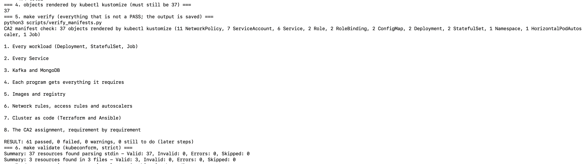

*Step 8, the file checks that need no cluster: `kubectl kustomize` renders 37 objects, `make verify` ends with `RESULT: 61 passed, 0 failed` (the lines that passed are hidden here with `grep -v`; all of them are in `evidence/step8-verify.txt`), and `make validate` finds all 37 objects and the 3 files that `make up` does not apply valid. Step 9 added the checks of the documents, so `make verify` has more checks now.*

## Integrity Packet

See [`integritypacket.md`](integritypacket.md) for the claim, evidence, assumption, validation and AI-review record: what each test proves, the failures that were found and fixed (including the first scaling run), and what still depends on a human. [`ai-guidance-log.md`](ai-guidance-log.md) lists each consequential AI recommendation with the official page that backs it up and what was actually tested.
