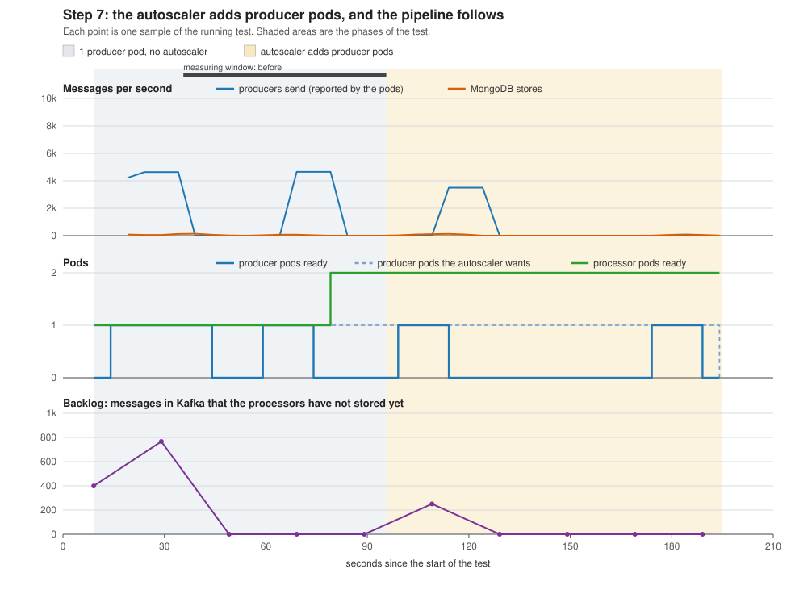

# Step 7: scaling test results

Run started 2026-10-15 01:57 (UTC). The load is the Deployment `producer-load`: producer pods that replay the dataset in a loop.
Autoscaler `producer-load`: 1 to 5 pods, target 50% of the CPU request.  Processor autoscaler: 1 to 3 pods, target 70%.

**The test stopped early:** after 90 s the autoscaler still has no CPU number for the producer pods, so it cannot scale. What it said about itself is in evidence/step7-run1-oom-hpa.txt (look for ScalingActive and FailedGetResourceMetric)

## Before and after

| Measurement | Before: 1 producer pod, no autoscaler | After: ? producer pods, autoscaler working | Change |
|---|---:|---:|---:|
| Producer pods ready | 0 | n/a |  |
| Messages per second from one producer pod | n/a | n/a | |
| Producers send, messages per second (all pods together, reported by the pods) | 1,162 | n/a |  |
| Kafka receives, messages per second (growth of the topic) | 25 | n/a |  |
| MongoDB stores, messages per second (growth of the record count) | 21 | n/a |  |
| Backlog in Kafka at the end of the window, messages | 0 | n/a |  |
| Time a new message would wait in the backlog, seconds (backlog / storing rate) | 0.0 | n/a |  |
| One tagged event: stored in Kafka until the REST API returns it, seconds | 0.1 | n/a | |
| Processor pods ready | 1 | n/a |  |
| Producer pods' CPU, % of their request (from the autoscaler) | n/a | n/a |  |
| Processor pods' CPU, % of their request (from their autoscaler) | 75 | n/a |  |
| Worker nodes' CPU, % (average of the workers, from kubectl top nodes) | 14 | n/a |  |

## How the autoscaler added pods

| Seconds after the autoscaler was created | Producer pods ready | Producer pods wanted by the autoscaler | Producer pods' CPU, % of request | Processor pods ready |
|---:|---:|---:|---:|---:|
| 4 | 1 | 1 | n/a | 2 |
| 14 | 1 | 1 | n/a | 2 |
| 24 | 0 | 1 | n/a | 2 |
| 34 | 0 | 1 | n/a | 2 |
| 44 | 0 | 1 | n/a | 2 |
| 54 | 0 | 1 | n/a | 2 |
| 64 | 0 | 1 | n/a | 2 |
| 74 | 0 | 1 | n/a | 2 |
| 84 | 1 | 1 | n/a | 2 |
| 94 | 0 | 1 | n/a | 2 |

The tagged event is the one the smoke test sends. Its time runs from the moment the producer Job reported that Kafka had stored it until the REST API returned it (asked every second), so it is accurate to about 2 seconds. The REST API finds the event by its trace_id; before the test the script gave MongoDB a small index on that field, so the lookup does not read every stored record.

## What the numbers say

- The processors have an autoscaler of their own. It took them from 1 to 2 pods, the first extra pod 65 s after the first producer pod was ready (their CPU was 75% of the request, the target is 70%).

