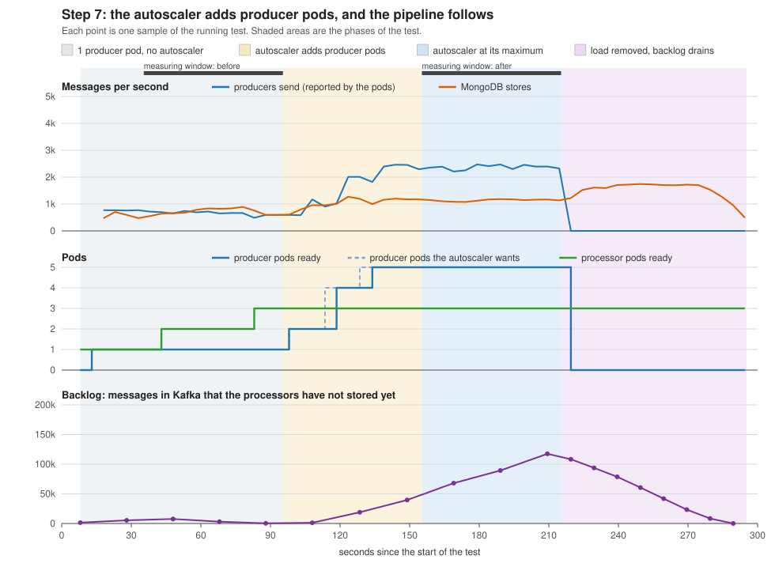

# Step 7: scaling test results

Run started 2026-10-15 04:00 (UTC). The load is the Deployment `producer-load`: producer pods that replay the dataset in a loop.
Autoscaler `producer-load`: 1 to 5 pods, target 50% of the CPU request.  Processor autoscaler: 1 to 3 pods, target 70%.

## Before and after

| Measurement | Before: 1 producer pod, no autoscaler | After: 5 producer pods, autoscaler working | Change |
|---|---:|---:|---:|
| Producer pods ready | 1 | 5 | x5.0 |
| Messages per second from one producer pod | 656 | 474 | |
| Producers send, messages per second (all pods together, reported by the pods) | 656 | 2,369 | x3.6 |
| Kafka receives, messages per second (growth of the topic) | 625 | 2,399 | x3.8 |
| MongoDB stores, messages per second (growth of the record count) | 737 | 1,138 | x1.5 |
| Backlog in Kafka at the end of the window, messages | 310 | 117,483 |  |
| Time a new message would wait in the backlog, seconds (backlog / storing rate) | 0.4 | 103.3 |  |
| One tagged event: stored in Kafka until the REST API returns it, seconds | 0.1 | 46.1 | |
| Processor pods ready | 2 | 3 | x1.5 |
| Producer pods' CPU, % of their request (from the autoscaler) | n/a | 490 |  |
| Processor pods' CPU, % of their request (from their autoscaler) | 355 | 461 |  |
| Worker nodes' CPU, % (average of the workers, from kubectl top nodes) | 35 | 77 |  |

## How the autoscaler added pods

| Seconds after the autoscaler was created | Producer pods ready | Producer pods wanted by the autoscaler | Producer pods' CPU, % of request | Processor pods ready |
|---:|---:|---:|---:|---:|
| 3 | 2 | 2 | 499 | 3 |
| 13 | 2 | 2 | 499 | 3 |
| 23 | 4 | 4 | 498 | 3 |
| 33 | 4 | 5 | 495 | 3 |
| 44 | 5 | 5 | 495 | 3 |
| 54 | 5 | 5 | 492 | 3 |

The tagged event is the one the smoke test sends. Its time runs from the moment the producer Job reported that Kafka had stored it until the REST API returned it (asked every second), so it is accurate to about 2 seconds. The second event was sent in the middle of the second window; the load was removed at the end of that window. The REST API finds the event by its trace_id; before the test the script gave MongoDB a small index on that field, so the lookup does not read every stored record.

## What the numbers say

- The producers' combined rate went from 656 to 2,369 messages per second (x3.6) when the autoscaler took the producers from 1 to 5 pods.
- That is less than 5 times the rate of one pod, and the workers were only at 77% CPU, so their CPU was not the limit: the producers were waiting for something else, for example Kafka accepting the messages.
- MongoDB stored 1,138 messages per second while the producers sent 2,369. The difference waits in Kafka (117,483 messages at the end of the window), so after the producers the next limit is the part that reads from Kafka and writes to MongoDB: 3 processor pods and MongoDB. The processors were busy (461% of their CPU request, the target is 70%); their autoscaler stops at 3 pods, one per partition of the topic.
- The processors have an autoscaler of their own. It took them from 1 to 3 pods, the first extra pod 30 s after the first producer pod was ready (their CPU was 355% of the request, the target is 70%).
- A tagged event needed 0.1 s to get from Kafka to the REST API before scaling and 46.1 s after, because it queued behind the backlog.
- The autoscaler needed 40 s from its creation to have all 5 producer pods ready.
- At the end the producer pods ran on: ca2-agent-1 2, ca2-agent-2 1, ca2-server 2.

