# CA3 — Cloud-Native Ops: the intrusion-detection pipeline with logs, metrics, autoscaling, hardening and a resilience drill

## Overview

This project operates the CA2 pipeline as if it were a production service. A producer replays 5,000 labelled network-flow records onto a Kafka topic, a processor reads them and stores them in MongoDB, and a REST API serves them over HTTPS. CA2 built that on a three-machine Kubernetes cluster on AWS. CA3 adds four things on top: **visibility** (logs and metrics from every program, one dashboard), **automatic scaling** (two autoscalers, measured under load), **hardening** (passwords and certificates made inside the cluster, encrypted connections, rules for every connection, access rules, encrypted Secrets) and **proof of resilience** (one pod deleted in every tier, measured, with the operator steps written down). Everything is code in this folder. Nothing is created by hand.

Every claim in this README points to a file in [`evidence/`](evidence/) or to a picture in [`images/`](images/). Where a result is quoted, the lines are copied from the saved file, a link to the whole file stands under them (📄), and `make verify` checks that every quoted line is really in that file. [`integritypacket.md`](integritypacket.md) says which test proves which claim, and [`ai-guidance-log.md`](ai-guidance-log.md) lists what the AI recommended and how each piece was checked.

**The resilience drill on video (2 min 58 s, unlisted on YouTube):**

[](https://youtu.be/gmOuqr7P_TI)

If the picture does not load, the video is here: <https://youtu.be/gmOuqr7P_TI>

**The state of the project at hand-in.** There is no cluster running. It was built from nothing more than once during CA3 and destroyed after each round; the last `make teardown` was on Sunday, 8 November 2026, and the scan of AWS after it found nothing left (`RESULT: CLEAN`, twice); see *How to destroy*. The numbers and pictures below come from those earlier runs, and every one of them can be produced again with the commands in *Quick start*.

| Stage | Command | What it does | Proof |
|---|---|---|---|
| Check the files | `make validate`, `make verify` | Manifests against the Kubernetes schemas; manifests, programs, cluster code, these documents and the evidence against each other. Needs no cluster. | [step9-validate.txt](evidence/step9-validate.txt) |
| Build the cluster | `make cluster-up` | Terraform: network, firewall, 3 machines. Ansible: k3s. | [step3-cluster-up.txt](evidence/step3-cluster-up.txt), [step9-cluster-up-run2.txt](evidence/step9-cluster-up-run2.txt) |
| Deploy the stack | `make up` | Applies the 85 objects of `kustomization.yaml` with `kubectl apply -k .` and waits until everything runs. The passwords and certificates are made inside the cluster. | [step3-up.txt](evidence/step3-up.txt), [step9-up-run2.txt](evidence/step9-up-run2.txt) |
| See what would change | `make dry-run` | Asks the cluster what the next `make up` would change, and changes nothing. | [step9-dry-run-server.txt](evidence/step9-dry-run-server.txt), [step9-dry-run-client.txt](evidence/step9-dry-run-client.txt) |
| Test the pipeline | `make smoke`, `make rest-check` | One tagged event through all five stages; the REST API called from outside on every node. | [step5-smoke.txt](evidence/step5-smoke.txt), [step3-rest-check.txt](evidence/step3-rest-check.txt) |
| Look at it | `make metrics-check`, `make logs-trace` | Prometheus, Loki and Grafana answer; one event id followed through the logs of every program. | [step4-metrics-check.txt](evidence/step4-metrics-check.txt), [step5-trace.txt](evidence/step5-trace.txt) |
| Scale | `make scale-test` | Producers 1 → 5 pods and processors 1 → 3 under their autoscalers, then back; before and after numbers. | [step6-scale-results.md](evidence/step6-scale-results.md) |
| Harden and test it | `make netpol-check`, `make rbac-check`, `make exposure-check` | 169 network connections tried; what each account may do; which ports answer from outside. | [step7-netpol-check.txt](evidence/step7-netpol-check.txt), [step3-rbac.txt](evidence/step3-rbac.txt), [step3-exposure.txt](evidence/step3-exposure.txt) |
| Break it on purpose | `make drill`, `make heal-check` | One pod deleted in each of the five tiers; recovery measured against written goals. | [step7-drill-results.md](evidence/step7-drill-results.md) |
| Delete everything and prove it | `make teardown` | Deletes the stack, destroys the machines and the network, then scans AWS for leftovers. Run twice. | [step10-teardown.txt](evidence/step10-teardown.txt), [step10-teardown-again.txt](evidence/step10-teardown-again.txt) |

### Quick start

```bash
git clone https://github.com/Amshu0-0/CA.git
cd CA/CA3
make verify          # checks the files; needs no cluster and no AWS account
make cluster-up      # AWS: network, firewall, 3 machines, Kubernetes (needs AWS credentials, see Prerequisites)
make up              # the whole stack, one to two minutes
make smoke           # one tagged event through producer, Kafka, processor, MongoDB and REST API
make metrics-check   # the monitoring answers
make teardown        # delete everything, then scan AWS to prove nothing is left
```

`make` with no argument lists every command. The long tests are `make scale-test` (about 7 minutes) and `make drill` (about 6 minutes). Details, expected output and troubleshooting are below.

## Use your own Kubernetes cluster

The Kubernetes part of this project does not need the AWS cluster that `infra/` builds. If `kubectl` points at a cluster you already have, these commands run the whole stack:

```bash
cd CA3
kubectl apply -k .               # the whole stack: 85 objects (kustomize is built into kubectl)
kubectl -n ca3 get pods          # about two minutes later every pod is Running and the Jobs say Completed
make up KUBECONFIG=$HOME/.kube/config    # the same, with waiting for every part and a message at the end
kubectl delete -k .              # removes everything again: the namespace, with its disks and Secrets
```

Nothing has to be prepared first: the Job `bootstrap` in the stack makes the passwords and certificates (13 Secrets) inside the cluster, and the pods that need them start by themselves a short while after it ends.

**What the cluster must provide.** The manifests name no machine, no host path and no storage class. They do assume the following:

| Assumption | Why | If it is missing |
|---|---|---|
| A default StorageClass | Kafka and MongoDB each ask for a 5Gi volume and name no class | the two pods stay `Pending` |
| Access to `ghcr.io` and Docker Hub | the three application images are public on `ghcr.io/amshu0-0/`; Kafka, MongoDB, Prometheus, Grafana, Loki, Alloy and the two exporters come from Docker Hub (the list is in *Software stack*) | `ImagePullBackOff` |
| metrics-server | the two autoscalers read the pods' CPU from it (k3s ships it) | the autoscalers show `<unknown>` and never scale; everything else works |
| A network plugin that enforces NetworkPolicy | the 25 policies are only rules until it does (k3s ships one) | nothing fails, but nothing is isolated |
| The cluster DNS domain `cluster.local` | Kafka tells its clients to come back to `kafka-0.kafka-headless.ca3.svc.cluster.local`, and its certificate carries that name | clients reach Kafka once, then fail to reconnect |
| About 1.4 CPU and 2.8 GiB of free capacity | the pods' requests at their smallest replica counts, with the log collector on three nodes (my sum over the manifests); the limits add up to 6.8 CPU and 6.5 GiB | pods stay `Pending` |
| Pod Security Admission | the namespace enforces the `restricted` profile and every pod complies (on by default since Kubernetes 1.25) | the profile is not enforced |
| The API server at `10.20.1.0/24` (the machines' subnet, port 6443) or `10.43.0.1` (the API Service) | the policies `bootstrap-egress` and `alloy-egress` name these two addresses, because a NetworkPolicy cannot name the API server any other way | the setup Job and Alloy cannot reach the API: change the two addresses in `policies/networkpolicies.yaml` and `policies/observability.yaml` |

**Tested only on k3s** `v1.37.1+k3s1`, the cluster that `infra/` builds. It was not tested on kind, minikube, EKS, GKE or AKS. The last row is the one thing that is not portable; it is listed again under *Known limitations*.

**Do not apply the folder recursively.** `kubectl apply -R -f .` would also apply the overlays `producer/loadtest/`, `producer/loadtest-one/` and the smoke-test Job in `producer/smoke/`. Those are applied on demand (`make scale-up`, `make scale-test`, `make smoke`) and are deliberately not listed in [`kustomization.yaml`](kustomization.yaml). Use `kubectl apply -k .`.

**The tests that call the REST API from your computer** ask Terraform for the node addresses by default. On another cluster pass the address yourself, for example `python3 scripts/rest-check.py --hosts <node-address>`, or use `kubectl -n ca3 port-forward service/restapi 8443:8443` and call `https://localhost:8443`.

## What changed after CA2 grading

CA2 was graded 99 of 100. The one point was lost because the cleanup scan could not list every tagged resource in AWS (my IAM user was not allowed to call `tag:GetResources`). CA3 fixes that, and builds in the security items that the CA2 review asked for.

| Item from the CA2 review | Status | How CA3 does it |
|---|---|---|
| The cleanup scan could not search all tagged resources | **Fixed** | The scan now has two checks for tagged resources: one through the tagging service (the permission was added), and one that asks EC2 for every kind of EC2 resource with the tag, which needs no extra permission. Each name in AWS's tag list is also asked for directly, so a stale entry is not mistaken for a leftover. Both checks ran in the last teardown (below). |
| Keep secrets out of Git, and out of anybody's terminal | **Done, stronger** | CA2 made the password on the operator's computer. CA3 makes all passwords and certificates inside the cluster, in the Job `bootstrap`, which may only *create* Secrets. No script, no Secret file on a computer, nothing to ignore in Git. |
| Encrypt the traffic | **Done** | Kafka demands TLS and a client certificate; MongoDB requires TLS and a login; the REST API answers only over HTTPS and asks for a login. Tested by trying the opposite: [step10-tls-checks.txt](evidence/step10-tls-checks.txt). |
| Rules for traffic in both directions | **Done** | 25 NetworkPolicies: default deny for all pods, then one rule per allowed connection, for ingress and for egress. |
| Pods with no more rights than they need | **Done** | Pod Security `restricted` on the namespace, no Kubernetes API token in pods that do not call the API, Secrets mounted read-only, one account per program in MongoDB, separate roles for a viewer and an operator. |
| Secrets stored encrypted in the cluster | **Done** | k3s encrypts Secrets in its database (AES-CBC). Proved by looking at the database itself: [step10-secrets-at-rest.txt](evidence/step10-secrets-at-rest.txt). |
| Run it twice | **Done** | Second `make cluster-up`: Terraform says `No changes`. Second `make up`: every object `unchanged`. Second `make teardown`: nothing to destroy, scan still `CLEAN`. |

## Where each grading category is shown

| Category (weight) | Where to look |
|---|---|
| Observability and logging (20%) | Logs: Loki and Alloy ([`observability/loki.yaml`](observability/loki.yaml), [`observability/alloy.yaml`](observability/alloy.yaml)); JSON log lines with `ts`, `level`, `service`, `trace_id`, `topic`; pictures [step5-logs-one-event.png](images/step5-logs-one-event.png) and [step7-logs-errors.png](images/step7-logs-errors.png). Metrics: Prometheus, Grafana, two exporters; the dashboard `CA3 pipeline` ([`observability/grafana/dashboards/pipeline.json`](observability/grafana/dashboards/pipeline.json)) with producer rate, consumer lag, database inserts per second and REST request rate, error rate and latency; pictures [step6-grafana-scaling.png](images/step6-grafana-scaling.png) and [step7-grafana-recovery.png](images/step7-grafana-recovery.png). See *Observability* and *Where to find logs*. |
| Autoscaling (15%) | Autoscalers [`producer/load/hpa.yaml`](producer/load/hpa.yaml) and [`processor/hpa.yaml`](processor/hpa.yaml); `kubectl get hpa` every 15 seconds during the test: [step6-scale-hpa-over-time.txt](evidence/step6-scale-hpa-over-time.txt); the measured before and after: [step6-scale-results.md](evidence/step6-scale-results.md); picture [kubectl-get-hpa.png](images/kubectl-get-hpa.png). The reasons for what is scaled and what is watched: *Why these tiers, and why these numbers* and *CPU, not the consumer lag*. See *Autoscaling* and *How to run the scaling test*. |
| Security hardening (15%) | Secrets, NetworkPolicies, TLS, access rules, Pod Security. [`policies/networkpolicies.yaml`](policies/networkpolicies.yaml), [`policies/observability.yaml`](policies/observability.yaml), [`rbac/roles.yaml`](rbac/roles.yaml); the sanitized Secret templates and the TLS summary are in *Security*; tested with real connections: [step7-netpol-check.txt](evidence/step7-netpol-check.txt), [step10-tls-checks.txt](evidence/step10-tls-checks.txt), [step10-security-facts.txt](evidence/step10-security-facts.txt), [step10-secrets-at-rest.txt](evidence/step10-secrets-at-rest.txt). |
| Resilience drill and recovery (25%) | One pod deleted in each tier, measured: [step7-drill-results.md](evidence/step7-drill-results.md), [step7-drill-timeline.txt](evidence/step7-drill-timeline.txt); the operator steps: [`runbook.md`](runbook.md) and [step7-operator-steps.txt](evidence/step7-operator-steps.txt); the video (above); REST evidence: [step7-rest-evidence.txt](evidence/step7-rest-evidence.txt). See *Resilience drill*. |
| Documentation and usability (10%) | This file: prerequisites with versions, deploy, validate, scale, drill, destroy, expected output, deviations, limitations. `make verify` checks that every link, every `make` command and every quoted evidence line in these documents is real. |
| Integrity Packet (15%) | [`integritypacket.md`](integritypacket.md) (claims, evidence, assumptions, failures, risks, AI-assisted work) and [`ai-guidance-log.md`](ai-guidance-log.md) (each AI recommendation, the official source, how it was checked, and each mistake the AI made). |

**What the assignment says to submit, and where it is:** screenshots of the log view, the Grafana panels and the scaling commands (*Observability*, *Where to find logs*, *How to run the scaling test*); manifests and configs for the autoscalers, the NetworkPolicies, the Secrets and TLS (*Autoscaling*, *Network and isolation*, *Security*); the video (above); this README; the REST evidence ([step7-rest-evidence.txt](evidence/step7-rest-evidence.txt)); the Integrity Packet.

## Architecture

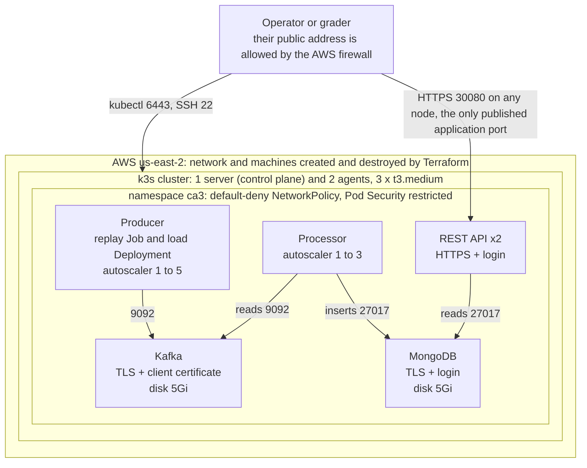

The monitoring sits in the same namespace and reads the pipeline; it does not sit in the data path:

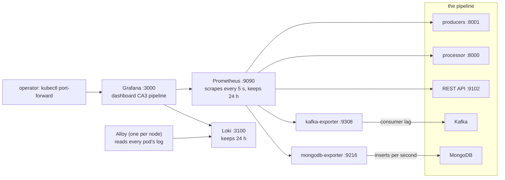

The pods are placed by Kubernetes, so which node runs which pod can change between runs. What does not change is who may talk to whom: see *Network and isolation*.

### Two layers, kept apart

| Layer | What it is | Where it lives | How it is driven |
|---|---|---|---|
| Platform | the machines, the network, the firewall and Kubernetes itself | [`infra/`](infra/) (Terraform and Ansible) | `make cluster-up`, `make cluster-down` |
| Microservices | Kafka, MongoDB, the processor, the REST API, the producers and the monitoring, with their network rules, access rules, Secret handling and autoscalers | every other folder, listed in [`kustomization.yaml`](kustomization.yaml) | `kubectl apply -k .` (`make up`), `kubectl delete -k .` (`make down`) |

The only thing that passes from the first layer to the second is a kubeconfig file (`.secrets/kubeconfig.yaml`, never in Git). The manifests name no machine, host path or storage class, so the second layer runs on any cluster that meets the assumptions in *Use your own Kubernetes cluster*; the first layer knows about the application only through one published port (`rest_node_port: 30080` in [`infra/config.yml`](infra/config.yml)), which `make verify` compares with the REST API's Service.

## Automation toolchain

Every step is a command in the [`Makefile`](Makefile); `make` with no argument lists them. Nothing is done by hand in a console, and no step depends on something typed earlier in a terminal.

| Tool | What it does here | Where |
|---|---|---|
| Terraform | creates and destroys the AWS network, firewall rules, key pair and three machines (19 resources) | [`infra/terraform/`](infra/terraform/) |
| Ansible | installs k3s on the three machines (one server, two agents) and writes the kubeconfig | [`infra/ansible/`](infra/ansible/) |
| kubectl with kustomize | creates and removes the whole stack from [`kustomization.yaml`](kustomization.yaml) | `make up`, `make down` |
| Python 3 scripts | the tests, the measurements and the checker; each one prints what it tested and ends with a `RESULT:` line | [`scripts/`](scripts/) |
| kubeconform | checks every manifest against the Kubernetes schemas | `make validate` |
| GitHub Actions | builds the three application images and pushes them to `ghcr.io` (public, so no pull Secret is needed) | the repository's workflow |
| Git | the only source of truth: a fresh clone is enough to rebuild everything | this repository |

### Two commands, two layers

`make cluster-up` builds the platform; `make up` puts the application on it. They are separate on purpose: the second one runs on any Kubernetes cluster, not only the one the first one builds (see *Use your own Kubernetes cluster*).

## Directory structure

```text
CA3/
├── Makefile               every command (make help lists them)
├── README.md              this file
├── integritypacket.md     claims, evidence, assumptions, failures, risks, AI-assisted work
├── ai-guidance-log.md     every AI recommendation and every AI mistake, with the official source and the test
├── runbook.md             what a person does when a part breaks
├── slo.json               the goals as numbers (service level objectives)
├── kustomization.yaml     the list of everything that makes up the stack
├── namespace.yaml         the namespace ca3, Pod Security "restricted"
├── bootstrap/             the setup Job that makes the 13 Secrets inside the cluster
├── config/                the pipeline settings (a ConfigMap)
├── db/                    MongoDB (StatefulSet, TLS required, one account per program)
├── kafka/                 Kafka (StatefulSet, KRaft, TLS with client certificates)
├── processor/             the processor, the setup program, the processor autoscaler
├── producer/              the producer, the dataset, the replay Job, the load generator and its autoscaler,
│                          the two load-test overlays, the smoke-test Job
├── restapi/               the REST API (two pods, HTTPS, login)
├── observability/         Prometheus, Grafana and its dashboard, Loki, Alloy, the two exporters
├── policies/              the NetworkPolicies
├── rbac/                  service accounts and roles
├── infra/                 Terraform and Ansible, and config.yml with every setting
├── scripts/               the programs behind the make commands, and the checker verify_manifests.py
├── evidence/              the saved output of every test (73 files; each is listed in the Integrity Packet)
└── images/                the terminal and browser pictures used in this README
```

The stack is the list in `kustomization.yaml`, which `kubectl apply -k .` turns into:

(85 objects: namespace, 25 NetworkPolicies, 14 service accounts, 4 roles and 4 role bindings, 8 ConfigMaps, 14 Services, 2 StatefulSets, 8 Deployments, 1 DaemonSet, 2 autoscalers and 2 Jobs: the setup Job and the replay Job)

Two more folders are applied on demand and are not in that list: `producer/loadtest/` and `producer/loadtest-one/` (the scaling test, applied by `make scale-test` and `make scale-up`) and `producer/smoke/` (the smoke-test Job, applied by `make smoke`).

## Software stack

Every image is pinned to a version, and the table is made from the manifests, so it cannot drift from them.

| Image (as in the manifests) | Role | Used by |
|---|---|---|
| `busybox:1.36` | init containers: wait until a service answers | `processor`, `producer-load`, `producer-replay`, `restapi` |
| `confluentinc/cp-kafka:7.7.1` | Kafka: message bus (KRaft, one broker) | `kafka` |
| `danielqsj/kafka-exporter:v1.9.0` | kafka-exporter: Kafka consumer lag as a metric | `kafka-exporter` |
| `ghcr.io/amshu0-0/ca3-processor:1.0.0` | processor, setup Job: reads Kafka, stores in MongoDB; the same image runs the setup Job `bootstrap` | `bootstrap`, `processor` |
| `ghcr.io/amshu0-0/ca3-producer:1.0.0` | producer: reads the dataset and sends events to Kafka; also the load generator | `producer-load`, `producer-replay` |
| `ghcr.io/amshu0-0/ca3-restapi:1.0.0` | REST API: serves the stored events over HTTPS with a login | `restapi` |
| `grafana/alloy:v1.5.0` | Alloy: DaemonSet that reads every pod's log and sends it to Loki | `alloy` |
| `grafana/grafana:11.3.0` | Grafana: dashboard (reached with `kubectl port-forward` only) | `grafana` |
| `grafana/loki:3.3.0` | Loki: log store, 24 hours | `loki` |
| `mongo:7.0` | MongoDB: database (TLS required, one account per program) | `mongo` |
| `percona/mongodb_exporter:0.40.0` | mongodb-exporter: MongoDB counters as metrics (inserts per second) | `mongodb-exporter` |
| `prom/prometheus:v2.55.1` | Prometheus: metrics, 24 hours | `prometheus` |

The three `ca3-*` images are built from the folders `producer/`, `processor/` and `restapi/`. Their containers run as user 1000, may not gain more rights, drop every Linux capability and use the default seccomp profile (the namespace enforces Pod Security `restricted`; `make verify` reads each Dockerfile for the numeric user). The root file system of the containers is writable: `readOnlyRootFilesystem` is not set (see *Known limitations*).

## Configuration

Every setting of the platform is in one file, [`infra/config.yml`](infra/config.yml). Terraform reads it for the AWS resources, Ansible reads it for k3s, and `make verify` checks it. It holds no secret.

```yaml
project_tag: CS5287-CA3
name_prefix: ca3

# Where in AWS. An empty availability_zone means: the first available zone in the region.
region: us-east-2
availability_zone: ""

# The private network that Terraform creates and destroys for this cluster.
# It must not overlap k3s's own pod range (10.42.0.0/16) or service range (10.43.0.0/16).
vpc_cidr: 10.20.0.0/16
subnet_cidr: 10.20.1.0/24

# The machines: one k3s server (the control plane) plus agent_count workers, so 3 nodes in total.
# t3.medium has 2 vCPU and 4 GiB of memory, enough for Kafka, MongoDB, the processor and the REST API.
instance_type: t3.medium
root_volume_gb: 30
agent_count: 2
```

Two settings need a word of explanation.

- `admin_cidr: auto` means the public address of the computer that runs the command, looked up on every run, so nobody edits an address by hand. If the address changes while a cluster exists, the next `make cluster-up` changes only the firewall rules that use it.
- `rest_api_cidr: admin` means that the REST API's node port answers only to the same address. Set it to `0.0.0.0/0` to let anyone call the API, for example while an instructor tests it. This was not needed for the video or the tests.

The settings of the pipeline itself (Kafka address and topic, MongoDB address, database and collection, ports, dataset file) are in [`config/pipeline-config.yaml`](config/pipeline-config.yaml). It holds no secret either: the certificates and passwords arrive as Secret files.

## Network and isolation

Two firewalls protect the pipeline, and they do not know about each other. The AWS firewall decides what can reach the three machines from the internet. The Kubernetes NetworkPolicies decide which pod may talk to which pod inside the cluster. Each one has its own test.

### Outside: the AWS firewall

Terraform creates one security group for the three machines ([`infra/terraform/security.tf`](infra/terraform/security.tf)). Nothing is open except these rules:

| Direction | Port | Who | What it is |
|---|---|---|---|
| in | 22 | the administrator's address only | SSH, used by Ansible and for debugging |
| in | 6443 | the administrator's address only | the Kubernetes API (only the server machine runs it) |
| in | 30080 | the administrator's address only (`rest_api_cidr: admin`) | the REST API: the one application port that is published |
| in | 6443, 10250, 8472 (UDP), ping | the three machines, named by their security group, never by an address | agents reaching the API, the kubelets, the pod network between machines |
| out | all | anywhere | image pulls, package downloads and the k3s installer |

`make exposure-check` tries 11 ports on each of the three machines from the administrator's computer, and lists the one Service that is reachable from outside the cluster:

<!-- from: evidence/step3-exposure.txt -->
```text
kubectl get svc -A --field-selector spec.type!=ClusterIP     (every Service that is reachable from outside the cluster)
NAMESPACE   NAME      TYPE       CLUSTER-IP      EXTERNAL-IP   PORT(S)          AGE
ca3         restapi   NodePort   10.43.111.140   <none>        8443:30080/TCP   29m
...
  port  what                                  server     agent-1    agent-2
  22    SSH                                   open       open       open
  2379  etcd                                  no answer  no answer  no answer
  6443  Kubernetes API                        open       no answer* no answer*
  8000  processor metrics                     no answer  no answer  no answer
  8443  REST API (container port)             no answer  no answer  no answer
  9092  Kafka                                 no answer  no answer  no answer
  10250 kubelet                               no answer  no answer  no answer
  27017 MongoDB                               no answer  no answer  no answer
  30080 REST API node port                    open       open       open
  30081 another node port                     no answer  no answer  no answer
  32767 last node port                        no answer  no answer  no answer
...
RESULT: PASS - on all 3 nodes only 22 (SSH), 6443 (Kubernetes API, server only), 30080 (REST API node port) answer; the other 8 ports are dropped
```

📄 [View the full text file: step3-exposure.txt](evidence/step3-exposure.txt)

The port check cannot test what it does not see: it was run from the administrator's address, so it shows that the allowed address gets in on three ports and not on the others. It was **not** run from a second, different address (that the firewall also keeps other addresses out is what the rule says, and was not measured).

### Inside: the NetworkPolicies

The namespace starts closed. The policy `default-deny-all` drops all traffic to and from every pod, for ingress and for egress. `allow-dns-egress` then opens the one thing every pod needs, the cluster DNS. After that, each allowed connection needs two policies: one on the sender (egress, "this pod may call that port") and one on the receiver (ingress, "this pod accepts calls from that pod"). If either is missing, the connection is dropped. The policy files are [`policies/networkpolicies.yaml`](policies/networkpolicies.yaml) (the pipeline) and [`policies/observability.yaml`](policies/observability.yaml) (the monitoring).

The table is made from the `description` of each policy in the manifests:

| Policy | What it allows (everything else is dropped) |
|---|---|
| `default-deny-all` | Blocks all traffic into and out of every pod in the namespace. The other policies then allow, one by one, only the connections the pipeline needs. |
| `allow-dns-egress` | Lets every pod ask the cluster DNS (CoreDNS in kube-system, port 53) to turn a Service name into an address. |
| `kafka-ingress` | Kafka accepts connections only from the producer and the processor, on port 9092. |
| `kafka-self` | The Kafka pod may talk to itself on port 9092. The controller and administration listeners are loopback-only and need no rule. |
| `mongo-ingress` | MongoDB accepts connections only from the processor and the REST API, on port 27017. |
| `processor-ingress` | The processor's metrics port 8000 may be read only by pods labelled component observer. |
| `restapi-ingress` | The REST API accepts connections on port 8443 (HTTPS) from any source. The AWS firewall limits who can reach the node port in front of it. |
| `producer-egress` | The producer may connect only to Kafka, on port 9092. |
| `processor-egress` | The processor may connect only to Kafka (port 9092) and MongoDB (port 27017). |
| `restapi-egress` | The REST API may connect only to MongoDB, on port 27017. |
| `observer-egress` | Pods with the label component=observer (the role of a monitoring tool; make netpol-check plays it) may call only the processor's port 8000 and the REST API's port 8443. |
| `bootstrap-egress` | The setup Job may connect only to the Kubernetes API server (the machines' subnet, port 6443, or the API Service address, port 443) and to DNS. |
| `prometheus-egress` | Prometheus may connect to the producers (8001), the processor (8000), the REST API (9102), kafka-exporter (9308) and mongodb-exporter (9216). As an observer pod it may also reach the REST API's port 8443 (observer-egress), where it has no login. |
| `prometheus-ingress` | Prometheus accepts connections only from Grafana, on port 9090. |
| `grafana-egress` | Grafana may connect only to Prometheus (9090) and Loki (3100). |
| `loki-ingress` | Loki accepts connections only from Alloy (to write logs) and Grafana (to search them), on port 3100. |
| `alloy-egress` | Alloy may connect only to Loki (3100) and to the Kubernetes API server (the machines' subnet, port 6443, or the API Service address, port 443). |
| `producer-metrics-ingress` | The producers' metrics port 8001 may be read only by Prometheus. Nothing else may connect to a producer. |
| `restapi-metrics-ingress` | The REST API's metrics port 9102 may be read only by Prometheus. |
| `kafka-exporter-ingress` | kafka-exporter accepts connections only from Prometheus, on port 9308. |
| `kafka-exporter-egress` | kafka-exporter may connect only to Kafka, on port 9092. |
| `mongodb-exporter-ingress` | mongodb-exporter accepts connections only from Prometheus, on port 9216. |
| `mongodb-exporter-egress` | mongodb-exporter may connect only to MongoDB, on port 27017. |
| `kafka-exporter-to-kafka` | The one exception to kafka-ingress: Kafka also accepts kafka-exporter on port 9092 (it still needs a client certificate). |
| `mongodb-exporter-to-mongo` | The one exception to mongo-ingress: MongoDB also accepts mongodb-exporter on port 27017 (it still needs its monitoring-only account). |

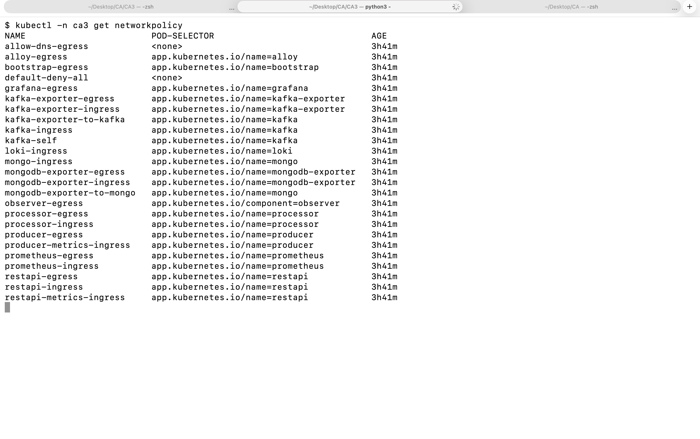

**What the assignment asked, and what the stack does.** The assignment says: only the processor may talk to the Kafka and database ports, and producers write only to Kafka. The producers reach Kafka and nothing else. The processor reaches Kafka and MongoDB. These exceptions exist, and each has a policy of its own that names it, so none of them is accidental:

- the REST API also **reads** MongoDB (that is what it is for: `restapi-egress` and `mongo-ingress`);
- the two exporters read the monitoring numbers of Kafka (`kafka-exporter-egress`, `kafka-exporter-to-kafka`) and of MongoDB (`mongodb-exporter-egress`, `mongodb-exporter-to-mongo`);
- the REST API's own port accepts calls from any sender (`restapi-ingress`), because the API is the published part of the stack. Everything else in the namespace does not.

**How it was tested.** `make netpol-check` starts 13 small probe pods, each wearing the labels of one kind of pod (and one in another namespace, `ca3-intruder`, as a stranger from outside), and tries 169 connections. It compares each answer with what the policies say, and marks any difference with `!`. The first table is the pipeline itself:

<!-- from: evidence/step7-netpol-check.txt -->
```text
The pipeline (78 connections):
  from              kafka:9092  mongo:27017  processor:8000  restapi:8443  DNS:53      k8s-api:443
  stranger          blocked     blocked      blocked         blocked       open        blocked
  intruder          blocked     blocked      blocked         open          open        open
  producer          open        blocked      blocked         blocked       open        blocked
  processor         open        open         blocked         blocked       open        blocked
  restapi           blocked     open         blocked         blocked       open        blocked
  observer          blocked     blocked      open            open          open        blocked
  bootstrap         blocked     blocked      blocked         blocked       open        open
  prometheus        blocked     blocked      open            open          open        blocked
  grafana           blocked     blocked      blocked         blocked       open        blocked
  loki              blocked     blocked      blocked         blocked       open        blocked
  alloy             blocked     blocked      blocked         blocked       open        open
  kafka-exporter    open        blocked      blocked         blocked       open        blocked
  mongodb-exporter  blocked     open         blocked         blocked       open        blocked
...
RESULT: PASS - all 169 connections behave as the policies say (34 allowed, 135 blocked)
```

📄 [View the full text file: step7-netpol-check.txt](evidence/step7-netpol-check.txt)

Read the table row by row: `stranger` (a pod of the namespace with no role) reaches nothing but DNS. `producer` reaches only Kafka (`open` under `kafka:9092`). `processor` reaches Kafka and MongoDB. `restapi` reaches only MongoDB. `intruder` (from another namespace) reaches only the REST API of the pipeline, plus DNS and the Kubernetes API server (the policies of `ca3` do not govern what a pod of another namespace sends out; the namespace `ca3-intruder` has no policy of its own, and what the pipeline's pods accept is still decided by the policies of `ca3`). `k8s-api` open means that a TCP connection was accepted. It is not a permission: what a caller may then do is decided by the access rules below, and the probe did not try to do anything.

**Do the policies really do the blocking?** A table of `blocked` could also mean that nothing worked at all, so there is a control experiment (`make netpol-control`): a shorter version of the same test, with two probes (`stranger` and `intruder`), run with the 25 policies in place, then with all of them deleted, then with them put back.

<!-- from: evidence/step7-netpol-control.txt -->
```text
Phase 1: the 25 policies are in place
...
  stranger  blocked     blocked      blocked         blocked       blocked          blocked       blocked     blocked              blocked
  intruder  blocked     blocked      blocked         open          blocked          blocked       blocked     blocked              blocked
...
Phase 2: no policies
...
  stranger  open        open         open            open          open             open          open        open                 open
  intruder  open        open         open            open          open             open          open        open                 open
...
  every connection was accepted after at most 1 s
...
Phase 3: the policies are back
...
  stranger  blocked     blocked      blocked         blocked       blocked          blocked       blocked     blocked              blocked
  intruder  blocked     blocked      blocked         open          blocked          blocked       blocked     blocked              blocked
...
  the original answers were back after at most 2 s
...
RESULT: PASS - without the policies every connection worked, with them only the allowed ones do: the policies are what blocks
```

📄 [View the full text file: step7-netpol-control.txt](evidence/step7-netpol-control.txt)

Without the policies every connection worked, with them only the allowed ones do, so the policies are what blocks. The network plugin that enforces them is the one k3s ships; a cluster without such a plugin would accept the objects and enforce nothing (see *Use your own Kubernetes cluster*).

**What the network test does not cover.** It tests connections between pods, at the level of a TCP connection (a probe either connects or it does not). It does not test UDP, it does not test what a pod could send once connected, and it does not test traffic from a pod to the internet: no policy in `policies/` opens a way out to the internet, and that was read from the files, not measured. Two policy files name fixed addresses (`10.20.1.0/24` and `10.43.0.1/32`, the machines' subnet and the address of the Kubernetes API Service): they are the one part that is not portable to another cluster.

## Security and access controls

This section answers the three security items of the assignment: Secrets, network isolation (above) and TLS. It also covers what the course notes asked for beyond that: who may do what in the cluster, and what is stored on disk.

### Secrets

All passwords and certificates are made **inside the cluster** by the Job `bootstrap` (the program is [`processor/bootstrap.py`](processor/bootstrap.py)), the first time `make up` runs. No password is typed by a person, none is in Git, and none is created on the administrator's computer. The Job makes a private certificate authority (CA), signs the certificates with it, keeps the CA's private key only in memory and then forgets it, and creates 13 Secrets. Its account may only **create** Secrets: it may not read, change or delete any (the table in *Access rules* shows the answers). Certificates are valid for 365 days; the passwords are 32 random characters.

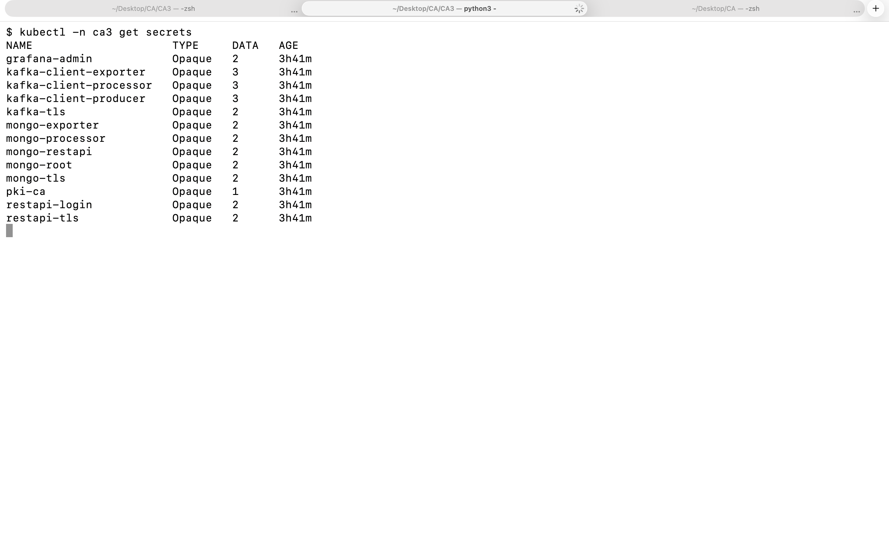

The table below is made from the saved output of the running cluster (the key names) and the manifests (who mounts what). It lists names only.

| Secret | Keys inside (names only) | Mounted or read by | What it is |
|---|---|---|---|
| `grafana-admin` | `password`, `username` | `grafana` | Grafana administrator login |
| `kafka-client-exporter` | `ca.crt`, `tls.crt`, `tls.key` | `kafka-exporter` | client certificate of the Kafka metrics reader |
| `kafka-client-processor` | `ca.crt`, `tls.crt`, `tls.key` | `processor` | client certificate of the processor |
| `kafka-client-producer` | `ca.crt`, `tls.crt`, `tls.key` | `producer-load`, `producer-replay` | client certificate of the producers |
| `kafka-tls` | `ca.pem`, `keystore.pem` | `kafka` | server certificate and key of the Kafka broker, and the CA certificate |
| `mongo-exporter` | `password`, `username` | `mongo`, `mongodb-exporter` | login of the MongoDB metrics reader (monitoring rights only) |
| `mongo-processor` | `password`, `username` | `mongo`, `processor` | login of the processor (writes to its collection) |
| `mongo-restapi` | `password`, `username` | `mongo`, `restapi` | login of the REST API (reads) |
| `mongo-root` | `password`, `username` | `mongo` | MongoDB administrator (used by the setup script of the database only) |
| `mongo-tls` | `ca.pem`, `mongo.pem` | `mongo` | server certificate and key of MongoDB, and the CA certificate |
| `pki-ca` | `ca.crt` | `mongodb-exporter`, `processor`, `restapi` | the CA certificate (public part only); the CA key is never stored |
| `restapi-login` | `password`, `username` | `restapi` | the login that the REST API asks for (HTTP Basic) |
| `restapi-tls` | `tls.crt`, `tls.key` | `restapi` | server certificate and key of the REST API |

**Secret templates (sanitized).** The Secrets are not files in the repository; the Job creates them. This is what one of each kind looks like, with the values replaced by a description. The real ones can be listed with `kubectl -n ca3 get secrets` (names and counts, as in the picture) and read with `kubectl get secret <name> -o jsonpath=...` by someone who is allowed to.

```yaml
# A login (mongo-root, mongo-processor, mongo-restapi, mongo-exporter, restapi-login, grafana-admin)
apiVersion: v1
kind: Secret
metadata:
  name: mongo-processor
  namespace: ca3
  labels:
    app.kubernetes.io/part-of: ca3-pipeline
  annotations:
    description: "MongoDB user of the processor: may read and write the database ca3"
type: Opaque
data:
  username: <the user name, base64>
  password: <32 random characters made by the Job, base64>
---
# A client certificate (kafka-client-producer, kafka-client-processor, kafka-client-exporter)
apiVersion: v1
kind: Secret
metadata:
  name: kafka-client-processor
  namespace: ca3
type: Opaque
data:
  tls.crt: <certificate signed by the CA of this stack, 365 days, base64>
  tls.key: <its private key, base64>
  ca.crt: <the CA certificate (public), base64>
---
# A server certificate (kafka-tls shown; mongo-tls and restapi-tls have the same shape)
apiVersion: v1
kind: Secret
metadata:
  name: kafka-tls
  namespace: ca3
type: Opaque
data:
  keystore.pem: <the broker's private key and certificate in one PEM file, base64>
  ca.pem: <the CA certificate (public), base64>
```

**How a Secret reaches a program.** As a read-only **file**, with one exception that is named below. The processor, for example, sees six Secret files, readable by the owner and the group only, and its environment holds the *path* of the password file, not the password. It has no Kubernetes API token either: the check looks for the folder where Kubernetes would put one, and `ls` says it does not exist.

<!-- from: evidence/step10-security-facts.txt -->
```text
/etc/pki/ca:
total 4
-r--r----- 1 0 1000 1172 Nov  8 15:01 ca.crt

/etc/pki/kafka-client:
total 12
-r--r----- 1 0 1000 1172 Nov  8 15:01 ca.crt
-r--r----- 1 0 1000 1229 Nov  8 15:01 tls.crt
-r--r----- 1 0 1000 1704 Nov  8 15:01 tls.key

/etc/secrets/mongo:
total 8
-r--r----- 1 0 1000 32 Nov  8 15:01 password
-r--r----- 1 0 1000  9 Nov  8 15:01 username
...
-- the folder where Kubernetes would put an API token
ls: cannot access '/var/run/secrets/kubernetes.io/serviceaccount': No such file or directory
...
OK: 13 Secrets exist
...
OK: the processor sees 6 Secret files, all read-only for owner and group (-r--r-----)
OK: the processor's environment holds the path of the password file (MONGO_PASSWORD_FILE), and no variable named like a password, key or token (GPG_KEY is set by the Python base image: it is the ID of a public key)
OK: the processor pod has no Kubernetes API token
```

📄 [View the full text file: step10-security-facts.txt](evidence/step10-security-facts.txt)

**The one exception** is the MongoDB metrics reader, `mongodb-exporter`. The program takes its login only from environment variables, so Kubernetes puts the two values of the Secret `mongo-exporter` into its environment (`secretKeyRef` in `observability/mongodb-exporter.yaml`). That account has monitoring rights only (`clusterMonitor` on `admin` and read on `local`): it can read server statistics and cannot read a flow of the database `ca3`. The check above looked at the processor, so it says nothing about this pod.

### TLS summary

| Connection | Encrypted | Who proves who they are | Tested by |
|---|---|---|---|
| producer, processor and kafka-exporter to Kafka (port 9092) | TLS | the broker shows a certificate that the client checks against the CA; **the client must show a certificate too** (`KAFKA_SSL_CLIENT_AUTH=required`) | [step10-tls-checks.txt](evidence/step10-tls-checks.txt), checks 1 to 3 |
| Kafka broker to Kafka broker | not applicable here | there is one broker. Its internal listeners (`ADMIN` for the broker itself and `CONTROLLER`) are bound to `127.0.0.1` inside its own pod, so no broker-to-broker traffic crosses the network | read from the manifest; **not tested with two brokers** |
| processor, REST API and mongodb-exporter to MongoDB (port 27017) | TLS is required (`--tlsMode=requireTLS`) | the server certificate is checked against the CA; the client logs in with its own account (a password, not a certificate) | [step10-tls-checks.txt](evidence/step10-tls-checks.txt), checks 4 to 6 |
| a person or a program to the REST API (node port 30080, container port 8443) | HTTPS only | the server certificate is checked against the CA; the caller logs in (HTTP Basic, user `ca3api`) | [step3-rest-check.txt](evidence/step3-rest-check.txt), [step7-rest-evidence.txt](evidence/step7-rest-evidence.txt) |
| Prometheus to the metrics ports; Alloy to Loki; Grafana to Prometheus and Loki | **plain HTTP**, inside the cluster | no certificate; a NetworkPolicy lets only the named sender through | not encrypted on purpose: a limitation (see *Known limitations*) |

The listeners of Kafka, as set in the manifest:

```yaml
            - name: KAFKA_LISTENERS
              value: "SECURE://0.0.0.0:9092,ADMIN://127.0.0.1:9094,CONTROLLER://127.0.0.1:9093"
...
            - name: KAFKA_LISTENER_SECURITY_PROTOCOL_MAP
              value: "SECURE:SSL,ADMIN:PLAINTEXT,CONTROLLER:PLAINTEXT"
...
            - name: KAFKA_INTER_BROKER_LISTENER_NAME
              value: "ADMIN"
...
            - name: KAFKA_SSL_CLIENT_AUTH
              value: "required"
```

The arguments of MongoDB:

```yaml
            - mongod
            - --tlsMode=requireTLS
            - --tlsCertificateKeyFile=/etc/mongo-tls/mongo.pem
            - --tlsCAFile=/etc/mongo-tls/ca.pem
            - --tlsAllowConnectionsWithoutCertificates
```

**The tests try the opposite of each rule**, because a test that only shows that the right connection works would also pass if TLS were off. They ran inside the processor pod, with the processor's own settings, and print names and results, never a file's content:

<!-- from: evidence/step10-tls-checks.txt -->
```text
[1/6] Kafka, plain connection without TLS
      required: refused
      observed: bytes came back that are not a Kafka answer
      OK
...
[2/6] Kafka, TLS but no client certificate
      required: refused
      observed: TLS refused (SSLV3_ALERT_BAD_CERTIFICATE)
      OK
...
[3/6] Kafka, TLS with the processor's own certificate
      required: answered
      observed: the broker answered the Kafka question (error code 0)
      OK
...
[4/6] MongoDB, plain connection without TLS
      required: refused
      observed: no connection (ServerSelectionTimeoutError)
      OK
...
[5/6] MongoDB, TLS, ping without a login
      required: answered
      observed: MongoDB answered the ping
      OK
...
[6/6] MongoDB, TLS, list the databases without a login
      required: refused
      observed: MongoDB refused: Unauthorized (code 13)
      OK
...
RESULT: PASS - 6 of 6 connections behaved as required: nothing without TLS, no Kafka client without a certificate, no MongoDB data without a login; the right ones were answered
```

📄 [View the full text file: step10-tls-checks.txt](evidence/step10-tls-checks.txt)

Check 1 says that a plain connection to Kafka got bytes back "that are not a Kafka answer": the port speaks TLS, and what it sent back to a plain request is nothing a Kafka client can read. Check 4 shows `ServerSelectionTimeoutError`: the driver could not get a connection that MongoDB would keep (with `requireTLS`, MongoDB refuses a connection that does not start with a TLS handshake). The script counts both as refused, and marks both `OK`.

### Pod Security

The namespace enforces the Pod Security profile `restricted` (`namespace.yaml`): a pod that runs as root, asks for privileges, or lacks a seccomp profile is refused, and every pod of the stack complies. The check asks the API server, as a dry run, to create a privileged pod:

<!-- from: evidence/step10-security-facts.txt -->
```text
NAME   STATUS   AGE    LABELS
ca3    Active   158m   app.kubernetes.io/part-of=ca3-pipeline,kubernetes.io/metadata.name=ca3,pod-security.kubernetes.io/audit=restricted,pod-security.kubernetes.io/enforce=restricted,pod-security.kubernetes.io/warn=restricted
...
OK: the namespace ca3 enforces the Pod Security profile restricted
OK: a privileged pod is refused by the API server (dry run, nothing was created)
```

📄 [View the full text file: step10-security-facts.txt](evidence/step10-security-facts.txt)

### Access rules (RBAC)

| Account | May | May not |
|---|---|---|
| `pipeline-viewer` | read pods, logs, Services, ConfigMaps, volumes claims, events, Deployments, StatefulSets, Jobs, autoscalers and policies | change anything, read Secrets |
| `pipeline-operator` | the same, plus scale the Deployments, and create and delete Jobs | read Secrets, delete pods |
| `bootstrap` (the setup Job) | **create** Secrets | read, change or delete a Secret; delete pods |
| `alloy` (the log collector) | read pods and their logs in the namespace `ca3` | everything else, in particular Secrets |
| every other program (producer, processor, REST API, Kafka, MongoDB, Prometheus, Grafana, Loki, the two exporters, the replay and smoke Jobs) | nothing: its pod has no Kubernetes API token at all (`automountServiceAccountToken: false`) | everything |

`make rbac-check` asks the API server nine questions with `kubectl auth can-i`, and the answers are the ones the roles say:

<!-- from: evidence/step3-rbac.txt -->
```text
pipeline-viewer   can list pods?       yes
pipeline-viewer   can delete pods?     no
pipeline-operator can scale producers? yes
pipeline-operator can read secrets?    no
processor pod     can read secrets?    no
bootstrap Job     can create secrets?  yes
bootstrap Job     can read secrets?    no
bootstrap Job     can change secrets?  no
bootstrap Job     can delete pods?     no
```

📄 [View the full text file: step3-rbac.txt](evidence/step3-rbac.txt)

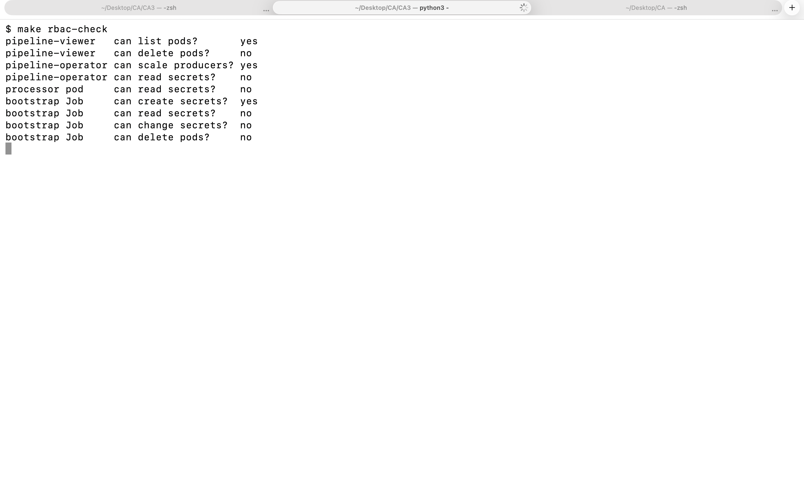

The processor pod has no token at all, which is the strongest form of "cannot read Secrets" (the check is in *Secrets*, above). That the other pods in the table have none either is read from the manifests, not measured pod by pod.

### Encryption at rest

Mounting a Secret as a file protects it inside the pod. Kubernetes keeps Secrets in its database, and by default that database holds them unencrypted (the base64 that `kubectl get secret -o yaml` shows is an encoding, not protection). k3s can encrypt them (`secrets-encryption`, AES-CBC, the key `aescbckey`). The first file shows the setting, the second looks at the database itself (the cluster database of k3s is a file on the server machine, and every Kubernetes object is a row in it):

<!-- from: evidence/step9-secrets-encryption.txt -->
```text
ca3-server | CHANGED | rc=0 >>
Encryption Status: Enabled
Current Rotation Stage: start
Server Encryption Hashes: All hashes match

Active  Key Type  Name
------  --------  ----
 *      AES-CBC   aescbckey
```

📄 [View the full text file: step9-secrets-encryption.txt](evidence/step9-secrets-encryption.txt)

<!-- from: evidence/step10-secrets-at-rest.txt -->
```text
SUMMARY secrets=13 encrypted=13 with_readable_words=0 configmaps=9 readable=9
...
OK: 13 of 13 Secrets are stored encrypted in the cluster database
OK: no stored Secret has a readable word in it (password, username, tls.key, ca.crt, BEGIN)
OK: the control: 9 of 9 ConfigMaps are stored readable, so this method does show plain text when there is some
...
RESULT: PASS - 13 Secrets are stored encrypted in the cluster database, and the control (ConfigMaps) is readable
```

📄 [View the full text file: step10-secrets-at-rest.txt](evidence/step10-secrets-at-rest.txt)

The check reads only the start of each row and prints no value. Its control is the nine ConfigMaps, which nothing encrypts: the word `ConfigMap` must be readable in their rows, and it is, so the method does show plain text when there is some. The key is on the same machine as the database. So this protects a copy of the database file taken without the key (a backup of the database alone, say). It does not protect against someone who can read the whole server machine or a full disk image; a key held in an external service (a KMS) would be the next step.

### What the security work does not cover

- **No rotation.** The CA's private key is never stored, and the Job makes all 13 Secrets or none, so a certificate (or a password) cannot be replaced while the data stays. The only way to new ones is `make down` and `make up`. `runbook.md` says what a production system would do, and [step7-operator-steps.txt](evidence/step7-operator-steps.txt) shows the end dates (364 days left on the day of the check) and says that rotation was **not** run.
- **No Kafka ACLs.** Every client that holds a certificate signed by the CA can read and write every topic. The pipeline uses one topic.
- **MongoDB clients use passwords, not certificates** (`--tlsAllowConnectionsWithoutCertificates`).
- **One Secret value is in an environment variable:** the login of the MongoDB metrics reader (see above).
- **Monitoring traffic is plain HTTP** inside the cluster.
- **Grafana and Prometheus are not published.** They are reached with `kubectl port-forward` (`make grafana`, `make prometheus`), which needs the kubeconfig. `make grafana-login` prints the Grafana login from the Secret `grafana-admin`.
- **The containers' root file system is writable** (`readOnlyRootFilesystem` is not set), and there is no admission policy beyond Pod Security.
- **A person who may create pods in the namespace** can give a pod the label of a trusted pod and so use its network rights. The NetworkPolicies trust labels.

## Prerequisites

The computer that runs the commands needs the tools below. The versions are the ones on the computer that ran every test of CA3 (a MacBook Air, macOS); other versions were not tried. The list is the saved output of `step9-tool-versions.txt`:

<!-- from: evidence/step9-tool-versions.txt -->
```text
macOS: 26.5
make: GNU Make 3.81
terraform: Terraform v1.16.3
ansible: ansible [core 2.21.4]
kubectl: Client Version: v1.37.1
kubeconform: v0.8.0
aws: aws-cli/2.36.49 Python/3.14.7 Darwin/25.5.0 source/arm64
python3: Python 3.13.2
openssl: OpenSSL 3.0.16 11 Feb 2025 (Library: OpenSSL 3.0.16 11 Feb 2025)
ssh: OpenSSH_10.2p1, LibreSSL 3.3.6
git: git version 2.50.1 (Apple Git-155)
PyYAML: 6.0.2
```

📄 [View the full text file: step9-tool-versions.txt](evidence/step9-tool-versions.txt)

| Tool | Needed for |
|---|---|
| `make`, Python 3 with PyYAML (`pip3 install pyyaml`), `kubectl` | `make verify` and every test script. With only these three, `make verify` runs with no cluster and no AWS account. |
| `kubeconform` | `make validate` only (the schema check of every manifest) |
| Terraform, Ansible, the AWS CLI and `ssh` | `make cluster-up`, `make cluster-down`, `make scan` and `make teardown` (everything that touches AWS) |
| `openssl` | `make operator-steps` (reads the certificate end dates) |

**AWS.** A dedicated IAM user (not the root user) whose credentials are set up with `aws configure`. It must be allowed to create and delete EC2 and VPC resources in `us-east-2`, and to call `tag:GetResources` (the cleanup scan uses it; this was the missing permission of CA2). The three machines are `t3.medium` and cost about $0.15 an hour together. Nothing else in AWS is used.

**No Docker.** The three application images are built by GitHub Actions and are public on `ghcr.io`, so the cluster pulls them without a login and there is no pull Secret to manage.

**Operating system.** Everything was tested on macOS. Linux should work (nothing is Mac-specific except the way the tests were launched), but it was not tried.

## Secret setup

There is nothing to prepare. No password, key or certificate is created on your computer or written in a file of this repository. The first `make up` applies the Job `bootstrap`, which makes the 13 Secrets inside the cluster (see *Security and access controls*), and the pods that need them start as soon as they exist.

Two logins can be read by a person who may read Secrets in the namespace (the administrator of the cluster):

```bash
cd CA3
make grafana-login        # prints the Grafana user name and password (from the Secret grafana-admin)
kubectl -n ca3 get secret restapi-login -o jsonpath='{.data.username}' | base64 --decode; echo
```

The password of the REST API is read the same way, with `.data.password`. Do not paste it into a file that is committed. `make rest-check`, `make smoke` and `make rest-evidence` read the login from the Secret by themselves and never print the password.

A password or a certificate cannot be changed while the data stays; that is a known limitation (*Known limitations*).

## How to deploy

**1. Check the files (no cluster needed).**

```bash
cd CA3
make verify        # manifests, programs, cluster code, documents and evidence against each other
make validate      # every manifest against the Kubernetes schemas (needs kubeconform)
```

[step9-validate.txt](evidence/step9-validate.txt) is the saved output of `make validate`: 85 resources found, 85 valid, none invalid.

**2. Build the cluster.** One command makes the network, the firewall, the key pair and the three machines (Terraform), then installs k3s on them (Ansible) and writes `.secrets/kubeconfig.yaml`, which every later command uses.

```bash
cd CA3
make cluster-up
```

This is the end of a real first run from nothing (the second, identical run is in *Idempotency* below):

<!-- from: evidence/step3-rebuild-cluster-up.txt -->
```text
Apply complete! Resources: 19 added, 0 changed, 0 destroyed.
...
ca3-agent-1                : ok=10   changed=5    unreachable=0    failed=0    skipped=0    rescued=0    ignored=0
ca3-agent-2                : ok=9    changed=5    unreachable=0    failed=0    skipped=0    rescued=0    ignored=0
ca3-server                 : ok=15   changed=7    unreachable=0    failed=0    skipped=0    rescued=0    ignored=0
...
make cluster-up took 2 min 28 s
```

📄 [View the full text file: step3-rebuild-cluster-up.txt](evidence/step3-rebuild-cluster-up.txt)

`make cluster-status` then shows three nodes `Ready`:

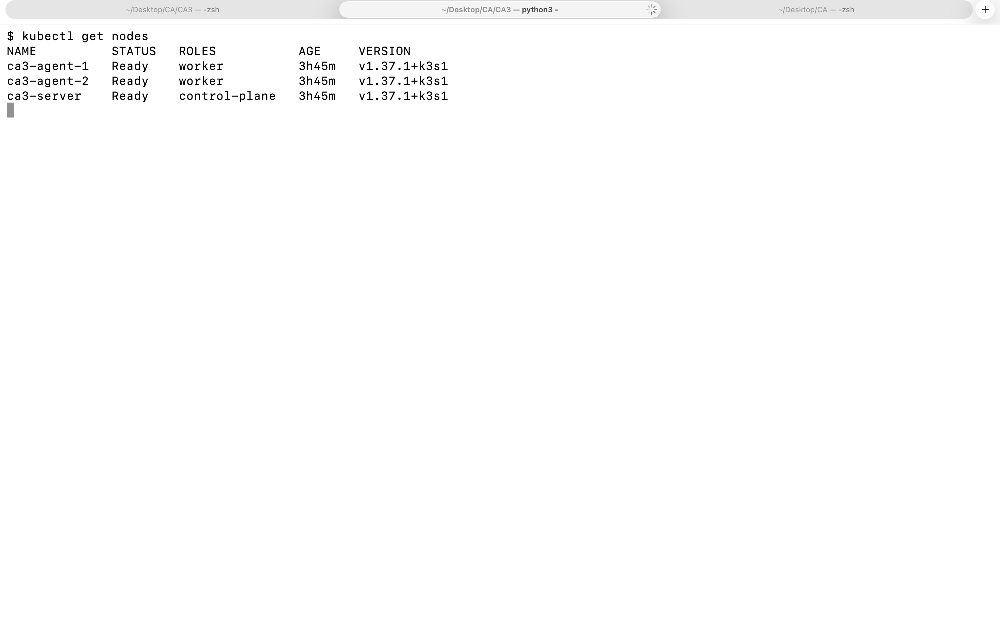

**3. Put the application on it.**

```bash
cd CA3
make up
```

`make up` runs `kubectl apply -k .` and waits for each part in order: the setup Job, MongoDB, Kafka, the processor, the REST API, the replay Job (it sends the 5,000 events of the dataset once), and the monitoring. If the first apply reports that the finished Job `bootstrap` cannot be changed, it deletes that Job and applies again. It ends with a line that says what to run next. This is a real first run on a fresh cluster (this version of the stack was the first one, before the monitoring was added, so it created 45 objects):

<!-- from: evidence/step3-rebuild-up.txt -->
```text
namespace/ca3 created
...
Stack is up. Call the REST API from this computer with:  make rest-check
make up took 1 min 0 s
```

📄 [View the full text file: step3-rebuild-up.txt](evidence/step3-rebuild-up.txt)

Adding the monitoring to that running stack created the 40 new objects and left the 45 old ones untouched. That is the point of declarative files: [step4-up.txt](evidence/step4-up.txt) holds 40 lines `created` and 45 lines `unchanged`. The full 85-object stack was built on a fresh cluster later as well (on Friday and again on Sunday); the output of those first runs was not saved, but the second run on the Sunday cluster is, and it is in *Idempotency*.

**4. Look at it.**

```bash
cd CA3
make status      # everything in the namespace ca3
make get-all     # everything in every namespace
```

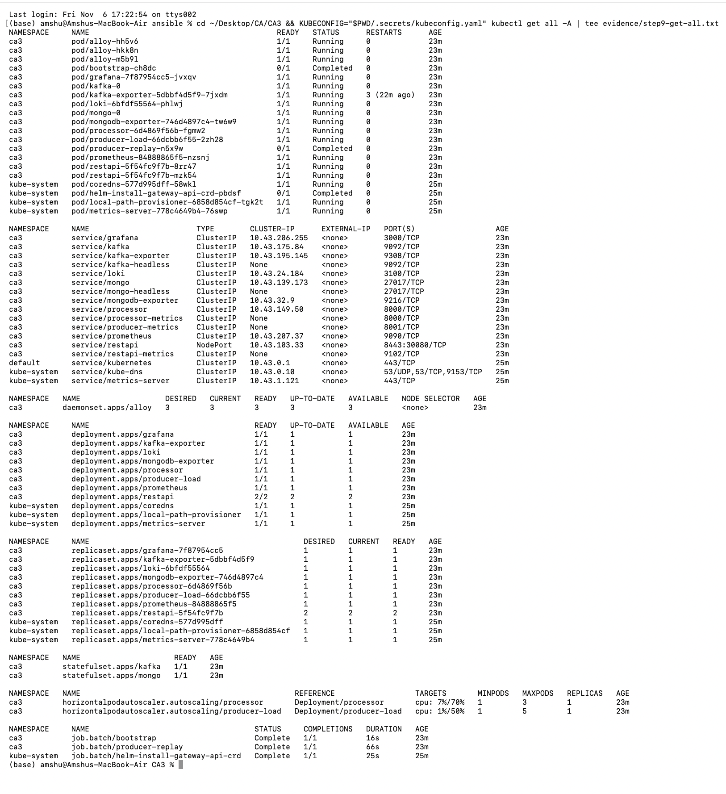

The pods of the namespace, from the saved output of `make get-all`:

<!-- from: evidence/step9-get-all.txt -->
```text
NAMESPACE     NAME                                          READY   STATUS      RESTARTS      AGE
ca3           pod/alloy-hh5v6                               1/1     Running     0             23m
ca3           pod/alloy-hkk8n                               1/1     Running     0             23m
ca3           pod/alloy-m5b9l                               1/1     Running     0             23m
ca3           pod/bootstrap-ch8dc                           0/1     Completed   0             23m
ca3           pod/grafana-7f87954cc5-jvxqv                  1/1     Running     0             23m
ca3           pod/kafka-0                                   1/1     Running     0             23m
ca3           pod/kafka-exporter-5dbbf4d5f9-7jxdm           1/1     Running     3 (22m ago)   23m
ca3           pod/loki-6bfdf55564-phlwj                     1/1     Running     0             23m
ca3           pod/mongo-0                                   1/1     Running     0             23m
ca3           pod/mongodb-exporter-746d4897c4-tw6w9         1/1     Running     0             23m
ca3           pod/processor-6d4869f56b-fgmw2                1/1     Running     0             23m
ca3           pod/producer-load-66dcbb6f55-2zh28            1/1     Running     0             23m
ca3           pod/producer-replay-n5x9w                     0/1     Completed   0             23m
ca3           pod/prometheus-84888865f5-nzsnj               1/1     Running     0             23m
ca3           pod/restapi-5f54fc9f7b-8rr47                  1/1     Running     0             23m
ca3           pod/restapi-5f54fc9f7b-mzk54                  1/1     Running     0             23m
```

📄 [View the full text file: step9-get-all.txt](evidence/step9-get-all.txt)

Sixteen pods: 14 `Running` (three of them are the log collector, one per machine) and the two Jobs `Completed`. `kafka-exporter` shows 3 restarts in its first minutes, while Kafka was still starting. I did not examine the cause, and the metric it provides (the consumer lag) was there when it was asked ([step4-metrics-check.txt](evidence/step4-metrics-check.txt)).

## Calling the API

The REST API is the one published part of the stack: HTTPS on port 30080 of any of the three machines, from the administrator's address only. It has five endpoints:

| Endpoint | Answer | Login |
|---|---|---|
| `GET /health` | `{"status":"ok"}`: the program is alive (the liveness probe) | no |
| `GET /ready` | `{"status":"ready"}` when MongoDB answers (the readiness probe) | no |
| `GET /stats` | how many flows are stored | yes |
| `GET /alerts` | up to 50 flows whose label is not `BENIGN` | yes |
| `GET /events/<trace id>` | the one flow that carries that id (`404` with a JSON body when there is none) | yes |

The certificate is signed by the private CA of the stack, so a caller must trust that CA (`ca.crt` below), and the certificate carries the name `restapi.ca3.test`, so a call to a machine's address uses `--resolve`. The smoke test prints this exact command with the address filled in:

<!-- from: evidence/step5-smoke.txt -->
```text
      the same request with curl:  curl -s --cacert ca.crt --resolve restapi.ca3.test:30080:<server-public-ip> -u USER:PASSWORD https://restapi.ca3.test:30080/events/smoke-1106-190230-548c   (README: Calling the API)
```

📄 [View the full text file: step5-smoke.txt](evidence/step5-smoke.txt)

```bash
cd CA3
kubectl -n ca3 get secret pki-ca -o jsonpath='{.data.ca\.crt}' | base64 --decode > ca.crt
# USER and PASSWORD are the two values of the Secret restapi-login; <node-address> is the public address of any machine
curl -s --cacert ca.crt --resolve restapi.ca3.test:30080:<node-address> -u USER:PASSWORD https://restapi.ca3.test:30080/stats
```

`make rest-evidence` makes every one of these calls, and the calls that must fail, and saves requests, answers, the REST pods' log lines, Prometheus' counters and the drill's recovery numbers in one file. Two of its answers, as saved:

<!-- from: evidence/step7-rest-evidence.txt -->
```text
### GET /stats  (how many flows are stored; login needed)
request:   GET https://<node-address>:30080/stats
           Authorization: Basic <user and password from the Secret restapi-login>
answer:    HTTP 200   (112 ms)   expected: 200
           {"collection":"flows","database":"ca3","documents":370359}
...
### GET /stats without a login
request:   GET https://<node-address>:30080/stats
           (no Authorization header: no login sent)
answer:    HTTP 401   (119 ms)   expected: 401
           {"error":"login required"}
...
### GET /stats when the client does not trust the certificate authority of the stack
answer:    no answer   expected: no answer (the TLS handshake must fail)
           SSLCertVerificationError: [SSL: CERTIFICATE_VERIFY_FAILED] certificate verify failed: unable to get local issuer certificate (_ssl.c:1028)
```

📄 [View the full text file: step7-rest-evidence.txt](evidence/step7-rest-evidence.txt)

The same file shows the REST pods' log lines for those calls (section 2), what Prometheus counted for each endpoint and status (section 3), and what the resilience drill saw while a REST pod and MongoDB were replaced (section 4). That is the "REST evidence" the assignment asks for: request and response, logs, metrics and failure-recovery behavior in one place. The part about recovery is repeated, with the numbers, in *Resilience drill*.

## Validation: the smoke test and other checks

**The smoke test** (`make smoke`) is the first thing to run after `make up`, and the thing that says whether the pipeline works end to end. It sends **one event with a unique id** through every stage, then looks for that same id at each stage, so it passes only if that very event went all the way through (a test that only checks that pods are `Running` would also pass with a broken pipeline). The six steps and the result of a real run:

<!-- from: evidence/step5-smoke.txt -->
```text
[1/6] The stack is running
...
[2/6] Send one event with a unique trace id
...
[3/6] Kafka holds it
...
[4/6] The processor read it and stored it
...
[5/6] MongoDB holds the record
...
[6/6] The REST API returns it to this computer
...
RESULT: PASS - event smoke-1106-190230-548c went producer -> Kafka (partition 1, offset 1667) -> processor -> MongoDB -> REST API in 25 s
```

📄 [View the full text file: step5-smoke.txt](evidence/step5-smoke.txt)

The event went into partition 1 at offset 1667 of the topic, and the processor reported the same partition and offset when it stored it. The saved answer of the API for that event is [step5-smoke-response.json](evidence/step5-smoke-response.json).

**The same event in the logs.** `make logs-trace TRACE=<id>` asks Loki for every log line that carries the id and prints them in time order. One id, one story across three programs:

<!-- from: evidence/step5-trace.txt -->
```text
  19:02:32.851  producer   info    {"ts":"2026-11-06T19:02:32.851+00:00","level":"info","service":"producer","msg":"sent","trace_id":"smoke-1106-190230-548c","topic":"network-flows","partition":1,"offset":1667}
...
  19:02:32.855  processor  info    {"ts":"2026-11-06T19:02:32.854+00:00","level":"info","service":"processor","msg":"stored","trace_id":"smoke-1106-190230-548c","topic":"network-flows","partition":1,"offset":1667}
...
  19:02:52.474  restapi    info    {"ts":"2026-11-06T19:02:52.474+00:00","level":"info","service":"restapi","msg":"request","method":"GET","path":"/events/smoke-1106-190230-548c","status":200,"duration_ms":9.3,"trace_id":"smoke-1106-190230-548c"}
...
RESULT: PASS - 3 log lines with this event id, from processor, producer, restapi: one id, one story across programs
```

📄 [View the full text file: step5-trace.txt](evidence/step5-trace.txt)

**The other checks.** Each one is a command, ends with a `RESULT:` line, and saves its output in `evidence/`:

| Command | What it checks | Saved output | Result |
|---|---|---|---|
| `make rest-check` | the API from outside, through each of the 3 machines: HTTPS only, login needed, plain http and an untrusted CA refused | [step3-rest-check.txt](evidence/step3-rest-check.txt) | PASS, 3 of 3 nodes |
| `make exposure-check` | which of 11 ports answer on each machine | [step3-exposure.txt](evidence/step3-exposure.txt) | PASS, only 22, 6443 (server) and 30080 |
| `make rbac-check` | nine questions about who may do what | [step3-rbac.txt](evidence/step3-rbac.txt) | all nine answers as designed |
| `make netpol-check`, `make netpol-control` | 169 connections against the policies, and the same with the policies deleted | [step7-netpol-check.txt](evidence/step7-netpol-check.txt), [step7-netpol-control.txt](evidence/step7-netpol-control.txt) | PASS, PASS |
| `make heal-check` | delete a REST pod, stop the processor, delete `mongo-0`, delete `kafka-0`, and compare data and disks | [step3-heal.txt](evidence/step3-heal.txt) | PASS, 4 of 4 |
| `make metrics-check` | Prometheus, Loki and Grafana answer, the numbers and logs exist, the dashboard is loaded | [step4-metrics-check.txt](evidence/step4-metrics-check.txt) | PASS, 4 of 4 |
| `make dry-run` | what the next `make up` would change | [step9-dry-run-server.txt](evidence/step9-dry-run-server.txt), [step9-dry-run-client.txt](evidence/step9-dry-run-client.txt) | everything `unchanged` |

The self-healing test (`make heal-check`) ran on the first version of the stack, before the monitoring existed; the resilience drill (*Resilience drill*) repeated the idea on the full stack, for every tier, with numbers.

**What was tested and what was not.** Every command above ran on the real three-machine cluster in AWS, and the output saved here is that output. The tests do not cover: losing a whole machine, cutting the network between machines, a second broker or a second database, the full 191,000-row dataset (the pipeline replays the 5,000-row sample), or any operating system but macOS for the operator's computer.

## Observability

Two kinds of signals leave the pipeline, and they take two roads. **Numbers** (how many events per second, how far behind the processor is) go to Prometheus and are drawn by Grafana. **Log lines** (what a program said, with the time and the pod) go to Loki through Alloy, and are searched in Grafana too. Everything runs in the namespace `ca3` and is created by `make up`.

| Part | What it does | Version | Where | Keeps |
|---|---|---|---|---|
| Prometheus | reads the numbers of every program every 5 seconds | v2.55.1 | [`observability/prometheus.yaml`](observability/prometheus.yaml) | 24 hours |
| Grafana | draws the dashboard `CA3 pipeline`; searches the logs | 11.3.0 | [`observability/grafana.yaml`](observability/grafana.yaml), [`observability/grafana/dashboards/pipeline.json`](observability/grafana/dashboards/pipeline.json) | nothing of its own: the data sources and the dashboard are provisioned from files |
| Loki | stores the log lines and answers searches | 3.3.0 | [`observability/loki.yaml`](observability/loki.yaml) | 24 hours |
| Alloy | reads the log of every pod on its machine and sends it to Loki (a DaemonSet: one pod per machine, 3) | v1.5.0 | [`observability/alloy.yaml`](observability/alloy.yaml) | nothing |
| kafka-exporter | turns Kafka's own bookkeeping into the number `kafka_consumergroup_lag` | v1.9.0 | [`observability/kafka-exporter.yaml`](observability/kafka-exporter.yaml) | nothing |
| mongodb-exporter | turns MongoDB's counters into numbers, among them the inserts | 0.40.0 | [`observability/mongodb-exporter.yaml`](observability/mongodb-exporter.yaml) | nothing |

The producer, the processor and the REST API publish their own numbers on a `/metrics` port (8001, 8000 and 9102). Prometheus finds the pods through the headless Services named `*-metrics`, so a new pod is picked up when the autoscaler adds it, with no change to a file. Loki and Prometheus keep their data on `emptyDir` volumes: **when their pod is deleted, their history is gone.** That is a deliberate limit for a course project (no disk to manage, nothing left over after `make down`), and the reason why the pictures in this README were taken while the cluster still ran. Grafana and Prometheus are not published: `make grafana` and `make prometheus` open them on your own computer through `kubectl port-forward`, and `make grafana-login` prints the Grafana login.

```bash
cd CA3
make grafana         # then open http://localhost:3000 and log in with: make grafana-login
make metrics-check   # asks Prometheus, Loki and Grafana if everything is there
```

**The check that monitoring itself works** (`make metrics-check`) asks the three programs from inside their pods and ends with a verdict. It confirms that every target is up, that the seven numbers the assignment names exist, that logs of 12 programs are in Loki, and that Grafana has the dashboard and both data sources:

<!-- from: evidence/step4-metrics-check.txt -->
```text
[1/4] Prometheus reads every program
...
[2/4] The numbers the assignment names exist
...
[3/4] Loki holds the logs of every program
...
[4/4] Grafana has the dashboard and both data sources
      producer          1 of 1 targets up
      processor         1 of 1 targets up
      restapi           2 of 2 targets up
      kafka-exporter    1 of 1 targets up
      mongodb-exporter  1 of 1 targets up
      prometheus        1 of 1 targets up
...
      producer rate, events per second (all producers)        0
      consumer lag of the group processor, messages           0
      database inserts per second (MongoDB's own count)       0
      events stored by the processor since it started         5000
      REST requests per second                                0.2545
      REST server errors per second (status 5xx)              0
      REST latency, 95% of the answers faster than (seconds)  0.0048
...
      programs with logs in Loki: alloy, bootstrap, grafana, kafka, kafka-exporter, loki, mongo, mongodb-exporter, processor, producer, prometheus, restapi
...
      dashboards found: CA3, CA3 pipeline
...
RESULT: PASS - 4 of 4 monitoring checks passed
```

📄 [View the full text file: step4-metrics-check.txt](evidence/step4-metrics-check.txt)

The zero values are honest: the check ran on a quiet stack (the replay Job had finished and the load generator was idle), so the producer rate, the lag and the insert rate were 0, and the REST request rate was only the health probes. They are not missing: a missing number would make the check fail.

### The dashboard

The dashboard `CA3 pipeline` has 7 rows and 23 panels. It is a file in the repository, loaded when Grafana starts, so it is the same on every cluster. The assignment names four things; this is where each one is:

| The assignment asks for | Panel | What it asks Prometheus |
|---|---|---|
| Producer rate: events emitted per second | "Producer rate: events per second" | `sum(rate(producer_messages_sent_total[$__rate_interval]))`, and the same per pod |
| Kafka consumer lag | "Consumer lag: messages not read yet" | `sum by (topic) (kafka_consumergroup_lag{group="processor"})` |
| Database inserts per second | "Database inserts per second" | `sum(rate(mongodb_ss_opcounters{legacy_op_type="insert"}[$__rate_interval]))` (MongoDB's own count), next to the processor's own count of what it stored |
| REST interface: request rate | "REST API: requests per second" | `sum by (status) (rate(restapi_requests_total[2m]))`, one line per status code |
| REST interface: error rate | "REST API: errors per second" | the same counter, for the status codes 4xx and for 5xx |
| REST interface: latency | "REST API: how long an answer takes (seconds)" | the 50th, 95th and 99th percentile of `restapi_request_duration_seconds_bucket` |

The other rows show what an operator needs next: how many pods are running (what the autoscalers did), how long a batch waits for Kafka and for MongoDB, the time from the producer's send to the stored record, whether each program is connected, the seconds since the last stored event, and the log panels (below). The rows are *Right now*, *Producers*, *Kafka and the processor*, *MongoDB*, *REST API*, *Is everything alive?* and *Logs (Loki)*.

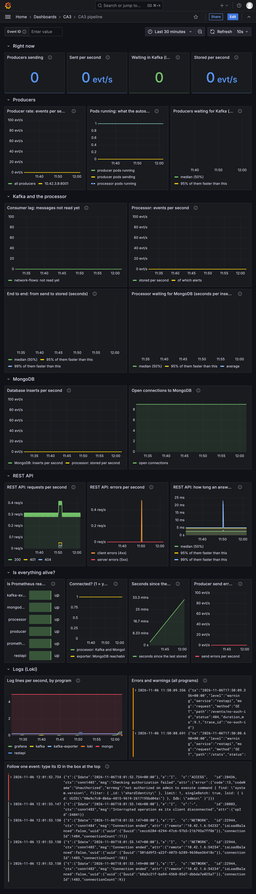

The next two pictures are the dashboard during the tests, with the producer rate, the lag, the inserts and the REST lines on one page. The first covers the scaling test, the second the resilience drill:

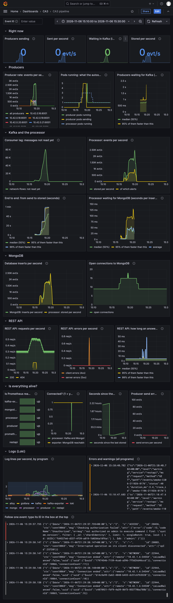

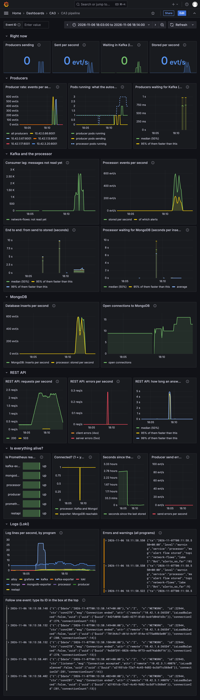

**A mistake in the first version of the dashboard, found by looking.** The dashboard was written with the AI (Claude). The first version drew two graphs stacked (the REST requests per second and the log lines per second). With stacking, the idle health checks looked like a solid band, and the `401` and `404` lines that the AI had said would be visible were not. `make verify` cannot see that, and the AI had described the graphs before looking at a real picture of them. It was found by looking at the real pictures ([step4-grafana-before-1.pdf](evidence/step4-grafana-before-1.pdf) and [step4-grafana-before-2.pdf](evidence/step4-grafana-before-2.pdf) are the full-page captures of the first version), fixed in the dashboard file, and the picture above is the fixed one.

**One honest gap.** There is no Alertmanager: nothing sends a message when a number crosses a line. The goals in `slo.json` are checked by the tests when they run, not watched while the stack idles. And the monitoring runs in the same cluster that it watches, so when the whole cluster is gone, so is the monitoring; the one outside check is `make rest-check`, which calls the API from the administrator's computer.

## Where to find logs

The producer, the processor and the REST API write **one JSON line per event**, with the fields `ts` (the time, UTC), `level`, `service`, `msg`, and, where they apply, `trace_id`, `topic`, `partition` and `offset`. Kafka and MongoDB write their own formats. Alloy reads every pod's log through the Kubernetes API, adds the labels `namespace`, `pod`, `container`, `app` and `node`, and turns `level` and `service` of a JSON line into labels as well. The newest line of each program, as Loki keeps it:

<!-- from: evidence/step5-log-sample.txt -->
```text
processor
  labels: app=processor container=processor detected_level=info instance=ca3/processor-6d4869f56b-8qsrh:processor job=loki.source.kubernetes.pods level=info namespace=ca3 node=ca3-agent-1 pod=processor-6d4869f56b-8qsrh service=processor service_name=processor
  line:   {"ts":"2026-11-06T19:02:32.854+00:00","level":"info","service":"processor","msg":"stored","trace_id":"smoke-1106-190230-548c","topic":"network-flows","partition":1,"offset":1667}
...
restapi
  labels: app=restapi container=restapi detected_level=info instance=ca3/restapi-5f54fc9f7b-87bbr:restapi job=loki.source.kubernetes.pods level=info namespace=ca3 node=ca3-agent-1 pod=restapi-5f54fc9f7b-87bbr service=restapi service_name=restapi
  line:   {"ts":"2026-11-06T19:02:52.597+00:00","level":"info","service":"restapi","msg":"request","method":"GET","path":"/stats","status":200,"duration_ms":1.3}
...
kafka
  labels: app=kafka container=kafka detected_level=info instance=ca3/kafka-0:kafka job=loki.source.kubernetes.pods namespace=ca3 node=ca3-agent-1 pod=kafka-0 service_name=kafka
...
RESULT: PASS - Loki holds log lines with pod labels from all 5 programs; the 3 that write JSON also have the labels level and service
```

📄 [View the full text file: step5-log-sample.txt](evidence/step5-log-sample.txt)

The three programs that write JSON have the labels `level` and `service`; Kafka and MongoDB have the pod labels but not those two, because their lines are not JSON. (MongoDB's own JSON has different field names, and Alloy leaves it as it is.)

| What you want | How |
|---|---|
| the end of the processor's log | `make logs` |
| the end of any pod's log | `kubectl -n ca3 logs <pod> -c <container> --tail=50` (the container is named like the program: `kafka`, `mongo`, `processor`, `restapi`, `producer`) |
| the log of the run before a restart | `kubectl -n ca3 logs <pod> --previous` |
| every line of one event, across all programs | `make smoke` prints an id, then `make logs-trace TRACE=<id>`; in Grafana type the id into the box "Follow one event" at the top of the dashboard |
| errors and warnings from every pod, also from pods that no longer exist | the panel "Errors and warnings (all programs)", or Grafana > Explore > Loki with `{namespace="ca3", level=~"error\|warning"}` |
| why a pod is not ready | `make diagnose`: states, events and the end of the log, read-only |

A pod that is deleted takes its own log with it, but Loki has the lines for 24 hours, so a deleted pod's last words can still be read, for a day. That was used in the drill ([step7-drill-observability.txt](evidence/step7-drill-observability.txt)).

**One event, in the log search of Grafana.** The first picture is the search for the id of the smoke test; it finds the three lines of [step5-trace.txt](evidence/step5-trace.txt) in the logs of three programs. The second picture is a search for the warnings of all programs: at the top are the `401` and `404` answers that `make rest-check` provokes on purpose.

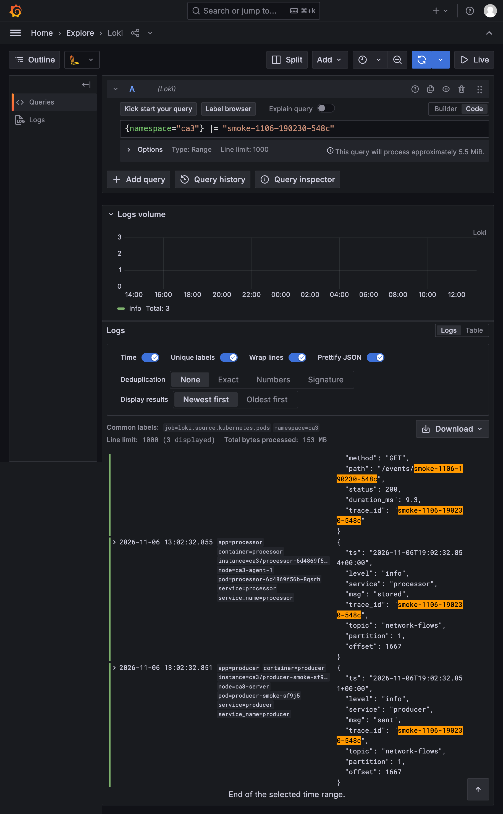

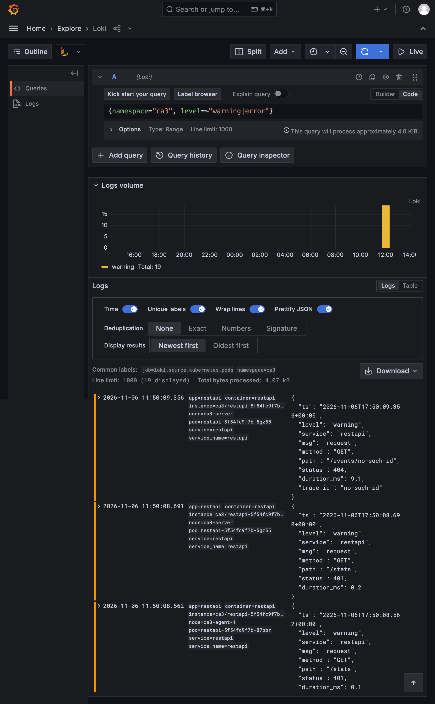

**A log search for `error` is not a health check.** The first search that the AI suggested, for the word `error` over all programs, would not come back empty on a healthy stack. MongoDB writes a line for every request that the metrics reader's small account is refused (`Checking authorization failed`, code 13), about five lines a second, and those lines hold the word `error` as the name of a field. The metrics still arrive (the account is allowed what it needs), so the lines are noise, but they are there all the time. The search below leaves them out with `!=`, and the saved operator steps show that it then finds nothing on a quiet stack (`0 lines in 0 pods`):

```text
{namespace="ca3"} |~ "(?i)(error|exception|traceback|refused|timed out)" != "Checking authorization failed"
```

After a drill the same search finds lines on purpose: the pods that lost MongoDB or Kafka said so. This picture is that search over the minutes of the drill:

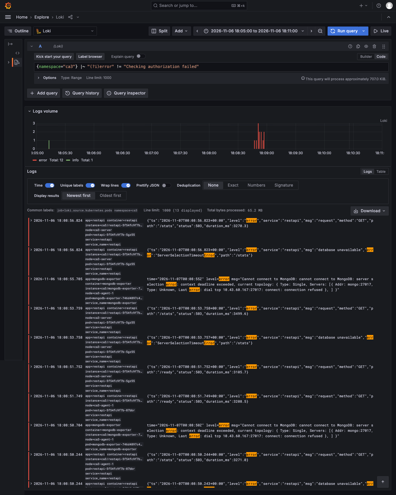

<!-- from: evidence/step7-operator-steps.txt -->
```text
   $ Loki:  {namespace="ca3"} |~ "(?i)(error|exception|traceback|refused|timed out)" != "Checking authorization failed"      (the last 15 minutes)
       0 lines in 0 pods.
```

📄 [View the full text file: step7-operator-steps.txt](evidence/step7-operator-steps.txt)

## Autoscaling

Two Deployments have a Horizontal Pod Autoscaler (HPA): the producers (the load generator) and the processor. The REST API has two fixed pods and no autoscaler, so that it keeps answering while one of them is replaced; Kafka and MongoDB have one pod each and are not scaled (see *Known limitations*).

### Why these tiers, and why these numbers

In class the point was made three ways. Replicas are "a means, not just an outcome". Say which goals matter (the *service level objectives*, "SLO": a goal that a test can measure) and scale what those goals need, because "scaling the wrong thing can actually slow things down". And weigh the cost of every extra copy ("is this mission critical?", the "rule of three"). So each tier below has a reason that comes from what this pipeline is for: **a network-flow alert should be readable from the REST API soon after the traffic happened, and the pipeline should not fall behind.** The goals are numbers in [`slo.json`](slo.json), each with a sentence saying why that number. The tests check them, and the last column is copied from the saved results of the scaling test ([step6-scale-results.md](evidence/step6-scale-results.md)) and of the drill ([step7-drill-results.md](evidence/step7-drill-results.md)).

| Tier | Autoscaler? | The reason, from what the pipeline is for | The goals that check it | This run |
|---|---|---|---|---|
| Producers (the load generator) | yes, 1 to 5 | In a real system this tier stands for the many sources that send traffic records, and a burst of them is the case the pipeline has to absorb. A producer in a tight loop is limited by its CPU, so its CPU says directly how much work it does. | all producer pods ready within 180 s of the autoscaler being freed; back to 1 pod within 180 s after the load stops | 41 s; 36 s |
| Processors | yes, 1 to 3 | The processor decides how fast an event becomes readable, so it is where a backlog is paid off. The ceiling is the 3 partitions of the topic: one partition is read by one processor at a time. | the backlog below 1,000 messages within 300 s after the load stops; a new event readable within 60 s; back to 1 pod within 600 s | 54 s; 16.0 s (0.1 s with one producer); 175 s |
| REST API | no: 2 fixed pods | It is the part a person uses, so its goals are about answering and about speed. With 2 pods and no autoscaler it kept all three of its goals, under full load and while a pod was replaced, so the numbers gave no reason for a third pod, whose CPU and memory would come from machines that were at 74% to 80% CPU during the load. Two pods, not one, so that one can be replaced while the other answers. | at least 99% of the calls answered; 95% of the answers within 1,000 ms; at most 5 s in a row without an answer while one pod is replaced | 100% (39 of 39); 205 ms; 0.0 s (0 of 13 calls failed) |
| Kafka and MongoDB | no: 1 pod each | They keep state, and scaling them means replication, which this project does not have (see *Known limitations*). The CPU table of the run gave no reason to try: the processors were at 99% of their CPU limit, Kafka at 25% and MongoDB at 7%. | a deleted pod is replaced within 60 s and no data is lost | Kafka 23 s, MongoDB 13 s; 5 of 5 tiers kept all their data |

### The rules and the manifests

| Autoscaler | Pods | Rule | Why this number |
|---|---|---|---|
| `producer-load` (the load generator) | 1 to 5 | average CPU above 50% of the request: add pods, up to doubling every 15 s; after 30 s of low CPU remove all but one, every 15 s | a producer in a tight loop is CPU-bound by design, so CPU is the right signal for it. 5 is what the three small machines carried in the test (they were at 74% to 80% CPU with 5). |
| `processor` | 1 to 3 | average CPU above 70% of the request: add pods | the topic has 3 partitions and one partition is read by one processor at a time, so a fourth processor would have nothing to read |

The manifest of the producers' autoscaler, [`producer/load/hpa.yaml`](producer/load/hpa.yaml), as it is in the repository (the comments at the top of the file are left out here):

```yaml
apiVersion: autoscaling/v2
kind: HorizontalPodAutoscaler
metadata:
  name: producer-load
  namespace: ca3
  labels:
    app.kubernetes.io/name: producer
    app.kubernetes.io/component: autoscaler
    app.kubernetes.io/part-of: ca3-pipeline
  annotations:
    description: "Scales the load-generating producers from 1 to 5 pods at 50 percent CPU, and back to 1 within about a minute of the load stopping. Part of make up; it keeps one pod while the load is off"
spec:
  scaleTargetRef:
    apiVersion: apps/v1
    kind: Deployment
    name: producer-load
  minReplicas: 1
  maxReplicas: 5
  metrics:
    - type: Resource
      resource:
        name: cpu
        target:
          type: Utilization
          averageUtilization: 50
  behavior:
    scaleUp:
      stabilizationWindowSeconds: 0
      policies:
        - type: Percent
          value: 100
          periodSeconds: 15
    scaleDown:
      stabilizationWindowSeconds: 30
      policies:
        - type: Percent
          value: 100
          periodSeconds: 15
```

The processors' autoscaler, [`processor/hpa.yaml`](processor/hpa.yaml):

```yaml
apiVersion: autoscaling/v2
kind: HorizontalPodAutoscaler
metadata:
  name: processor
  namespace: ca3
  labels:
    app.kubernetes.io/name: processor
    app.kubernetes.io/component: autoscaler
    app.kubernetes.io/part-of: ca3-pipeline
  annotations:
    description: "Keeps the processor between 1 and 3 pods and adds pods above 70 percent CPU. The maximum is 3 because the topic has 3 partitions"
spec:
  scaleTargetRef:
    apiVersion: apps/v1
    kind: Deployment
    name: processor
  minReplicas: 1
  maxReplicas: 3
  metrics:
    - type: Resource
      resource:
        name: cpu
        target:
          type: Utilization
          averageUtilization: 70
  behavior:
    scaleUp:
      stabilizationWindowSeconds: 0
      policies:
        - type: Pods
          value: 1
          periodSeconds: 30
    # After 60 seconds of low CPU the autoscaler removes one pod every 30 seconds (3 pods -> 1 pod in about 2 minutes), so that the scaling
    # test can show the whole way back down. A longer wait would be the safer choice for a service whose load rises and falls in short waves.
    scaleDown:
      stabilizationWindowSeconds: 60
      policies:
        - type: Pods
          value: 1
          periodSeconds: 30
```

### CPU, not the consumer lag: what that misses

The assignment allows "CPU% or a custom metric (consumer lag)". In class the answer was that either is fine, that CPU is the easy one ("it doesn't really tell you anything except your machine is busy"), and that a custom metric would be preferred because it "means more". **Both autoscalers here use CPU**, which metrics-server (shipped with k3s) provides.

- **For the producers CPU is the right signal**, for the reason in the table: a load generator in a tight loop is limited by its CPU.
- **For the processors the lag would be the better signal.** It says directly that events are waiting, while CPU says only that the processor is busy. Using it needs a metrics adapter between Prometheus and the autoscaler, which is one more component to run and secure. I did not build it and did not test a lag-based rule, so I cannot say how it would behave.
- **What this leaves open:** the autoscaler does not look at the goals that say whether the pipeline does its job ("a new event is readable within 60 s", "the backlog is gone within 300 s of a burst"). The scaling test checks them and the dashboard draws the lag, but they do not decide. Both goals were met in this run. The price of the CPU rule is visible in the results below: the processors reached their maximum of 3 as soon as the load started, and 3 was still not enough to clear the backlog while the load lasted. Whatever the signal, 3 is the ceiling for the processors, because the topic has 3 partitions.

**The load is idle until the test switches it on.** `producer-load` is part of the stack, with `PRODUCER_IDLE=true`: its pod connects to Kafka and sends nothing, so the autoscaler holds it at one pod and the pipeline is quiet. Three small folders switch the load, each applied with `kubectl apply -k`:

| Folder | What it changes | Used for |
|---|---|---|
| `producer/load/` | the idle default (in the stack) | the "load off" state |
| `producer/loadtest-one/` | `PRODUCER_IDLE=false`, and the producers' autoscaler may not go above 1 pod | the "before" window: the same load on one pod |
| `producer/loadtest/` | `PRODUCER_IDLE=false`, the autoscaler's maximum is 5 | the "after" window: the autoscaler decides |

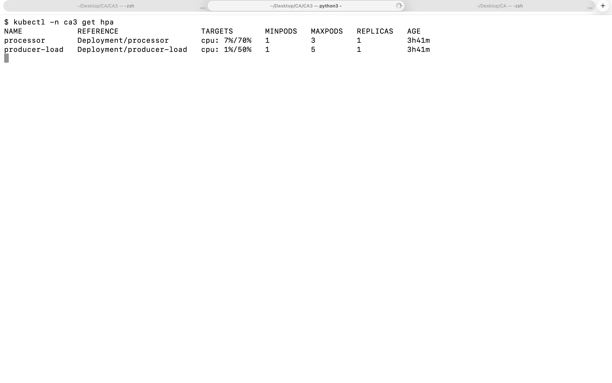

## How to run the scaling test

```bash
cd CA3
make scale-test      # about 7 minutes; load on with one producer pod, then the autoscaler, then the load off
make scale-report    # draws the table, the goals and the chart again from the saved files (needs no cluster)
make goals           # lists the goals (service level objectives) in slo.json
```

The test does this, in order, and measures each part (the number of each step is the one in its output):

1. **Checks** that the stack runs, that the REST API answers from this computer and that CPU numbers are available.
2. **Before:** the load on, one producer pod (the autoscaler may not add pods). It measures for 45 seconds.
3. **Ramp:** the same load, with the autoscaler free. Kubernetes adds producer pods until the CPU is low enough. It waits until the numbers of pods stop changing, then measures the larger set. This is **after**.
4. **Load off:** it watches the producers shrink back to one pod, the backlog in Kafka disappear and the processors shrink back. How long each takes is the "scale back down" part of the assignment.

While it runs, a second thread samples every 5 seconds (pods, producer rate from the pods' own log lines, records stored from the REST API's `/stats`, the backlog from Kafka, CPU from `kubectl top`) and every 15 seconds it saves the plain output of `kubectl get hpa`. In each window it also sends one tagged event and times how long it takes from Kafka to the REST API.

**The test protects the disks of the cluster.** The producers send as fast as their CPU limit allows, and a message is about 2.3 KB, so the test stops the load by itself when the producers have sent 1,000,000 messages, when `kafka-0` or `mongo-0` restarts, after 30 minutes, or on Ctrl-C (closing the Terminal window has the same effect), and it always switches the load off and checks that it is off before it ends. The run below sent hundreds of thousands of messages and stopped normally. It creates one small index on `trace_id` in MongoDB, so that finding a tagged event stays fast however many records the load adds; that is the one change it makes to the data.

### What `kubectl get hpa` showed over time

The assignment asks for `kubectl get hpa` over time. The test saved it every 15 seconds ([step6-scale-hpa-over-time.txt](evidence/step6-scale-hpa-over-time.txt), 134 lines). `TARGETS` is the current CPU over the target, in percent of what each pod asked for (its CPU request); `REPLICAS` is the number of pods. Five of the snapshots, one from each stage:

<!-- from: evidence/step6-scale-hpa-over-time.txt -->
```text
=== 21:16:46 UTC   +40 s   phase: before   (producer pods ready 1, processor pods ready 1) ===
NAME            REFERENCE                  TARGETS         MINPODS   MAXPODS   REPLICAS   AGE
processor       Deployment/processor       cpu: 371%/70%   1         3         1          3h48m
producer-load   Deployment/producer-load   cpu: 497%/50%   1         1         1          3h48m
...
=== 21:17:46 UTC   +100 s   phase: ramp   (producer pods ready 2, processor pods ready 3) ===
NAME            REFERENCE                  TARGETS         MINPODS   MAXPODS   REPLICAS   AGE
processor       Deployment/processor       cpu: 172%/70%   1         3         3          3h49m
producer-load   Deployment/producer-load   cpu: 499%/50%   1         5         2          3h49m
...
=== 21:18:30 UTC   +145 s   phase: after   (producer pods ready 5, processor pods ready 3) ===
NAME            REFERENCE                  TARGETS         MINPODS   MAXPODS   REPLICAS   AGE
processor       Deployment/processor       cpu: 493%/70%   1         3         3          3h49m
producer-load   Deployment/producer-load   cpu: 489%/50%   1         5         5          3h49m
...
=== 21:20:02 UTC   +237 s   phase: shrink   (producer pods ready 1, processor pods ready 3) ===
NAME            REFERENCE                  TARGETS         MINPODS   MAXPODS   REPLICAS   AGE
processor       Deployment/processor       cpu: 478%/70%   1         3         3          3h51m
producer-load   Deployment/producer-load   cpu: 16%/50%    1         5         5          3h51m
...
=== 21:21:47 UTC   +342 s   phase: cooldown   (producer pods ready 1, processor pods ready 2) ===
NAME            REFERENCE                  TARGETS       MINPODS   MAXPODS   REPLICAS   AGE
processor       Deployment/processor       cpu: 6%/70%   1         3         3          3h53m
producer-load   Deployment/producer-load   cpu: 1%/50%   1         5         1          3h53m
```

📄 [View the full text file: step6-scale-hpa-over-time.txt](evidence/step6-scale-hpa-over-time.txt)

Read down the `producer-load` rows: with the autoscaler held at one pod the CPU is at about 500% of the request; once it is free the pods go 1, 2, 4, 5 and the CPU per pod stays near 490% (it is still far above 50%, so the autoscaler stays at its maximum); after the load is off the CPU falls to 1% and the replicas fall to 1. The processors go 1, 2, 3 on their own, and fall back to 2, then 1, a minute or two after the producers did (the autoscaler waits before it removes a pod). The `REPLICAS` column of `kubectl get hpa` can lag a few seconds behind the pods that are ready; the header of each snapshot in the file also gives the number of pods that were ready at that moment.

The percentages are far above the targets because they are relative to the pods' CPU **requests**. A producer or a processor asks for 100m (a tenth of a core, so that the whole stack fits on three small machines) and may use up to 500m, so a pod that works flat out shows about 500%. A reading near 500% means "at its limit", not that something is wrong. It also means that a load generator in a tight loop always asks for the maximum number of pods, which is what this test wants.

### The measured result

The numbers below are copied from the results file written by the test ([step6-scale-results.md](evidence/step6-scale-results.md)). Producers x4.7, records stored x3.3:

<!-- from: evidence/step6-scale-results.md -->
```text
Run started 2026-11-06 21:16 (UTC). The load is the Deployment `producer-load`: producer pods that replay the dataset in a loop.
...
| Measurement | Before: 1 producer pod, the autoscaler held at 1 | After: 5 producer pods, autoscaler free | Change |
...
| Producer pods ready | 1 | 5 | x5.0 |
...
| Producers send, messages per second (all pods together, reported by the pods) | 566 | 2,644 | x4.7 |
...
| MongoDB stores, messages per second (growth of the record count) | 551 | 1,796 | x3.3 |
| Backlog in Kafka at the end of the window, messages | 1,432 | 71,024 |  |
| Time a new message would wait in the backlog, seconds (backlog / storing rate) | 2.6 | 39.6 |  |
| One tagged event: stored in Kafka until the REST API returns it, seconds | 0.1 | 16.0 | |
...
| Processor pods ready | 2 | 3 | x1.5 |
| REST API: calls answered with HTTP 200, percent (one call every 5 s from your computer) | 100.0 | 100.0 | |
| REST API: 95 percent of the answers came within (milliseconds, including the trip over the internet) | 201 | 205 |  |
...
| CPU of a processor pod, % of its CPU limit | 79 | 99 |  |
...
| Worker nodes' CPU, % (average of the workers, from kubectl top nodes) | 22 | 74 |  |
| Control-plane node's CPU, % (the server also runs pods, from kubectl top nodes) | 39 | 80 |  |
```

📄 [View the full text file: step6-scale-results.md](evidence/step6-scale-results.md)

How the autoscaler added pods, and how everything shrank back:

<!-- from: evidence/step6-scale-results.md -->
```text
| Seconds after the autoscaler was freed | Producer pods ready | Producer pods wanted by the autoscaler | Producer pods' CPU, % of request | Processor pods ready |
|---:|---:|---:|---:|---:|
| 4 | 1 | 2 | 499 | 2 |
| 9 | 2 | 2 | 499 | 3 |
| 14 | 2 | 2 | 499 | 3 |
| 19 | 2 | 4 | 499 | 3 |
| 24 | 4 | 4 | 499 | 3 |
| 29 | 4 | 4 | 499 | 3 |
| 34 | 4 | 5 | 488 | 3 |
| 39 | 5 | 5 | 488 | 3 |
| 44 | 5 | 5 | 488 | 3 |
| 49 | 5 | 5 | 490 | 3 |
| 54 | 5 | 5 | 490 | 3 |
| 59 | 5 | 5 | 490 | 3 |
...
| Seconds after the load was switched off | Producer pods ready | Producer pods wanted | Backlog in Kafka, messages | Processor pods ready | Processor pods wanted |
|---:|---:|---:|---:|---:|---:|
| 3 | 4 | 5 | 71,024 | 3 | 3 |
| 18 | 5 | 5 | 39,525 | 3 | 3 |
| 35 | 1 | 1 | 20,350 | 3 | 3 |
| 50 | 1 | 1 | 0 | 3 | 3 |
| 65 | 1 | 1 | 0 | 3 | 3 |
| 80 | 1 | 1 | 0 | 3 | 3 |
| 95 | 1 | 1 | 0 | 3 | 3 |
| 110 | 1 | 1 | 0 | 3 | 3 |
| 125 | 1 | 1 | 0 | 3 | 3 |
| 140 | 1 | 1 | 0 | 2 | 2 |
| 155 | 1 | 1 | 0 | 2 | 2 |
| 170 | 1 | 1 | 0 | 1 | 1 |
```

📄 [View the full text file: step6-scale-results.md](evidence/step6-scale-results.md)

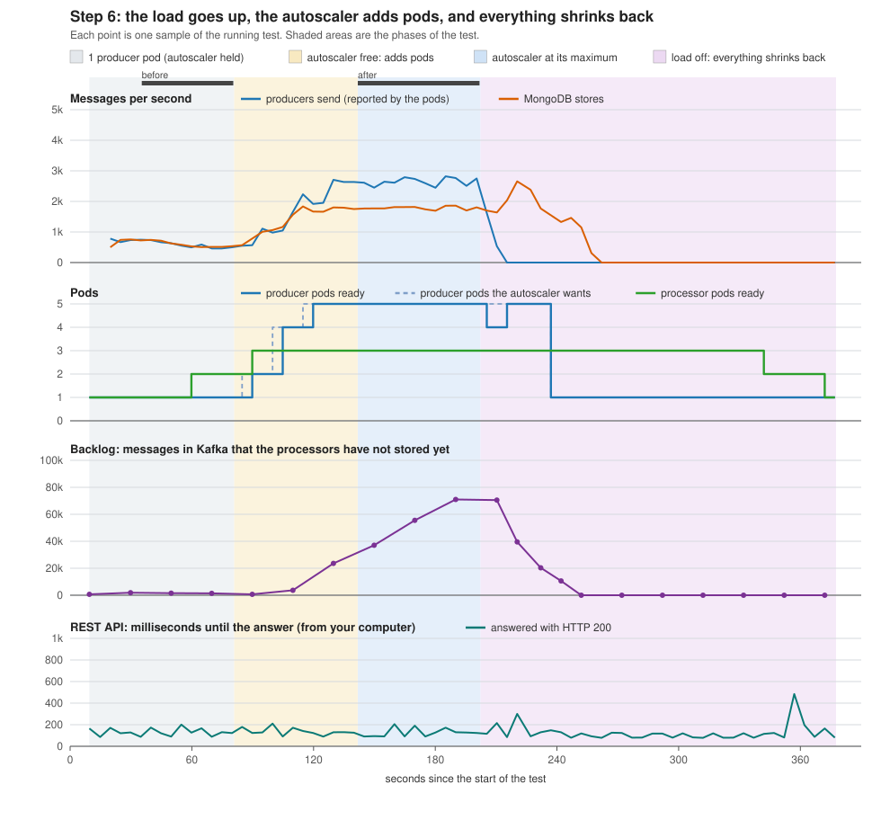

**The goals, as numbers.** "Does it scale?" is not a goal; a goal is a number that a test can fail. They are in [`slo.json`](slo.json), each with a sentence saying why that number, and `make goals` lists them. The report marks each one met or not met. All seven of the scaling goals were met in this run:

<!-- from: evidence/step6-scale-results.md -->
```text
| Goal | Asked | This run | |
|---|---|---|---|
| The REST API answers (HTTP 200) when it is asked, also while the pipeline is under full load | at least 99 percent of the calls | 100.0 percent (39 of 39 calls) | **met** |
| The REST API answers quickly, measured from your computer over the internet | at most 1,000 milliseconds, for 95 percent of the answers | 205 ms (slowest 210 ms) | **met** |
| A new event can be read from the REST API soon after Kafka has stored it, with one producer and with the autoscaler at its maximum | at most 60 seconds | one producer: 0.1 s, autoscaler at its maximum: 16.0 s | **met** |
| With the load on, the producers' autoscaler has all its pods ready | at most 180 seconds after the autoscaler was freed | all producer pods were ready after 41 s | **met** |
| After the load stops, the producers are back to the minimum of 1 pod | at most 180 seconds after the load was switched off | the producers were back to the minimum after 36 s | **met** |
| After the load stops, the processors catch up: the backlog in Kafka is below 1,000 messages | at most 300 seconds after the load was switched off | the backlog was gone after 54 s | **met** |
| After the load stops, the processors are back to the minimum of 1 pod | at most 600 seconds after the load was switched off | the processors were back to the minimum after 175 s (2.9 min) | **met** |
```

📄 [View the full text file: step6-scale-results.md](evidence/step6-scale-results.md)

**What the numbers say, and what they do not.**

- Replicas are a means, not the result. Producers x4.7 gave records stored in MongoDB x3.3, and 71,024 messages were still waiting in Kafka at the end of the window. What counts is how much arrives stored, and how long it takes: a tagged event needed 0.1 s from Kafka to the REST API with one producer, and 16.0 s with the autoscaler at work, because it queued behind the backlog.
- **Where the pipeline is held back** (by the run's own CPU table): the processor pods used 99% of their CPU limit in the second window, the highest of the programs behind the producers (`kafka-0` 25%, `mongo-0` 7%, the REST API pods 1%). A program at its CPU limit cannot do more however many pods send to it, so adding producers does little for the stored record. That is a reading of one table, not a proof: to find out whether a part really is the limit, change that one part (more CPU for it, or one more of it) and run the test again. I did not run that second experiment.
- The processors' autoscaler is part of the result. It took them from 1 to 3 pods, the first extra pod 50 seconds after the first producer pod was ready.
- The REST API kept answering the whole time the load was on: 39 of 39 calls got HTTP 200, 95% within 205 ms (this includes the trip over the internet to the machine).
- **The 'before' window was not a steady state.** The processors were still scaling during it (from 1 to 2 pods), so "before" is not what one producer and one processor would do alone.
- **The load generator and the pipeline share the same three machines.** At the end of the second window the worker machines' CPU was at 74% and the control-plane machine's at 80%, so the measurement is of a small cluster that was close to full, and some of the limits may be the machines and not the programs.
- The goals and thresholds (for example 60 seconds from Kafka to the REST API) are my choice, with a reason written next to each in `slo.json`; they are not a standard.
- The replica count can briefly show more than the maximum while a rolling update runs, because the old and the new pod exist together; this was not triggered during the test.

## Resilience drill

The assignment asks for three things: **failure injection** (delete one pod in each tier), **self-healing** (show the platform restarting it) and **operator response** (the manual steps a person would take). All three are below, with numbers. The demonstration video (2 min 58 s, unlisted on YouTube) is here as well as at the top of this README:

[](https://youtu.be/gmOuqr7P_TI)

Video: <https://youtu.be/gmOuqr7P_TI>

The numbers on this page come from the saved files of the full five-tier drill, not from the video.

### What `make drill` does

```bash
cd CA3
make drill                                   # all five tiers, about 6 minutes
make drill DRILL_ARGS="--only restapi"       # one tier
make drill-report                            # draws the table, the goals and the chart again from the saved files
```

For each of the five tiers (Kafka, processor, MongoDB, REST API, producer) it does the same thing, one tier at a time:

1. It records what is there: the number of records in MongoDB, the number of messages in Kafka, and the disk (volume) of `kafka-0` and `mongo-0`.
2. It deletes one pod with `kubectl delete pod`, and starts the clock.
3. It watches every pod of the stack every 1.5 seconds and writes down each state change ([step7-drill-timeline.txt](evidence/step7-drill-timeline.txt)); it also copies what Kubernetes says about it ([step7-drill-events.txt](evidence/step7-drill-events.txt)).
4. Right after the delete it sends **one tagged event** through the pipeline, and asks for it from the REST API until it comes back.
5. While all that happens, it calls the REST API from the administrator's computer once a second, so that a gap in the service shows as failed calls ([step7-drill-rest-calls.csv](evidence/step7-drill-rest-calls.csv)).
6. It checks again what it recorded in step 1: no record, no message and no disk may be lost.

The monitoring pods (Prometheus, Grafana, Loki, Alloy, the exporters) are deliberately **not** deleted: they are what watches the drill. The producer tier is drilled with the load switched on, so a deleted producer is deleted while it is working.

### The result

One run of all five tiers (2026-11-07, 00:06 UTC) ended with `RESULT: PASS`. Every number is in seconds after the delete:

<!-- from: evidence/step7-drill-results.md -->
```text
Run at 2026-11-07 00:06 UTC, 5 of 5 tiers drilled. Every number is in seconds after the pod was deleted (`kubectl delete pod`).
...
| Tier | Pod deleted | New pod ready | Whole stack | Event readable | REST `/stats` calls failed | Data | Result |
|---|---|---|---|---|---|---|---|
| Kafka | `kafka-0` | 23 s | 25 s | 29 s | 0 of 29 | kept | **PASS** |
| Processor | `processor-6d4869f56b-8qsrh` | 14 s | 14 s | 14 s | 0 of 14 | kept | **PASS** |
| MongoDB | `mongo-0` | 13 s | 14 s | 13 s | 3 of 6 (8 s) | kept | **PASS** |
| REST API | `restapi-5f54fc9f7b-5gz55` | 7 s | 8 s | 13 s | 0 of 13 | kept | **PASS** |
| Producer | `producer-load-f877bb9f4-w2rlt` | 6 s | 16 s | 12 s | 0 of 16 | kept | **PASS** |
```

📄 [View the full text file: step7-drill-results.md](evidence/step7-drill-results.md)

The columns: *New pod ready* is when the replacement pod reports Ready; *Whole stack* is when every part of the stack has its pods ready again; *Event readable* is when the tagged event sent right after the delete can be read from the REST API; the next column counts the `/stats` calls that failed while it happened; *Data* says whether every record, message and disk was still there.

**One row needs a note.** The producer's *Whole stack* time (16 s) is longer than its *New pod ready* time (6 s). The drill counts a producer as whole when it has seen the new pod's own first `rate` line in its log; a producer writes one every 5 seconds and the drill looks every 4 seconds, and that line came 15 s after the delete (the results file says: *the producer was sending again after 15 s*). So the 16 s tells how the drill measures, not how long Kubernetes took.


### Self-healing, as the platform did it

This is what `kubectl get pods` would have shown, second by second, for three of the tiers (the full file has all five). `+N s` is the time after the delete; `Terminating` is the old pod, the other lines are the new one:

<!-- from: evidence/step7-drill-timeline.txt -->
```text
=== Kafka: kafka-0 deleted at 00:06:13 UTC
    +1 s  00:06:14  kafka-0                                  Terminating
    +2 s  00:06:16  kafka-0                                  ContainerCreating
    +4 s  00:06:17  kafka-0                                  Running, not ready
   +11 s  00:06:25  producer-smoke-ggszj                     Init:0/1   (new pod)
   +23 s  00:06:37  kafka-0                                  Running, ready
   +25 s  00:06:38  producer-smoke-ggszj                     Running, ready
   +27 s  00:06:40  producer-smoke-ggszj                     Completed
...
=== MongoDB: mongo-0 deleted at 00:08:45 UTC
    +1 s  00:08:46  mongo-0                                  Terminating
    +3 s  00:08:48  mongo-0                                  Running, not ready
    +4 s  00:08:49  producer-smoke-m9j54                     Init:0/1   (new pod)
    +4 s  00:08:49  producer-smoke-hb5bt                     gone
    +5 s  00:08:51  producer-smoke-m9j54                     Running, ready
    +7 s  00:08:52  producer-smoke-m9j54                     Completed
   +13 s  00:08:58  mongo-0                                  Running, ready
...
=== REST API: restapi-5f54fc9f7b-5gz55 deleted at 00:09:52 UTC
    +1 s  00:09:53  restapi-5f54fc9f7b-5gz55                 Terminating
    +1 s  00:09:53  restapi-5f54fc9f7b-gc7qb                 Init:0/1   (new pod)
    +3 s  00:09:54  restapi-5f54fc9f7b-5gz55                 gone
    +4 s  00:09:56  producer-smoke-ljj8w                     Init:0/1   (new pod)
    +4 s  00:09:56  producer-smoke-m9j54                     gone
    +6 s  00:09:57  restapi-5f54fc9f7b-gc7qb                 Running, not ready
    +7 s  00:09:59  restapi-5f54fc9f7b-gc7qb                 Running, ready
```

📄 [View the full text file: step7-drill-timeline.txt](evidence/step7-drill-timeline.txt)

(`gone` means that the old pod has disappeared from the list. The lines named `producer-smoke-...` are the pods of the tagged test events that the drill itself sends.) A **Deployment** (processor, REST API, producer) is repaired by its ReplicaSet, which starts a new pod with a new name. A **StatefulSet** (Kafka, MongoDB) brings back the pod with the *same* name and the *same disk*, which is why the data is still there. The disk is a local volume on the machine, so this works when a pod dies and **would not** work when a machine dies: the new pod would have no disk (see *Known limitations*).

### Nothing was lost

For each tier the drill compares what it recorded before the delete with what is there afterwards:

<!-- from: evidence/step7-drill-results.md -->
```text
- OK: records in MongoDB: 330,353 -> 330,354
...
- OK: messages in Kafka: 330,353 -> 330,354
- OK: the disk of kafka-0: pvc-a183437c-3daa-486b-99b8-ba0951139f8f -> pvc-a183437c-3daa-486b-99b8-ba0951139f8f
...
- OK: records in MongoDB: 330,354 -> 330,355
...
- OK: records in MongoDB: 330,355 -> 330,356
...
- OK: the disk of mongo-0: pvc-70d04a35-7345-44a5-922f-a8160f9d1e97 -> pvc-70d04a35-7345-44a5-922f-a8160f9d1e97
...
- OK: records in MongoDB: 330,356 -> 330,357
...
- OK: records in MongoDB: 349,801 -> 357,007 (the load adds records all the time, so only 'not fewer than before' is checked)
```

📄 [View the full text file: step7-drill-results.md](evidence/step7-drill-results.md)

The records and messages only go up (by the one test event), the disks have the same names before and after, and the test event is stored exactly once.

### What the REST API's users saw

The drill asked the API once a second, from outside, during each tier:

<!-- from: evidence/step7-drill-results.md -->
```text
- REST API, asked from outside every second: `/health` failed 0 of 29 times (longest stretch 0.0 s), `/stats` failed 0 of 29 times (longest stretch 0.0 s)
...
- REST API, asked from outside every second: `/health` failed 0 of 14 times (longest stretch 0.0 s), `/stats` failed 0 of 14 times (longest stretch 0.0 s)
...
- REST API, asked from outside every second: `/health` failed 0 of 6 times (longest stretch 0.0 s), `/stats` failed 3 of 6 times (longest stretch 7.5 s)
...
- REST API, asked from outside every second: `/health` failed 0 of 13 times (longest stretch 0.0 s), `/stats` failed 0 of 13 times (longest stretch 0.0 s)
...
- REST API, asked from outside every second: `/health` failed 0 of 16 times (longest stretch 0.0 s), `/stats` failed 0 of 16 times (longest stretch 0.0 s)
```

📄 [View the full text file: step7-drill-results.md](evidence/step7-drill-results.md)

Four of the five tiers show **no failed call at all**. When one of the two REST API pods was deleted, the other kept answering (13 calls, none failed); when Kafka, the processor or a producer was deleted, the API did not notice, because it reads only MongoDB. When `mongo-0` was deleted, three of six `/stats` calls failed over a stretch of 7.5 seconds: with one database pod, the API cannot return data while MongoDB is away, however it is built. `/health` kept answering (the program is alive), and the REST pods turned `not ready` on purpose (their readiness probe asks MongoDB), so that Kubernetes takes them out of the Service until the database is back. That is the honest result for a single database pod, not a failure of the drill.

### The goals

The goals are the numbers in [`slo.json`](slo.json) whose field `test` says `drill`, each with a sentence saying why that number. The report says for each whether it was met:

<!-- from: evidence/step7-drill-results.md -->
```text
| Goal | Asked | This run | |
|---|---|---|---|
| A pod that is deleted is replaced by a new pod that is ready, in every tier | at most 60 seconds after the delete, for the slowest of the five tiers | kafka 23 s, processor 14 s, mongo 13 s, restapi 7 s, producer 6 s | **met** |
| After the delete, every part of the stack has its pods ready again (not only the replaced pod) | at most 90 seconds after the delete, for the slowest of the five tiers | kafka 25 s, processor 14 s, mongo 14 s, restapi 8 s, producer 16 s | **met** |
| An event that is sent while a pod is being replaced is not lost: it can be read from the REST API afterwards | at most 90 seconds after the delete, for the slowest of the five tiers | kafka 29 s, processor 14 s, mongo 13 s, restapi 13 s, producer 12 s | **met** |
| Deleting a pod deletes no data: every tier still has all the records and messages it had | at least 100 percent of the tiers | 100 percent (5 of 5 tiers kept all their data) | **met** |
| While one of the two REST API pods is replaced, the REST API keeps answering the calls for /stats | at most 5 seconds in a row without a good answer | longest stretch of failed /stats calls: 0.0 s (0 of 13 calls failed) | **met** |
```

📄 [View the full text file: step7-drill-results.md](evidence/step7-drill-results.md)

**A threshold set after seeing the data.** The three time goals were first set at 150, 300 and 300 seconds. After the first run showed 23, 25 and 29 seconds as the slowest values, they were tightened to 60, 90 and 90 seconds (the reason for each is written next to it in `slo.json`) and `make drill-report` judged the saved measurements again. The measurements did not change, only the thresholds. A threshold chosen after seeing the data is weaker evidence than one chosen before, so read "met" as "within the numbers I chose", and the measured seconds as the real result.

### What Loki and Prometheus kept

A deleted pod takes its own log with it, but Loki has the lines for 24 hours. For each tier the drill saved what Loki still had of the deleted pod, the search for `error` across all pods and a few Prometheus numbers ([step7-drill-observability.txt](evidence/step7-drill-observability.txt)). The last words of the deleted Kafka pod, read from Loki after the pod was gone:

<!-- from: evidence/step7-drill-observability.txt -->
```text
Loki: the pod that was deleted (kafka-0) has 500 log lines in the window, the first and the last two:
    00:06:13 [2026-11-07 00:06:13,990] INFO Terminating process due to signal SIGTERM (org.apache.kafka.common.utils.LoggingSignalHandler)
    00:06:27 [2026-11-07 00:06:27,868] WARN [QuorumController id=1] Performing controller activation. Loaded ZK migration state of NONE. (org.apache.kafka.controller.QuorumController)
    00:06:27 [2026-11-07 00:06:27,940] INFO [MetadataLoader id=1] maybePublishMetadata(LOG_DELTA): The loader finished catching up to the current high water mark of 47730 (org.apache.kafka.image.loader.MetadataLoader)
```

📄 [View the full text file: step7-drill-observability.txt](evidence/step7-drill-observability.txt)

The picture of the error search over the minutes of the drill is in *Where to find logs*. Its lines are expected: the pods that lost MongoDB or Kafka said so, and `mongo-0` fills the rest with the refused requests of the metrics reader (explained there). The processor and the producer wrote no error line in this run.

### Operator response

When a pod does not come back by itself, or comes back and fails again, a person is needed. [`runbook.md`](runbook.md) is that person's page. Its sections: look first (`make status`, `make diagnose`: which pod, why), check the logs, scale replicas, certificates and passwords, tier by tier (what the platform does and what a person checks), prove that it is healthy again (`make smoke`), and what was not tested.

`make operator-steps` does the manual steps once on the running stack, changes nothing permanent and saves the output ([step7-operator-steps.txt](evidence/step7-operator-steps.txt)). Its checks:

<!-- from: evidence/step7-operator-steps.txt -->
```text
   ok:       Kafka: the log of kafka-0 can be read
...
   ok:       Processor: the log of processor-6d4869f56b-rjxqg can be read
...
   ok:       MongoDB: the log of mongo-0 can be read
...
   ok:       REST API: the log of restapi-5f54fc9f7b-87bbr can be read
...
   ok:       Producer (load generator): the log of producer-load-66dcbb6f55-xrpg5 can be read
...
   ok:       Loki answers the error search
...
   ok:       the REST API starts with all its pods ready (2 of 2)
...
   ok:       kubectl scale to 3 was accepted
...
   ok:       the extra pod became ready within 240 s (3 of 3 ready)
...
   ok:       the REST API answers /stats with 3 pods
...
   ok:       the REST API is back to 2 pods, all ready
...
   ok:       pki-ca: more than 30 days left
...
   ok:       kafka-tls: more than 30 days left
...
   ok:       mongo-tls: more than 30 days left
...
   ok:       restapi-tls: more than 30 days left
...
   ok:       kafka-client-producer: more than 30 days left
...
   ok:       kafka-client-processor: more than 30 days left
...
   ok:       kafka-client-exporter: more than 30 days left
```

📄 [View the full text file: step7-operator-steps.txt](evidence/step7-operator-steps.txt)

Two things in that file are worth reading. **Scaling by hand** is undone by the autoscalers on the processor and the load generator (about 15 seconds later), so only the REST API, which has no autoscaler, is scaled by hand: 2 to 3 pods and back, and the file says why a `kubectl scale` is not in the manifest and is not undone by `kubectl apply -k .`. And **rotating a certificate is not done, on purpose**: with this design the old CA cannot sign a new certificate (its key was never stored), the setup Job makes all 13 Secrets or none, and the database users were created once with the first passwords. The file says so, and so does *Known limitations*; what a production system would do instead (cert-manager renewing before the end date) is written in `runbook.md`, and was not built.

### What the drill does not show

- **A whole machine failing.** Every drill deleted a pod, not a machine. The disks of Kafka and MongoDB are local volumes, so a lost machine loses the data on it.
- **A cut network** between machines, or a failure of two parts at once.
- **A second Kafka broker or a MongoDB replica set.** Both have one pod, so while the pod is away that part is away: the numbers above say how long that took (13 seconds until the new MongoDB pod was ready, 23 for Kafka), not that there was no gap.
- **The load.** Four of the five tiers were drilled on a quiet pipeline; only the producer tier was drilled under load.
- **One run.** The numbers are one run of the drill. A second run was not made, so the spread between runs is not known.

## How to destroy

One command removes everything the project made in AWS and then checks AWS for leftovers:

```bash
cd CA3
make teardown     # the stack, the machines, the network and the key pair; then the cleanup scan; it fails if anything is left
```

| Step | What happens | The same step alone |
|---|---|---|
| 1 | If the cluster still answers, the stack is deleted: the namespace `ca3` with its disks and Secrets, and the namespace `ca3-intruder` of the network test. Then the namespaces and volumes that are left are listed (no `ca3`, no volumes). If the cluster does not answer, this step says so and is skipped. | `make down` |
| 2 | Terraform destroys the 19 AWS resources: three machines with their disks, the key pair, the network and the firewall rules. The files made on this computer (the Ansible inventory, `known_hosts`, the kubeconfig) are removed. | `make cluster-down` |
| 3 | The cleanup scan looks in AWS for everything tagged `Project=CS5287-CA3` and for everything that costs money, waiting up to 3 minutes for AWS's tag list to catch up. It ends with `RESULT: CLEAN` or `RESULT: LEFTOVERS FOUND`, and the exit status says which. | `make scan` |

Step 2 reads Terraform's state file in `infra/terraform/`, so run it in the folder that built the cluster. The scan asks AWS and not the state file, so it also finds machines that Terraform has lost track of. `make scan SCAN_ARGS="--all-regions"` also looks for things that cost money in every other region.

### The scan finds the cluster while it exists, and nothing after it

A scan that can only say "clean" proves nothing. So it was run on the running cluster first, where it has to find it. The numbers in brackets are how many it found. Each `...` stands for lines that are left out here (the names and ids of the resources, and the account line); they are in the full file:

<!-- from: evidence/step10-scan-before.txt -->
```text
CA3 cleanup scan
...
  region  : us-east-2
  tag     : Project=CS5287-CA3
...
Created by this project (tagged Project=CS5287-CA3)
  [FOUND] EC2 instances (3)
...
  [FOUND] EBS volumes (3)
...
  [FOUND] VPCs (1)
...
  [FOUND] Subnets (1)
...
  [FOUND] Security groups (2)
...
  [FOUND] Internet gateways (1)
...
  [FOUND] Route tables (1)
...
  [FOUND] Key pairs (1)
...
Anything else with that tag, in any AWS service
  [FOUND] Tagged resources (21)
...
Every kind of EC2 resource with that tag (asked of EC2, which needs no extra permission)
  [FOUND] Tagged EC2 resources (21)
...
Resources that cost money, tagged or not, in us-east-2
  [FOUND] EC2 instances (3)
...
  [FOUND] EBS volumes (3)
...
  [none ] Elastic IP addresses
  [none ] NAT gateways
  [none ] Load balancers
...
RESULT: LEFTOVERS FOUND - the resources listed above are still in AWS.
        While the cluster exists, that is expected. After "make cluster-down" it is not: run it again, then scan again.
```

📄 [View the full text file: step10-scan-before.txt](evidence/step10-scan-before.txt)

Then `make teardown` deleted the stack, Terraform destroyed 19 resources, and the scan ran again. It has to find nothing:

<!-- from: evidence/step10-teardown.txt -->
```text
namespace "ca3" deleted
...
Deleted. Check:  kubectl get namespace ca3   (it should say NotFound)
...
What is left inside Kubernetes (no ca3 namespace, no volumes):
NAME              STATUS   AGE
default           Active   3h57m
kube-node-lease   Active   3h57m
kube-public       Active   3h57m
kube-system       Active   3h57m
No resources found
...
Plan: 0 to add, 0 to change, 19 to destroy.
...
Destroy complete! Resources: 19 destroyed.
...
CA3 cleanup scan
  time    : 2026-11-08 17:15 UTC
...
  region  : us-east-2
  tag     : Project=CS5287-CA3
...
Created by this project (tagged Project=CS5287-CA3)
  [none ] EC2 instances
  [none ] EBS volumes
  [none ] VPCs
  [none ] Subnets
  [none ] Security groups
  [none ] Internet gateways
  [none ] Route tables
  [none ] Key pairs
...
Anything else with that tag, in any AWS service
  [none ] Tagged resources
            (AWS's tag list names 12 items that do not exist any more. Asked for each one directly,
             AWS says 'not found', so they are not left over; AWS removes such entries from its list by itself.
...
Every kind of EC2 resource with that tag (asked of EC2, which needs no extra permission)
  [none ] Tagged EC2 resources
            (AWS's tag list names 11 items that do not exist any more. Asked for each one directly,
             AWS says 'not found', so they are not left over; AWS removes such entries from its list by itself.
...
Resources that cost money, tagged or not, in us-east-2
  [none ] EC2 instances
  [none ] EBS volumes
  [none ] Elastic IP addresses
  [none ] NAT gateways
  [none ] Load balancers
...
RESULT: CLEAN - nothing tagged Project=CS5287-CA3 is left, and no billable resources are running in us-east-2.
        AWS's tag lists still name 12 deleted items; each was asked for directly and does not exist, so none of them is a leftover.
```

📄 [View the full text file: step10-teardown.txt](evidence/step10-teardown.txt)

**The note about "tag lists".** AWS's tag index keeps naming deleted items (disks, firewall rules) for a while; in this run it named 12. The scan does not trust that list: it asks AWS for each name by its id, and only the answer "not found" counts as gone. Any other answer, an error included, keeps the item in the list of leftovers and the result is `LEFTOVERS FOUND`. This is the fix for the one point lost in CA2, where the scan could not look at the tag index at all; now the tag index is read (the permission was added) and a second check asks EC2 itself, which needs no extra permission.

**Run twice.** The second `make teardown` finds no cluster and nothing to destroy, and the scan is still clean:

<!-- from: evidence/step10-teardown-again.txt -->
```text
The cluster does not answer, so there is no stack to delete: going on to destroy the machines.
...
No changes. No objects need to be destroyed.
...
Destroy complete! Resources: 0 destroyed.
...
RESULT: CLEAN - nothing tagged Project=CS5287-CA3 is left, and no billable resources are running in us-east-2.
        AWS's tag lists still name 12 deleted items; each was asked for directly and does not exist, so none of them is a leftover.
```

📄 [View the full text file: step10-teardown-again.txt](evidence/step10-teardown-again.txt)

**What the scan does not cover.** These two runs looked at the region `us-east-2` only; the option for every region exists (`--all-regions`) and was not run for CA3. Check 4 knows five kinds of billable things (machines, disks, Elastic IPs, NAT gateways, load balancers); a billable thing of another kind that carries no tag would not be found, and the project creates none. The saved scan files print the last four digits of the AWS account number, so that a reader can see which account was searched; the lines are in the files and are not quoted here.

## Idempotency: run it twice

The files describe the end state, not the steps, so a second run has nothing to do. Each part was run twice and the second run is saved:

| Step | First run | Second run | Files |
|---|---|---|---|
| `make cluster-up` | 19 resources added, 1 min 48 s (built again later from the same files: 19 added, 2 min 28 s) | Terraform: no changes; Ansible: `changed=0` on all three machines; 27 s | [step3-cluster-up.txt](evidence/step3-cluster-up.txt), [step3-rebuild-cluster-up.txt](evidence/step3-rebuild-cluster-up.txt), [step9-cluster-up-run2.txt](evidence/step9-cluster-up-run2.txt) |
| `make up` | 45 objects created (the first version of the stack), 1 min 15 s; adding the monitoring then created 40 and left 45 unchanged, 42 s | all 85 objects `unchanged`, none `created` or `configured`; 9 s | [step3-up.txt](evidence/step3-up.txt), [step4-up.txt](evidence/step4-up.txt), [step9-up-run2.txt](evidence/step9-up-run2.txt) |
| `make dry-run` | | the cluster's own check of `kubectl apply -k .` says `unchanged` for all 85 objects, once as a server dry run and once as a client dry run | [step9-dry-run-server.txt](evidence/step9-dry-run-server.txt), [step9-dry-run-client.txt](evidence/step9-dry-run-client.txt) |
| `make teardown` | 19 destroyed | 0 destroyed, scan `CLEAN` | [step10-teardown.txt](evidence/step10-teardown.txt), [step10-teardown-again.txt](evidence/step10-teardown-again.txt) |

The second `make cluster-up`:

<!-- from: evidence/step9-cluster-up-run2.txt -->
```text
No changes. Your infrastructure matches the configuration.
...
Apply complete! Resources: 0 added, 0 changed, 0 destroyed.
...
PLAY RECAP *********************************************************************
ca3-agent-1                : ok=8    changed=0    unreachable=0    failed=0    skipped=1    rescued=0    ignored=0
ca3-agent-2                : ok=7    changed=0    unreachable=0    failed=0    skipped=1    rescued=0    ignored=0
ca3-server                 : ok=13   changed=0    unreachable=0    failed=0    skipped=1    rescued=0    ignored=0
...
make cluster-up took 0 min 27 s
```

📄 [View the full text file: step9-cluster-up-run2.txt](evidence/step9-cluster-up-run2.txt)

The second `make up` (the first three and the last three of the 85 objects, then the end):

<!-- from: evidence/step9-up-run2.txt -->
```text
namespace/ca3 unchanged
serviceaccount/alloy unchanged
serviceaccount/bootstrap unchanged
...
networkpolicy.networking.k8s.io/restapi-ingress unchanged
networkpolicy.networking.k8s.io/restapi-metrics-ingress unchanged
job.batch/bootstrap condition met
...
Stack is up. Call the REST API from this computer with:  make rest-check   and check the monitoring with:  make metrics-check
make up took 0 min 9 s
```

📄 [View the full text file: step9-up-run2.txt](evidence/step9-up-run2.txt)

**Passwords and certificates are not replaced by a second run.** The Job `bootstrap` is `unchanged` in the second run, so it did not run again. If it does run again, it first asks the API server which of its 13 Secrets exist (a dry-run create, which stores nothing): all exist means nothing to do; none exist means make all; only some exist means stop with an error, because new certificates would not match the old ones (`make down` removes them all). That is what the program's header says and what the code does; no saved run shows the Job running again against existing Secrets.

## Rebuild from nothing

A fresh clone is enough: the repository holds the code, and nothing has to be prepared by hand (the SSH key is made by `make cluster-up`, the passwords and certificates by the Job). On a computer with the tools in *Prerequisites* it is the *Quick start* again: `make cluster-up`, then `make up`.

What was done, and what was not:

- **Done and saved:** the cluster was destroyed and built again from the same files (`step3-rebuild-*`): 19 resources added in 2 min 28 s, the 45-object first version of the stack created in 1 min 0 s, and the REST API answered from outside on all three nodes, HTTPS only, login required (the result line is below).
- **Done, but the first-run output was not saved:** the final stack of 85 objects was built from nothing on a fresh cluster on Friday and again on Sunday. What is saved of it is the second run (above) and the state of the cluster on Sunday, where all the pods have the same age because they were created together ([step9-get-all.txt](evidence/step9-get-all.txt)).
- **Not done:** the repository was not deployed again after Sunday morning. Since then it changed only in the saved evidence, a `.gitignore`, these documents, the help texts of the `Makefile` and the comments of the scripts; `make verify` checks the documents against the files.

The result line of the rebuilt cluster's check ([step3-rebuild-rest-check.txt](evidence/step3-rebuild-rest-check.txt)):

<!-- from: evidence/step3-rebuild-rest-check.txt -->
```text
RESULT: PASS - 3 of 3 nodes answered correctly (HTTPS only, login required) and MongoDB holds 5000 flows
```

📄 [View the full text file: step3-rebuild-rest-check.txt](evidence/step3-rebuild-rest-check.txt)

## Outputs summary

| Output the assignment asks for | Where it is |
|---|---|
| Screenshot of the log search (for example "error" across components) | [images/step7-logs-errors.png](images/step7-logs-errors.png), [images/step5-logs-one-event.png](images/step5-logs-one-event.png), [images/step5-logs-warnings.png](images/step5-logs-warnings.png) |
| Screenshot of the Grafana dashboard with the key metrics | [evidence/step4-grafana-after.png](evidence/step4-grafana-after.png), [images/step6-grafana-scaling.png](images/step6-grafana-scaling.png), [images/step7-grafana-recovery.png](images/step7-grafana-recovery.png) |
| HPA manifest snippet | [`producer/load/hpa.yaml`](producer/load/hpa.yaml) and [`processor/hpa.yaml`](processor/hpa.yaml), shown in *Autoscaling* |
| `kubectl get hpa` over time, scale-up and scale-down | [step6-scale-hpa-over-time.txt](evidence/step6-scale-hpa-over-time.txt), [step6-scale-results.md](evidence/step6-scale-results.md), [step6-scale-chart.svg](evidence/step6-scale-chart.svg), [images/kubectl-get-hpa.png](images/kubectl-get-hpa.png) |
| NetworkPolicy YAML | [`policies/networkpolicies.yaml`](policies/networkpolicies.yaml), [`policies/observability.yaml`](policies/observability.yaml); how the cluster holds them: [images/kubectl-get-networkpolicy.png](images/kubectl-get-networkpolicy.png) |
| Secret templates (sanitized) and TLS configuration summary | *Secrets* and *TLS summary* in *Security and access controls* above |
| Pod failure, recovery and troubleshooting (video of 3 minutes at most) | <https://youtu.be/gmOuqr7P_TI> (2 min 58 s), and the measured drill in *Resilience drill* |
| Operator actions | [`runbook.md`](runbook.md), [step7-operator-steps.txt](evidence/step7-operator-steps.txt) |
| REST evidence: request and response, logs, metrics, failure and recovery | [step7-rest-evidence.txt](evidence/step7-rest-evidence.txt), [step5-smoke.txt](evidence/step5-smoke.txt), [step5-smoke-response.json](evidence/step5-smoke-response.json), [step5-trace.txt](evidence/step5-trace.txt) |
| `kubectl get all -A` | [images/kubectl-get-all.png](images/kubectl-get-all.png); the same as text: [step9-get-all.txt](evidence/step9-get-all.txt) |
| Deploy, delete and clean-up commands | `make cluster-up`, `make up`, `make down`, `make teardown` (see *How to deploy* and *How to destroy*) |
| Integrity Packet and AI critique | [`integritypacket.md`](integritypacket.md), [`ai-guidance-log.md`](ai-guidance-log.md) |

Stable values: Kafka topic `network-flows` (3 partitions), MongoDB database `ca3` and collection `flows`, REST API container port 8443 (HTTPS) and node port 30080, project tag `Project=CS5287-CA3`, namespace `ca3`. Node addresses change on every build: `terraform -chdir=infra/terraform output`.

## Deviations from CA0, CA1 and CA2

CA3 sits on top of CA2, which sat on CA1 and CA0 (see their README files for the earlier changes). The changes below are the ones since CA2, and each one points at the file to look at. The Integrity Packet checks them against the repository instead of just listing them.

| What changed | Why | Where to see it |
|---|---|---|
| **Passwords and certificates are made inside the cluster** by the Job `bootstrap` (13 Secrets, create-only rights, the CA's private key kept in memory only). In CA2 a script on the operator's computer made one password from files in `.secrets/`. | Nothing secret on a computer or in Git; a CA2 review item. | [`bootstrap/job.yaml`](bootstrap/job.yaml), [`processor/bootstrap.py`](processor/bootstrap.py), [`rbac/bootstrap.yaml`](rbac/bootstrap.yaml) |
| **Kafka demands TLS and a client certificate** (CA2: plain text). One broker, three listeners: `SECURE` (9092, TLS), `ADMIN` and `CONTROLLER` (both on `127.0.0.1` inside the pod). | The assignment asks for TLS on Kafka. | [`kafka/kafka.yaml`](kafka/kafka.yaml), [step10-tls-checks.txt](evidence/step10-tls-checks.txt) |
| **MongoDB requires TLS and a login, and each program has its own account** (CA2: the processor and the REST API used the administrator). | The assignment asks for TLS on MongoDB; CA2 limitation 4. | [`db/mongo.yaml`](db/mongo.yaml), [step10-security-facts.txt](evidence/step10-security-facts.txt) |
| **The REST API answers HTTPS on port 8443 and asks for a login** (CA2: HTTP on 8080, no login). The node port is still 30080. | CA2 limitation 5; TLS in front of the published part. | [`restapi/restapi.yaml`](restapi/restapi.yaml), [`restapi/rest_app.py`](restapi/rest_app.py), [step3-rest-check.txt](evidence/step3-rest-check.txt) |
| **Monitoring was added:** Prometheus, Grafana, Loki, Alloy (one per node), kafka-exporter and mongodb-exporter, with one dashboard, `CA3 pipeline`, loaded from a file. | The assignment: centralized logs, metrics and dashboards. | [`observability/`](observability/), [`observability/grafana/dashboards/pipeline.json`](observability/grafana/dashboards/pipeline.json) |
| **The three programs write one JSON line per event** (`ts`, `level`, `service`, `msg`, `trace_id`, `topic`...) and publish `/metrics`. In CA2 they printed plain text lines. | Logs that can be searched by field; numbers that Prometheus can read. | [`producer/producer.py`](producer/producer.py), [`processor/processor.py`](processor/processor.py), [`restapi/rest_app.py`](restapi/rest_app.py), [step5-log-sample.txt](evidence/step5-log-sample.txt) |
| **25 NetworkPolicies** (CA2: 11): default deny, then one rule per connection, for ingress and egress, including the monitoring. | Least privilege inside the namespace; the assignment's rule that only the processor talks to Kafka and the database. | [`policies/networkpolicies.yaml`](policies/networkpolicies.yaml), [`policies/observability.yaml`](policies/observability.yaml), [step7-netpol-check.txt](evidence/step7-netpol-check.txt) |
| **Pod Security `restricted` for the whole namespace**, and every container runs as a non-root user with all capabilities dropped (CA2: `baseline`, with the extra settings only on the three application containers). | CA2 limitation 6. | [`namespace.yaml`](namespace.yaml), [step10-security-facts.txt](evidence/step10-security-facts.txt) |
| **Access rules:** 14 service accounts and 4 roles (CA2: 7 and 2), no Kubernetes API token in pods that do not call the API. | Pods with no more rights than they need. | [`rbac/roles.yaml`](rbac/roles.yaml), [`rbac/serviceaccounts.yaml`](rbac/serviceaccounts.yaml), [step3-rbac.txt](evidence/step3-rbac.txt) |
| **k3s encrypts Secrets in its own database** (AES-CBC). | A CA2 review item. | [`infra/ansible/`](infra/ansible/), [step10-secrets-at-rest.txt](evidence/step10-secrets-at-rest.txt) |
| **The producers' autoscaler belongs to the stack:** a load generator `producer-load` runs idle (one pod, sends nothing) and the scaling test switches the load on with the overlays `producer/loadtest-one/` and `producer/loadtest/`. In CA2 the producer Deployment and its autoscaler lived in the folder `CA2/producer/scaling/` and were applied for the test. | The test can run again on a clean stack, and an autoscaler that is part of the stack is seen by the dashboards and the network test. | [`producer/load/`](producer/load/), [`producer/loadtest/`](producer/loadtest/), [`producer/loadtest-one/`](producer/loadtest-one/) |
| **Goals as numbers** in `slo.json`, and a **runbook** for the operator. | The professor asked for service level objectives and operator steps. | [`slo.json`](slo.json), [`runbook.md`](runbook.md) |
| **The cleanup scan has four checks** and handles stale tag entries (CA2: two checks). | The one point lost in CA2. | [`scripts/cleanup-scan.py`](scripts/cleanup-scan.py), [step10-teardown.txt](evidence/step10-teardown.txt) |
| **New tests:** `make netpol-check`, `make netpol-control`, `make exposure-check`, `make rbac-check`, `make heal-check`, `make metrics-check`, `make scale-test`, `make drill`, `make operator-steps`, `make rest-evidence`. | Each claim in the Integrity Packet needs a test that can fail. | [`scripts/`](scripts/), [`Makefile`](Makefile) |
| **The namespace and the database are called `ca3`** (CA2: `ca2`). The images are `ghcr.io/amshu0-0/ca3-{producer,processor,restapi}:1.0.0`, built by GitHub Actions. | A name that points at an old assignment is confusing in logs; the images are built in the cloud because there is no Docker on the laptop. | [`config/pipeline-config.yaml`](config/pipeline-config.yaml), [`VERSION`](VERSION), `.github/workflows/ca3-images.yml` (repository root) |
| **Saved output is scrubbed before it is committed** (public addresses, account number, home folder). | Raw output of a cloud session holds private values; one early commit did (see *Known limitations*). | [`scripts/scrub-evidence.py`](scripts/scrub-evidence.py) |

## Troubleshooting

| Symptom | Cause | What to do |
|---|---|---|
| A call to the REST API times out (`HTTP 000`) or SSH is refused | Your public address changed since the last `make cluster-up`, so the AWS firewall no longer lets you in | Run `make cluster-up` again: Terraform changes the three rules that use the address, in place. Do not open the firewall to everyone. |
| `make cluster-up` stops with "Could not look up this computer's public IP address" | `https://checkip.amazonaws.com` is not reachable from this network | Set `admin_cidr` in `infra/config.yml` to a fixed range, for example `203.0.113.7/32` |
| `make: ... There is no cluster yet` | The kubeconfig does not exist: no `make cluster-up` was run in this folder | `make cluster-up` |
| `make up` does not finish, or a pod is not ready | Image pull, scheduling or start-up problem | `make diagnose` (read-only: states, events, the end of the logs), then `make up` again; it is safe to repeat. A real case, with its output: [step3-diagnose-run1-failed.txt](evidence/step3-diagnose-run1-failed.txt) |
| `kubectl apply` says that the Job `bootstrap` cannot be changed | A finished Job's pod template is fixed | `make up` deletes the finished Job and applies again by itself |
| The Job `bootstrap` stops with "only some of the Secrets exist" | A half-deleted stack: the old and the new certificates would not match | `make down`, then `make up`: all 13 Secrets or none |
| `make up` fails with "field is immutable" for `producer-replay` | The image tag in the replay Job changed | `kubectl -n ca3 delete job producer-replay`, then `make up` |
| The autoscalers show `<unknown>` | metrics-server has no numbers yet (about a minute after start), or the cluster has none | Wait a minute; on your own cluster, install metrics-server |
| On your own cluster the MongoDB and Kafka pods stay `Pending` | There is no default StorageClass | See *Use your own Kubernetes cluster* |
| Grafana or Loki show nothing for the time before a restart | Prometheus and Loki keep their data on `emptyDir` volumes: when their pod is deleted, the history is gone | Expected (see *Observability*); the numbers start again |
| The load is still on after a scale test or drill that was stopped | The test switches the load off by itself, even on Ctrl-C; if the Terminal was killed, it could not | `make scale-down` (it applies the idle load again) |
| `make scan` ends with `COULD NOT SCAN` (exit status 2) | A required AWS call was refused, or there are no credentials | `aws sts get-caller-identity`; fix the credentials or the permissions. It never reports `CLEAN` in this case |
| `make scan` finds leftovers after `make teardown` | A destroy did not finish | `make cluster-down` again, then `make scan` |
| The scan says that AWS's tag list names deleted items | AWS's tag index lags behind | Not a leftover: each name was asked for directly and does not exist |
| A `KUBECONFIG` is set in your terminal | A leftover from another project | Ignored on purpose: the `Makefile` uses `.secrets/kubeconfig.yaml`. Override it on the command line if you mean it: `make up KUBECONFIG=...` |

## Known limitations

These are documented instead of hidden. The professor asked for "what I should not do with it": the first two are the ones that could do harm.

1. **Do not read a drill as a test of losing a machine.** Every drill deleted a pod. Kafka and MongoDB have one pod each and their disks are `local-path` volumes, a directory on one machine's disk: when a pod dies the data stays, when a machine dies the data goes. Nothing here replicates data.
2. **Do not let the load run unattended.** `make scale-test` has protections (it stops itself after 1,000,000 messages, after 30 minutes, when `kafka-0` or `mongo-0` restarts, or on Ctrl-C), but `make scale-up` has none: producers at their CPU limit fill the disks of Kafka and MongoDB, and the records add up (330,353 at the time of the drill). `make scale-down` switches the load off.
3. **One Kafka broker and one MongoDB, no replication.** The assignment lists TLS "broker-to-broker and client"; with one broker there is no broker-to-broker traffic, and that part was **not built or tested with two brokers**.
4. **Autoscaling uses CPU, not the consumer lag.** The professor said that either is accepted and that he would prefer a custom metric. The lag-based autoscaler was not built; see *CPU, not the consumer lag: what that misses*.
5. **Replicas are a means, not a result.** Producers x4.7 gave records stored x3.3; the processors were at 99% of their CPU limit, which suggests that they were the limit, but a table of one run does not prove a cause. The load generator and the pipeline share three small machines that were at 74% to 80% CPU, so some limits may be the machines.
6. **The record count is not a count of different flows.** The load sends the same 5,000 rows again and again (the full dataset has about 191,000 rows and was not used), and the processor stores each message with a plain insert, without a unique key. The scaling test also adds one MongoDB index (`trace_id`) outside the manifests; its proper home is the processor.
7. **No rotation.** The CA's private key is never stored and the Job makes all 13 Secrets or none, so a certificate or a password cannot be replaced while the data stays. The certificates are valid for 365 days. [`runbook.md`](runbook.md) says what a production system would do (for example cert-manager); it was not built.
8. **No Kafka ACLs.** Every client with a certificate signed by the CA can read and write every topic; the pipeline uses one topic. **MongoDB clients use passwords, not certificates.**
9. **The monitoring lives in the cluster it watches**, so when the cluster is gone so is the monitoring; the one outside check is `make rest-check`. Prometheus and Loki keep 24 hours on `emptyDir`. **There is no Alertmanager:** nothing sends a message when a number crosses a line. The metrics travel as plain HTTP inside the namespace.
10. **One Secret value is in an environment variable** (the login of the MongoDB metrics reader); every other Secret is a read-only file.
11. **The containers' root file system is writable** (`readOnlyRootFilesystem` is not set), and there is no admission policy beyond Pod Security.
12. **NetworkPolicies trust labels.** Someone who may create pods in the namespace can give a pod the label of a trusted pod; the role `pipeline-operator` can create Jobs. Closing that gap needs an admission policy.
13. **The network test covers TCP connections between pods.** Not UDP, not what a pod could send once connected, and not traffic to the internet (no policy opens a way out; that was read from the files, not measured). The REST API port accepts calls from any sender inside the cluster, and from outside the AWS firewall lets only the administrator's address in (`rest_api_cidr: admin`).
14. **Two policy files are not portable:** they name the machines' subnet (`10.20.1.0/24`) and the address of the Kubernetes API Service (`10.43.0.1/32`).
15. **The goals are my choice.** The numbers in `slo.json` are not a standard. The three drill time goals were tightened after the first run (150, 300, 300 s became 60, 90, 90 s), so they are weaker evidence than goals set before.
16. **One run of each test.** The scaling test and the drill were run once, so the spread between runs is not known. MongoDB's deletion cost three of six `/stats` calls over 7.5 seconds: with one database pod the API cannot return data while it is away.
17. **`kafka-exporter` restarted 3 times in its first minute** and has run without a restart since; the cause was not examined:

<!-- from: evidence/step9-get-all.txt -->
```text
ca3           pod/kafka-exporter-5dbbf4d5f9-7jxdm           1/1     Running     3 (22m ago)   23m
```

📄 [View the full text file: step9-get-all.txt](evidence/step9-get-all.txt)

18. **The saved scan files show the last four digits of the AWS account number,** and one early commit in the Git history held unscrubbed output (the administrator's public address and folder names). It was replaced and `scripts/scrub-evidence.py` was added, but the old commit stays in the history.
19. **Terraform state is local** (in `infra/terraform/`, ignored by Git) and contains the administrator's address. If it is lost, `terraform destroy` cannot find the resources; the cleanup scan exists for that case, because it asks AWS and not the state file.
20. **Only macOS was used** as the operator's computer; the tool versions are in [step9-tool-versions.txt](evidence/step9-tool-versions.txt). Linux and Windows were not tried.
21. **A running cluster costs money by the hour;** `make teardown` stops it, and the scan says whether it did.
22. **Three of the security checks have no `make` command.** The TLS checks, the security facts and the look into the cluster database were saved once each (the security facts twice: the first run is kept) from commands that Claude wrote and I pasted into the terminal. Each file says what it asked and shows its results, but the commands themselves are not in the repository as scripts, so repeating them means writing them again.

## Testing and verification

| What was tested | How | Result | Files |
|---|---|---|---|
| Manifests are valid | `make validate`: every object against the Kubernetes schemas | all 85 objects valid | [step9-validate.txt](evidence/step9-validate.txt) |
| The cluster and the stack are built from code, and a second run changes nothing | `make cluster-up`, `make up`, `make dry-run`, each twice | see *Idempotency* | [step9-cluster-up-run2.txt](evidence/step9-cluster-up-run2.txt), [step9-up-run2.txt](evidence/step9-up-run2.txt) |
| The REST API answers from outside on all three nodes, HTTPS only, login required | `make rest-check` | `PASS`, 3 of 3 nodes | [step3-rest-check.txt](evidence/step3-rest-check.txt), [step4-rest-check.txt](evidence/step4-rest-check.txt) |
| Only the intended ports answer | `make exposure-check` | only 22, 6443 and 30080 | [step3-exposure.txt](evidence/step3-exposure.txt) |
| One tagged event goes through producer, Kafka, processor, MongoDB and REST API | `make smoke`, `make logs-trace` | `PASS`; the id is found in the logs of three programs | [step5-smoke.txt](evidence/step5-smoke.txt), [step5-trace.txt](evidence/step5-trace.txt) |
| The monitoring works | `make metrics-check` | 4 of 4 | [step4-metrics-check.txt](evidence/step4-metrics-check.txt) |
| The NetworkPolicies do the blocking | `make netpol-check` (169 connections), `make netpol-control` | every answer as the policies say; without the policies every connection worked | [step7-netpol-check.txt](evidence/step7-netpol-check.txt), [step7-netpol-control.txt](evidence/step7-netpol-control.txt) |
| TLS and logins are enforced | the opposite of each rule is tried | 6 of 6 | [step10-tls-checks.txt](evidence/step10-tls-checks.txt) |
| Access rules answer as designed | `make rbac-check` | 9 answers | [step3-rbac.txt](evidence/step3-rbac.txt) |
| Secrets are encrypted in the cluster database | the database is read directly | 13 of 13 Secrets encrypted; the 9 ConfigMaps (the control) readable | [step10-secrets-at-rest.txt](evidence/step10-secrets-at-rest.txt) |
| The pods and manifests have the security settings that are claimed | read from the running cluster | 6 of 6 | [step10-security-facts.txt](evidence/step10-security-facts.txt) |
| The producers and processors scale up and back down under load | `make scale-test` | all 7 scaling goals met | [step6-scale-results.md](evidence/step6-scale-results.md) |
| One pod deleted in each tier recovers, and no data is lost | `make drill` | 5 of 5 tiers `PASS`, all 5 drill goals met | [step7-drill-results.md](evidence/step7-drill-results.md) |
| Four more deliberate failures, with recovery, on the first version of the stack | `make heal-check` | 4 of 4 | [step3-heal.txt](evidence/step3-heal.txt) |
| The operator steps work on the running stack | `make operator-steps` | every check `ok` | [step7-operator-steps.txt](evidence/step7-operator-steps.txt) |
| Cleanup finds the cluster while it exists, and nothing after | `make scan` before, `make teardown` twice | `LEFTOVERS FOUND`, then `CLEAN` twice | [step10-scan-before.txt](evidence/step10-scan-before.txt), [step10-teardown.txt](evidence/step10-teardown.txt), [step10-teardown-again.txt](evidence/step10-teardown-again.txt) |
| The documents agree with the repository and the evidence | `make verify`: every link, file name, `make` command, count and quoted line is looked up; no secret, account number, public address or home folder in any published file | ends with `RESULT:` and a count of checks; `0 failed` is the condition for the hand-in | run `make verify` |

**Not tested:** losing a machine, a cut network, two failures at once, UDP, a second broker or a MongoDB replica set, the lag-based autoscaler, certificate rotation, another operating system, a second run of the scaling test or the drill, and the full dataset.

## Integrity Packet

See [`integritypacket.md`](integritypacket.md) for the claims, the evidence for each, the assumptions, the failures that were found and fixed, the risks that remain and the AI-assisted work. [`ai-guidance-log.md`](ai-guidance-log.md) lists each consequential AI recommendation with the official page to read and what was tested, and each mistake the AI made and how it was caught.
