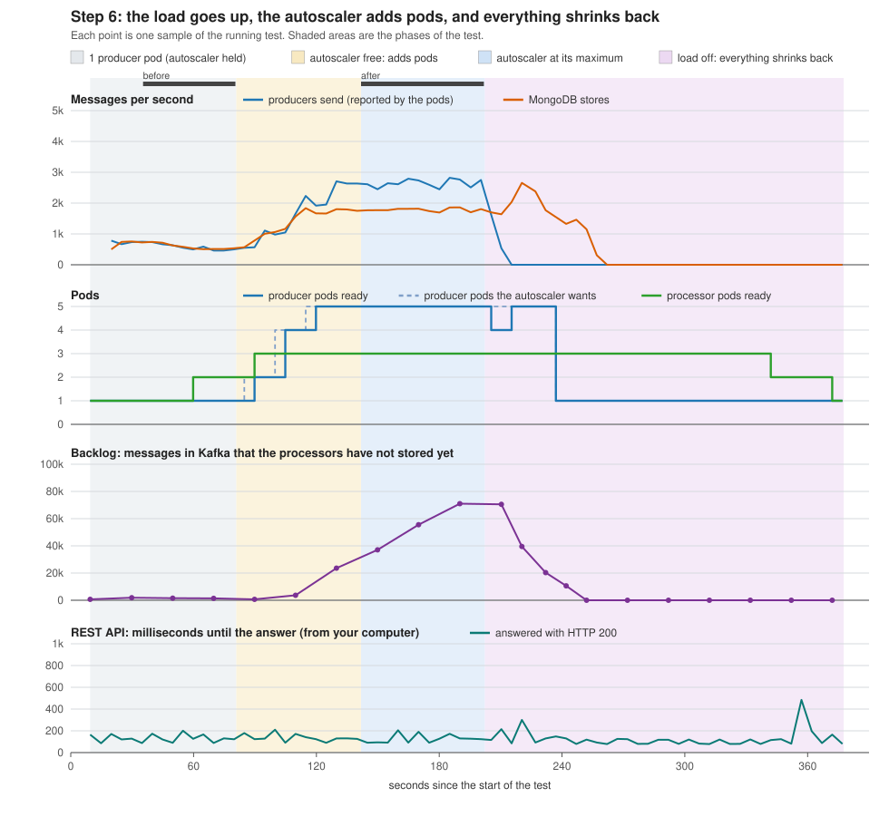

# Step 6: scaling test results

Run started 2026-11-06 21:16 (UTC). The load is the Deployment `producer-load`: producer pods that replay the dataset in a loop.
Autoscaler `producer-load`: 1 to 5 pods, target 50% of the CPU request.  Processor autoscaler: 1 to 3 pods, target 70%.

## Before and after

| Measurement | Before: 1 producer pod, the autoscaler held at 1 | After: 5 producer pods, autoscaler free | Change |
|---|---:|---:|---:|
| Producer pods ready | 1 | 5 | x5.0 |
| Messages per second from one producer pod | 566 | 529 | |
| Producers send, messages per second (all pods together, reported by the pods) | 566 | 2,644 | x4.7 |
| Kafka receives, messages per second (growth of the topic) | n/a | 2,674 |  |
| MongoDB stores, messages per second (growth of the record count) | 551 | 1,796 | x3.3 |
| Backlog in Kafka at the end of the window, messages | 1,432 | 71,024 |  |
| Time a new message would wait in the backlog, seconds (backlog / storing rate) | 2.6 | 39.6 |  |
| One tagged event: stored in Kafka until the REST API returns it, seconds | 0.1 | 16.0 | |
| Prometheus: from the producer's send to the stored record, 95 percent faster than (seconds) | 0.9 | 46.3 | |
| Processor pods ready | 2 | 3 | x1.5 |
| REST API: calls answered with HTTP 200, percent (one call every 5 s from your computer) | 100.0 | 100.0 | |
| REST API: 95 percent of the answers came within (milliseconds, including the trip over the internet) | 201 | 205 |  |
| CPU of a producer pod, % of its CPU limit (from kubectl top pods) | 100 | 99 |  |
| CPU of a processor pod, % of its CPU limit | 79 | 99 |  |
| CPU of a REST API pod, % of its CPU limit | 1 | 1 |  |
| CPU of kafka-0, % of its CPU limit | 23 | 25 |  |
| CPU of mongo-0, % of its CPU limit | 6 | 7 |  |
| Producer pods' CPU as the autoscaler counts it, % of the CPU request (target 50%) | 499 | 492 |  |
| Processor pods' CPU as their autoscaler counts it, % of the CPU request (target 70%) | 432 | 495 |  |
| Worker nodes' CPU, % (average of the workers, from kubectl top nodes) | 22 | 74 |  |
| Control-plane node's CPU, % (the server also runs pods, from kubectl top nodes) | 39 | 80 |  |

## How the autoscaler added pods

| Seconds after the autoscaler was freed | Producer pods ready | Producer pods wanted by the autoscaler | Producer pods' CPU, % of request | Processor pods ready |
|---:|---:|---:|---:|---:|
| 4 | 1 | 2 | 499 | 2 |
| 9 | 2 | 2 | 499 | 3 |
| 14 | 2 | 2 | 499 | 3 |
| 19 | 2 | 4 | 499 | 3 |
| 24 | 4 | 4 | 499 | 3 |
| 29 | 4 | 4 | 499 | 3 |
| 34 | 4 | 5 | 488 | 3 |
| 39 | 5 | 5 | 488 | 3 |
| 44 | 5 | 5 | 488 | 3 |
| 49 | 5 | 5 | 490 | 3 |
| 54 | 5 | 5 | 490 | 3 |
| 59 | 5 | 5 | 490 | 3 |

## How everything shrank back

| Seconds after the load was switched off | Producer pods ready | Producer pods wanted | Backlog in Kafka, messages | Processor pods ready | Processor pods wanted |
|---:|---:|---:|---:|---:|---:|
| 3 | 4 | 5 | 71,024 | 3 | 3 |
| 18 | 5 | 5 | 39,525 | 3 | 3 |
| 35 | 1 | 1 | 20,350 | 3 | 3 |
| 50 | 1 | 1 | 0 | 3 | 3 |
| 65 | 1 | 1 | 0 | 3 | 3 |
| 80 | 1 | 1 | 0 | 3 | 3 |
| 95 | 1 | 1 | 0 | 3 | 3 |
| 110 | 1 | 1 | 0 | 3 | 3 |
| 125 | 1 | 1 | 0 | 3 | 3 |
| 140 | 1 | 1 | 0 | 2 | 2 |
| 155 | 1 | 1 | 0 | 2 | 2 |
| 170 | 1 | 1 | 0 | 1 | 1 |

The tagged event is the one the smoke test sends. Its time runs from the moment the producer Job reported that Kafka had stored it until the REST API returned it (asked every second), so it is accurate to about 2 seconds. The second event was sent at the start of the second window, behind whatever backlog the producers had built up; the load was switched off after the window. The REST API finds the event by its trace_id; before the test the script gave MongoDB a small index on that field, so the lookup does not read every stored record.

## The goals (service level objectives)

The goals are the numbers in `slo.json`. Each line says what was asked, what this run measured, and whether the goal was met. Change a goal with `make goals` and run `make scale-report`: the verdicts change, the measurements do not.

| Goal | Asked | This run | |
|---|---|---|---|
| The REST API answers (HTTP 200) when it is asked, also while the pipeline is under full load | at least 99 percent of the calls | 100.0 percent (39 of 39 calls) | **met** |
| The REST API answers quickly, measured from your computer over the internet | at most 1,000 milliseconds, for 95 percent of the answers | 205 ms (slowest 210 ms) | **met** |
| A new event can be read from the REST API soon after Kafka has stored it, with one producer and with the autoscaler at its maximum | at most 60 seconds | one producer: 0.1 s, autoscaler at its maximum: 16.0 s | **met** |
| With the load on, the producers' autoscaler has all its pods ready | at most 180 seconds after the autoscaler was freed | all producer pods were ready after 41 s | **met** |
| After the load stops, the producers are back to the minimum of 1 pod | at most 180 seconds after the load was switched off | the producers were back to the minimum after 36 s | **met** |
| After the load stops, the processors catch up: the backlog in Kafka is below 1,000 messages | at most 300 seconds after the load was switched off | the backlog was gone after 54 s | **met** |
| After the load stops, the processors are back to the minimum of 1 pod | at most 600 seconds after the load was switched off | the processors were back to the minimum after 175 s (2.9 min) | **met** |

## What the numbers say

- The producers' combined rate went from 566 to 2,644 messages per second (x4.7) when the autoscaler took the producers from 1 to 5 pods.
- Producers x4.7, records stored in MongoDB x3.3. Replicas are a means, not the result: what counts is how much arrives stored, and how long it takes.
- The processors were still scaling during the 'before' window (from 1 to 2 pods), so 'before' is not a steady state.
- MongoDB stored 1,796 messages per second while the producers sent 2,644. The difference waits in Kafka (71,024 messages at the end of the window).
- Where the pipeline is held back: the processor pods used 99% of its CPU limit in the second window, the highest of the programs behind the producers (kafka-0 25%, mongo-0 7%, the REST API pods 1%). A program at its CPU limit cannot do more, however many pods send to it: adding producers there does nothing for the stored records, and scaling the wrong part can even slow things down.
- The processors have an autoscaler of their own. It took them from 1 to 3 pods, the first extra pod 50 s after the first producer pod was ready (their CPU was 432% of the request, the target is 70%).
- A tagged event needed 0.1 s to get from Kafka to the REST API with one producer and 16.0 s with the autoscaler at work, because it queued behind the backlog.
- The REST API kept answering the whole time the load was on: all 39 calls got HTTP 200, and 95% of the answers came within 205 ms.
- The producers' autoscaler needed 41 s from the moment it was freed to have all 5 producer pods ready.
- After the load was switched off the producers were back to 1 pod after 36 s, the backlog was gone after 54 s, and the processors were back to 1 pod after 175 s (2.9 min).
- At the end of the second window the producer pods ran on: ca3-agent-1 1, ca3-agent-2 2, ca3-server 2.
- This test measures; it does not prove a cause. To find out whether a part really is the limit, change that one part (more CPU for it, or one more of it) and run the test again.

